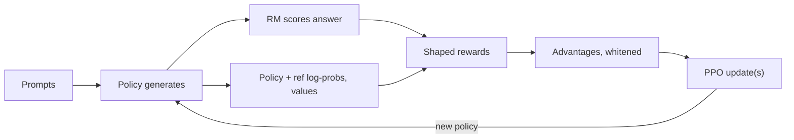

Every piece is now on the table: a policy with a value head, a frozen reference, a reward model, a shaped reward, advantages and a clipped loss. The training loop arranges them into two alternating phases. In the **rollout** phase the policy acts: it writes answers, which are scored and frozen into a batch. In the **update** phase it learns from that batch. Then the updated policy writes the next batch. Because the data always comes from the current policy, PPO is **on-policy**, and that is both its strength (it learns from its own mistakes) and its cost (old batches cannot be reused).

## In everyday life

A chess club player improves in rounds. First she plays several games. Then she reviews them with a coach, who marks the key moments. Then she studies the notes and changes her habits a little. Next week she plays again with the new style. She does not use games from months ago to judge her current play, because an older version of her played those.

PPO's training loop has the same two phases. In the **rollout** phase the policy writes answers, which are scored and saved as a fixed batch. In the **update** phase it learns from that batch. Each batch must come from the current policy, so the method is called **on-policy**. Its strength is that the model learns from its own mistakes. Its cost is that old batches cannot be reused for long.

You watch two things: how far this update moved the player from last week, and how far she now plays from her original style. If the second keeps climbing while scores stall, something is wrong.

**Where you meet it.** Teams that tune assistants this way repeat the cycle thousands of times. They also use stability tricks, such as small learning steps and capped gradients, so that no single bad batch can undo the earlier progress.

```scene
title: A chess club's weekly cycle
step: 🧩 The player plays a handful of games | rollout: policy generates answers
step: 🔍 The coach marks how well each game went | reward model scores the answers
step: 🗂 The notes are filed and not changed afterwards | frozen batch of log-probs
step: 📚 She studies the notes and adjusts her habits a little | PPO update step
step: 📏 She checks her drift from last week and from her original style | KL_move and KL_ref
step: 🔁 Next round, new games with the new style | next on-policy batch
takeaway: PPO alternates between writing and scoring a fresh batch and learning from it, while watching how far the policy drifts.
```

## One iteration of `train_ppo.py`

```steps
One PPO iteration in the repo
**Collect.** Take 4 prompts (`--batch_size`), wrap each in the SFT template, and let the policy generate up to 64 tokens (`--resp_len`) with `temperature=0.2, top_k=3`, one prompt at a time, under `torch.no_grad()`.
---
**Score.** Decode each response, put it back in the template, and run the reward model once per answer to get $r_\phi$. Pad the batch with id 2, build `mask`, and write $r_\phi$ at each sample's last position.
---
**Freeze the batch.** One no-grad forward pass each through the policy and the reference gives `old_logp`, `ref_logp` and `old_values` for every action token. Shape the reward with $-\beta \cdot$KL, compute advantages and whiten them.
---
**Update.** One forward pass with gradients, `ppo_losses`, `backward`, gradient clipping to norm 1.0, an AdamW step at learning rate $10^{-5}$.
---
**Measure.** Recompute log-probs and log `KL_move` (how far this update moved the policy from the batch snapshot) and `KL_ref` (how far the policy now is from the SFT reference). Every 10 steps, print them with the loss and value loss.
```



## Making it real PPO: several epochs per batch

As topic 5 showed, a single update per batch never activates the clip. The rollout is the expensive part, so standard PPO squeezes several gradient steps out of each batch, and the clip is what makes that safe. A sketch of the change, keeping the repo's names (not in the repo):

```python
for epoch in range(4):                                          # reuse the same rollout batch
    logits_new, values_full, _ = policy(seq, None)              # (B, T, V), (B, T)
    logp = torch.log_softmax(logits_new[:, :-1, :], dim=-1)     # (B, T-1, V)
    new_logp = logp.gather(-1, seq[:, 1:].unsqueeze(-1)).squeeze(-1)[act_mask]   # (N,)
    new_values = values_full[:, :-1][act_mask]                  # (N,)

    out = ppo_losses(new_logp, old_logp, adv, new_values, old_values, returns)
    opt.zero_grad(set_to_none=True)
    out.total_loss.backward()
    torch.nn.utils.clip_grad_norm_(policy.parameters(), 1.0)
    opt.step()
    if out.approx_kl.item() > 0.02:                              # moved enough: stop early
        break
```

`old_logp`, `adv` and `returns` stay fixed across the epochs; only the new log-probs change. From the second epoch on, ratios drift away from 1 and the clip starts zeroing the gradient for tokens that have moved far enough. Larger runs also split the batch into minibatches inside each epoch.

## Stability tricks

| Trick | In the repo? | What it does |
|---|---|---|
| Advantage whitening | yes | fixes the update's scale whatever the reward range |
| Gradient clipping to norm 1.0 | yes | caps the occasional huge gradient |
| Small learning rate ($10^{-5}$) | yes | 30 times below the SFT rate of $3 \times 10^{-4}$; RL gradients are noisy |
| Per-token KL penalty, fixed $\beta = 0.01$ | yes | leash to the SFT model |
| Adaptive KL coefficient | no | moves $\beta$ to hold KL near a target |
| Reward normalisation | no (listed in the README) | rescales RM scores to mean 0, std 1 using running statistics |
| Multiple PPO epochs, early stop on KL | no | sample efficiency, with the clip for safety |
| Value-loss clipping | no | limits how far $V$ moves per update |

The **adaptive KL controller** of Ziegler et al. (2019) nudges $\beta$ after each batch towards a target KL:

$$
e = \text{clip}\!\left(\frac{\text{KL} - \text{KL}_{\text{target}}}{\text{KL}_{\text{target}}},\, -0.2,\, 0.2\right), \qquad \beta \leftarrow \beta\,(1 + K_\beta\, e)
$$

with $K_\beta = 0.1$. **Worked example:** target 0.05 nats per token, measured 0.08. The relative error is $0.03 / 0.05 = 0.6$, clipped to $0.2$, so $\beta$ grows by a factor $1 + 0.1 \times 0.2 = 1.02$, from $0.0100$ to $0.0102$. The clip limits $\beta$ to a 2% change per batch, so a single noisy KL reading cannot yank it around. If KL stays too high, $\beta$ compounds upwards: 50 batches at the maximum rate multiply it by $1.02^{50} \approx 2.7$.

## Sampling: how much does the policy explore?

```sim
sampling
{"temperature": 0.2, "topK": 3}
```

These are the repo's rollout settings. Note the entropy and how many distinct tokens appear in 20 draws, then set temperature to 1.0 and top-k to 0. At $T = 0.2$ with three candidates, the policy nearly always picks its top token, so different samples of the same prompt look alike and there is little variety for the advantages to compare. RL needs some exploration; most RLHF setups sample at temperature 0.7 to 1.0 and compute log-probs at that same temperature.

## What to watch

The repo prints a line like this every 10 steps:

```text
step 10 | loss 0.0621| value loss 0.1241 | KL_move 0.000080 | KL_ref -0.000493
```

That line came from 10 steps of the repo's loop on randomly initialised tiny models (no trained SFT or reward checkpoint), so only its format matters. On a real run:

- **Reward** should rise, then flatten. The repo does not print it; add `rewards.sum() / B` to the log line, since it is the curve everyone looks at first.
- **`KL_ref`** should rise slowly and level off. A steady climb with flat reward means the leash is too weak or has a sign error; a value stuck at 0 means the reference is not separate from the policy.
- **`KL_move`** should stay small per update, typically below 0.01 to 0.02. Large values mean the learning rate is too high.
- **Value loss** should fall as the head learns what returns look like.
- **Samples.** Read a few answers every few hundred steps. Rising reward with answers that get longer, more repetitive or oddly formatted is reward hacking, not progress.

`eval_ppo.py` reports the average reward-model score over 16 prompts. It also generates answers from the SFT reference but never scores them, so to see the improvement, score both and compare the averages.

## In practice

Even with every trick, PPO for LLMs is fragile: Huang et al. (2024) list dozens of implementation details that change results. That fragility, plus the memory of four models, is why most open post-training moved to DPO and GRPO, as the [method map](/learn/fine-tuning/preference-optimization-methods) explains, and why TRL dropped its PPO trainer. A from-scratch loop like this one is now the clearest way to see PPO run. The [next lesson](/learn/post-training/grpo-from-scratch) removes the value head entirely and gets advantages from a group of answers instead.

```quiz
{"q": "Using Ziegler's controller with $K_\\beta = 0.1$, $\\beta = 0.02$ and a target of 0.05 nats per token, the measured KL is 0.04. What is the new $\\beta$?", "options": ["0.0196", "0.0204", "0.016", "0.02"], "answer": 0, "explain": "Relative error $(0.04 - 0.05) / 0.05 = -0.2$, inside the clip range. $\\beta \\leftarrow 0.02 \\times (1 + 0.1 \\times -0.2) = 0.02 \\times 0.98 = 0.0196$. KL is below target, so the leash loosens. 0.0204 has the sign backwards; 0.016 forgets $K_\\beta$."}
```

```quiz
{"q": "After switching to 4 PPO epochs per batch, `KL_move` jumps from 0.003 to 0.15 per update and reward becomes erratic. What is the best first fix?", "options": ["Lower the learning rate or stop the epochs early when `approx_kl` passes about 0.02", "Raise the KL coefficient $\\beta$ to the reference", "Remove advantage whitening", "Raise the clip range $\\epsilon$ to 0.5"], "answer": 0, "explain": "`KL_move` measures how far each update moves the policy from the batch it learned from; 0.15 means the epochs are overshooting. Smaller steps or KL-based early stopping fix that directly. $\\beta$ controls drift from the SFT reference, a different quantity, and a wider clip range allows even larger moves."}
```
