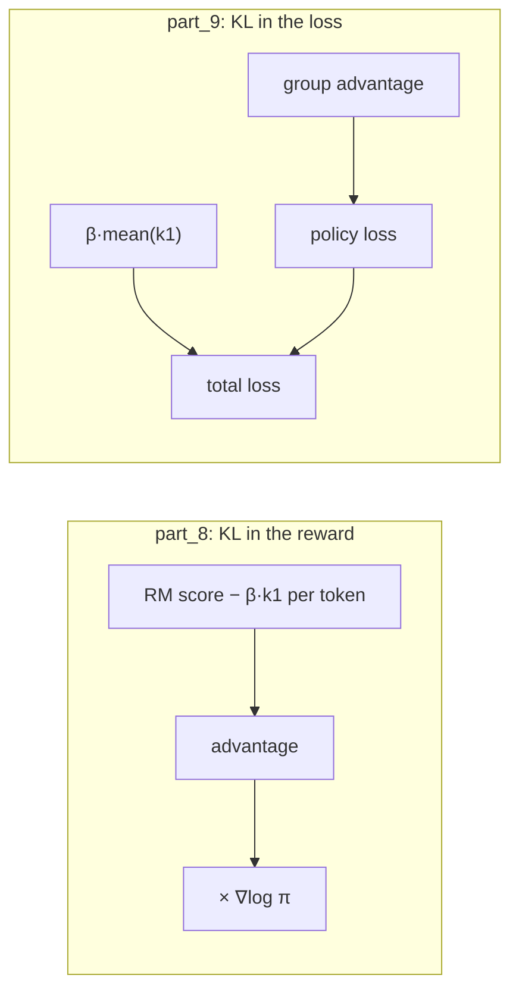

With the value head gone, GRPO's loss has two jobs left. The **policy term** pushes up tokens of above-average completions and pushes down the rest, with PPO's clip limiting how far one batch can move any token. The **KL term** keeps the policy near the frozen SFT model, the **reference**, so it cannot drift into text the reward model was never trained to judge.

PPO had the same two jobs and handled the second differently. `part_8` subtracts the per-token KL from the reward before computing advantages, so staying close to the reference is just another thing the policy is rewarded for. `part_9` takes it out of the reward and adds it to the loss as its own term, the way DeepSeekMath writes GRPO. That move looks cosmetic. With the estimator the repo uses, it is not.

## The loss, term by term

The repo minimises

$$
\mathcal{L} = \underbrace{-\frac{1}{N}\sum_{k=1}^{N}\min\!\big(\rho_k \hat A_k,\ \operatorname{clip}(\rho_k, 1-\epsilon, 1+\epsilon)\hat A_k\big)}_{\text{policy\_loss}} \;+\; \beta\,\widehat{\mathrm{KL}} \;-\; c_{\text{ent}}\,\hat H
$$

over the $N$ flat action tokens $k$, with $\rho_k = \exp(\log\pi_\theta - \log\pi_{\text{old}})$, $\epsilon = 0.2$, $\beta$ = `kl_coef` = 0.01 and $c_{\text{ent}} = 0$ (the comment in the code notes the entropy bonus was not in the original GRPO paper).

```python
# llm_from_scratch/part_9/grpo_loss.py (excerpt)
ratio = torch.exp(new_logp - old_logp)                               # (N_act,)
unclipped = ratio * adv                                              # (N_act,)
clipped = torch.clamp(ratio, 1.0 - clip_ratio, 1.0 + clip_ratio) * adv
policy_loss = -torch.mean(torch.min(unclipped, clipped))             # scalar
kl_ref = kl_mean if kl_mean is not None else new_logp.new_tensor(0.0)
total = policy_loss - ent_coef * entropy + kl_coef * kl_ref          # scalar

# llm_from_scratch/part_9/train_grpo.py: the KL that is passed in
kl_now_ref_mean = (new_logp - ref_logp).mean()   # scalar, gradient flows through new_logp
```

**Clip, worked.** A token with $\hat A = +1.41$ whose ratio has reached $\rho = 1.3$: unclipped $1.3 \times 1.41 = 1.83$, clipped $1.2 \times 1.41 = 1.69$, the min is 1.69, a constant, so the token stops contributing gradient. A token with $\hat A = -1.41$ and $\rho = 0.7$: unclipped $-0.99$, clipped $0.8 \times -1.41 = -1.13$, the min is the clipped one, again constant. Each token can move about 20% per batch and no further.

In `part_9` that never happens. The loop takes one gradient step per batch, and `old_logp` comes from the same weights a moment before, so $\rho = 1$ exactly. Logging the ratio in a short run of the script on a random tiny model gave a minimum and maximum of 1.000000 on every step. With $\rho = 1$ the policy term's gradient is $-\frac{1}{N}\sum_k \hat A_k \nabla_\theta \log\pi_\theta$: REINFORCE with a group baseline. The clip only starts working when you reuse a batch for several updates.

## Two ways to estimate KL per token

The true KL between policy and reference is an expectation over completions the policy would generate. On sampled tokens it is estimated per token. Writing $x = \pi_{\text{ref}}(o_k) / \pi_\theta(o_k)$, two common estimators are

$$
k_1 = -\log x = \log\pi_\theta(o_k) - \log\pi_{\text{ref}}(o_k), \qquad k_3 = x - \log x - 1 .
$$

Both average to the true $\mathrm{KL}(\pi_\theta\,\|\,\pi_{\text{ref}})$ over on-policy samples. $k_1$ is what `part_9` uses. $k_3$ is the one in the DeepSeekMath objective and in TRL.

| Token | $\pi_\theta$ | $\pi_{\text{ref}}$ | $x$ | $k_1$ | $k_3$ |
|---|---|---|---|---|---|
| a | 0.5 | 0.4 | 0.8 | $\ln 1.25 = +0.223$ | $0.8 + 0.223 - 1 = 0.023$ |
| b | 0.4 | 0.5 | 1.25 | $\ln 0.8 = -0.223$ | $1.25 - 0.223 - 1 = 0.027$ |

$k_1$ goes negative on any token the policy likes less than the reference; only its average is a KL. $k_3$ is never negative, because $x - 1 \ge \log x$ for every $x > 0$, and it is 0 only when the two models agree. That is why the repo's diagnostic `KL_ref` can print a negative number: a 20-step run of the script on a random tiny model logged `KL_ref -0.001350`.

## Why the term barely pulls, as written

Here the identity from topic 1 comes back. Differentiate the repo's KL term with the sampled tokens held fixed, as autograd does:

$$
\nabla_\theta \frac{1}{N}\sum_k\big(\log\pi_\theta(o_k) - \log\pi_{\text{ref}}(o_k)\big) = \frac{1}{N}\sum_k \nabla_\theta \log\pi_\theta(o_k), \qquad \mathbb{E}_{o\sim\pi_\theta}\big[\nabla_\theta\log\pi_\theta(o)\big] = 0 .
$$

The reference drops out of the gradient, and what is left averages to zero over on-policy samples. So in expectation the $k_1$ term adds noise to the gradient and no pull towards the reference. An exact check on a three-token toy (logits $(1, 0, -1)$, uniform reference) confirms it:

| Expected gradient on the logits | Value |
|---|---|
| $k_1$ in the loss (as in `part_9`) | $(0, 0, 0)$ |
| $k_3$ in the loss (as in TRL) | $(+0.332, -0.089, -0.243)$ |
| true $\nabla\,\mathrm{KL}(\pi_\theta\,\|\,\pi_{\text{ref}})$ | $(+0.283, -0.141, -0.142)$ |

The $k_3$ gradient is not the true one either; it equals the gradient of the reverse direction, $\mathrm{KL}(\pi_{\text{ref}}\,\|\,\pi_\theta)$. But it points the right way: it lowers the logit the policy has over-weighted and raises the others.

PPO's placement avoids the problem. In `part_8` the $k_1$ value enters the reward, the reward enters the advantage, and the advantage multiplies $\nabla\log\pi$. The gradient then contains $\nabla\log\pi \cdot (\log\pi_\theta - \log\pi_{\text{ref}})$, whose expectation is the KL gradient at each position, holding the context fixed (the advantage normalisation rescales it but keeps its direction). The estimator works as a reward and fails as a loss. In the tiny run, what actually keeps the policy close is the learning rate of $10^{-5}$, the gradient clip at 1.0 and a few hundred steps.



A two-line fix, not in the repo, swaps in $k_3$:

```python
log_x = ref_logp - new_logp                                   # (N_act,) log(pi_ref / pi_theta)
kl_now_ref_mean = (torch.exp(log_x) - log_x - 1).mean()       # k3: >= 0, pulls towards the reference
```

## In practice

- **Read the clip as dormant.** With one update per batch, `approx_kl` and the clip are both inert, and `loss` is dominated by $-\text{mean}(\hat A) \approx 0$ after normalisation. None of these numbers tells you whether training works.
- **$\beta$ is small everywhere.** DeepSeekMath used $\beta = 0.04$ with $k_3$; TRL defaults to $\beta = 0$, skipping the reference model altogether. The library page on [the GRPO objective](/learn/fine-tuning/grpo-hands-on/grpo-in-one-page) lists the TRL options.
- **Check gradients, not values.** A loss term whose value looks sensible can still contribute nothing to the update. A quick test: compute the term's expected gradient on a toy categorical by enumeration, as in the table above.

```quiz
{"q": "For one token, $\\pi_\\theta = 0.2$ and $\\pi_{\\text{ref}} = 0.4$. What are the $k_1$ and $k_3$ KL estimates?", "options": ["$k_1 = -0.693$, $k_3 = 0.307$", "$k_1 = 0.693$, $k_3 = 0.307$", "$k_1 = -0.693$, $k_3 = -0.307$", "$k_1 = 0.693$, $k_3 = 1.693$"], "answer": 0, "explain": "$x = \\pi_{\\text{ref}}/\\pi_\\theta = 2$. $k_1 = \\log\\pi_\\theta - \\log\\pi_{\\text{ref}} = \\ln 0.5 = -0.693$, negative because the policy likes this token less than the reference. $k_3 = 2 - \\ln 2 - 1 = 0.307$, positive as always. Flipping the sign of $k_1$ is the tempting error: it is $-\\log x$, not $\\log x$."}
```

```quiz
{"q": "Why does adding $\\beta\\cdot\\text{mean}(\\log\\pi_\\theta - \\log\\pi_{\\text{ref}})$ to the loss give no expected pull towards the reference, while subtracting the same per-token quantity from the reward (as PPO does) works?", "options": ["In the loss, its gradient is $\\text{mean}(\\nabla\\log\\pi_\\theta)$, which averages to zero over on-policy samples; in the reward, it is multiplied by $\\nabla\\log\\pi_\\theta$, which in expectation gives the KL gradient at each position", "Because $\\beta$ is too small in the loss", "Because the clip removes the KL gradient", "Because the reference model's log-probabilities are detached in the loss but not in the reward"], "answer": 0, "explain": "The reference term is a constant with respect to $\\theta$, so the loss version's gradient is just the score function, whose expectation is zero. As a reward, the KL value becomes a weight on $\\nabla\\log\\pi$, and $\\mathbb{E}[\\nabla\\log\\pi\\,(\\log\\pi_\\theta - \\log\\pi_{\\text{ref}})]$ is the KL gradient for that position's next-token distribution. The reference is detached in both cases, so detachment is not the difference, and the clip is inactive at $\\rho = 1$."}
```
