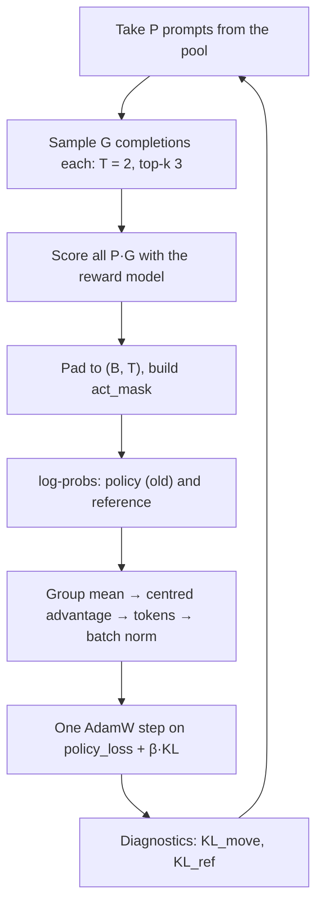

The previous topics took GRPO apart. This one puts `llm_from_scratch/part_9/train_grpo.py` back together as a loop, works out where the time goes, and asks what you should print to know whether it is working. The repo prints three numbers, and none of them answers that question on its own.

## In everyday life

Learning to drive at a driving school follows a loop. You pick a few routes for the day. On each route you drive several times, trying small variations. The instructor scores each drive. You compare each drive with your average on that route, change your habits a little, and go again.

Two things about this loop surprise beginners. First, the driving takes most of the day, and the thinking afterwards is quick. In GRPO the driving is **sampling**: the model writes each answer one token at a time. It is the slow part, and the number of answers per step is the number of prompts times the group size. Second, the dashboard can lie. Imagine a gauge that reads zero whether you are improving or not. The printed **loss** in this loop is like that: it sits near zero by construction. The numbers that tell you how you are doing are the average reward, how much the answers within a group differ, how many groups are all tied, and how far the model has moved from the **reference**, its starting copy.

An instructor cannot be fooled, but a reward model can. So a rising score still needs you to read a few answers yourself.

**Where you meet it.** An engineer runs a GRPO job for hours while the printed loss sits at zero, which says nothing. After logging the average reward and the share of tied groups, they see the groups have gone flat and raise the sampling temperature, not the learning rate.

```scene
title: A day at the driving school
step: 🗺️ The instructor picks a few routes for today | take P prompts from the pool
step: 🚗 You drive each route several times with small changes | sample G completions per prompt
step: 📝 The instructor scores every drive | reward model scores each completion
step: 🔧 You compare with your route average and adjust a little | advantage, one optimiser step
step: 📊 You read the real gauges, not the one stuck at zero | reward, group spread, KL
takeaway: Most of the time goes into sampling, and the printed loss tells you little, so watch reward, group spread and KL instead.
```

## One step of the loop

Each iteration of the `while step < args.steps` loop does the same eight things.



On every step the policy runs forward four times (sampling, `old_logp`, the training pass with gradients, and the post-update diagnostics) and the reference once. The reward model runs once per completion. No value model runs at all.

## Where the time goes

Sampling dominates, because generation is one forward pass per new token and the loop calls `policy.generate` once per completion, not batched:

$$
\text{sampled tokens per step} = P \times G \times \text{resp\_len}.
$$

**Worked example.** The orchestrator runs `--batch_prompts 4 --group_size 4 --resp_len 128`: $4 \times 4 \times 128 = 2{,}048$ tokens generated one at a time, in 16 separate calls. The PPO orchestrator in `part_8` uses `--batch_size 4 --resp_len 128`, one completion per prompt: 512 tokens. GRPO pays four times the sampling for the same number of prompts, which is the price of the free baseline. The training pass, by contrast, is a single batched forward and backward over $B = 16$ padded rows. A 20-step run with $P = 2$, $G = 4$ and 16-token responses on a random tiny model took about 14 seconds on a laptop CPU; the orchestrator's settings sample 16 times as many tokens per step.

## What the repo prints, and what it means

Every 10 steps the script prints one line. In the short run mentioned above it read:

```text
step 10 | loss -0.0000| KL_move 0.000063 | KL_ref -0.001090
step 20 | loss -0.0000| KL_move 0.000089 | KL_ref -0.001350
```

- **`loss`** is $-\text{mean}(\hat A) + \beta\,\widehat{\mathrm{KL}}$ at $\rho = 1$. The batch normalisation makes $\text{mean}(\hat A) = 0$ exactly, so the printed value is $0.01 \times (-0.001) \approx -10^{-5}$. It is near zero by construction, on a run that is learning and on one that is not.
- **`KL_move`** is $\text{mean}(\log\pi_{\text{old}} - \log\pi_{\text{new}})$ on the batch's own tokens, measured after the update: how far one step moved the policy. Values around $10^{-4}$ to $10^{-2}$ per token are normal for a small learning rate; a sudden jump means the step was too large.
- **`KL_ref`** is the $k_1$ estimate of the distance to the reference after the update. As topic 4 showed, $k_1$ can be negative per token and in a small batch; read its trend over many steps, not its sign on one.

None of these mentions the reward, which is the thing GRPO is trying to raise.

## What to add

Three numbers tell you most of what you need, and they come straight from tensors the loop already holds. A few lines after `raw_rewards_t` is built (not in the repo):

```python
r = raw_rewards_t.view(len(batch_prompts), G)                 # (P, G), completions are contiguous per prompt
grp_std = r.std(dim=1, unbiased=False)                        # (P,) spread within each group
log_x = ref_logp - old_logp                                   # (N_act,) for a k3 estimate, always >= 0
print(f"reward {r.mean():.3f} | within-group std {grp_std.mean():.3f} "
      f"| flat groups {(grp_std < 1e-3).float().mean():.2f} "
      f"| KL_k3 {(log_x.exp() - log_x - 1).mean():.4f}")
```

| Signal | Healthy | Warning sign |
|---|---|---|
| reward mean | rises, noisily, then flattens | flat for hundreds of steps; or rising while samples read worse (reward hacking) |
| within-group std | stays clearly above 0 | falls towards 0: the policy has collapsed onto one answer per prompt |
| flat groups | low | rising: prompts too easy for the policy, or temperature too low |
| KL ($k_3$) | grows slowly | climbs steeply: the policy is leaving the region the reward model was trained on |

`len(batch_prompts)` rather than `P` matters here: with the default `--batch_prompts 32` and a 16-prompt pool, the slice holds only 16 prompts while `P` stays 32, and the reshape would fail. The repo's own group loop survives this by skipping prompt ids with no completions.

A rising reward from a learned reward model is not the same as a better model; past a point it usually means the policy has found what the reward model over-rates (see [reward hacking and over-optimisation](/learn/fine-tuning/preference-tuning/reward-hacking-and-overoptimisation)). Read a handful of completions every few dozen steps. `eval_ppo.py`, which `part_9` reuses unchanged from `part_8`, averages the reward-model score of 16 greedy-ish completions (temperature 0.2). It also generates from the SFT reference but never scores those, so run it once on the SFT checkpoint yourself to get the baseline number to compare against.

## The same loop in a library

[GRPO hands-on](/learn/fine-tuning/grpo-hands-on/the-grpo-trainer) runs this algorithm with TRL's `GRPOTrainer`. Almost every piece of `part_9` has a named counterpart:

| `part_9` | TRL `GRPOTrainer` / `GRPOConfig` |
|---|---|
| `--group_size` | `num_generations` |
| `--batch_prompts` × `--group_size` completions per step | batch sizes counted in completions, divisible by `num_generations` |
| `--resp_len` | `max_completion_length` |
| `temperature=2, top_k=3`, hard-coded | `temperature`, `top_k`, `top_p` |
| reward model from Part 7 | `reward_funcs`: Python functions or a model |
| group mean, then token-level batch std | `scale_rewards="batch"`; default `"group"` |
| `clip_ratio=0.2` | `epsilon` |
| `--kl_coef`, $k_1$ in the loss | `beta` (default 0), $k_3$ estimator |
| one update per batch, $\rho = 1$ | `num_iterations=1` by default |
| prints `loss`, `KL_move`, `KL_ref` | logs reward, `reward_std`, `frac_reward_zero_std`, `kl`, entropy, lengths |

The library adds batched generation (often through vLLM), per-function reward logging and the $k_3$ estimator. The maths underneath is the 39 lines of `grpo_loss.py` plus the advantage block you have now read line by line.

## In practice

- **Fix the cheap things first.** Before scaling up, batch the generation calls, log the reward and within-group std, and swap the KL estimator for $k_3$. Each is a few lines and changes what you can see or what the KL term does.
- **Tune temperature and $G$ for spread.** If many groups are flat, more samples or a higher temperature buy signal; a higher learning rate does not.
- **Keep the reference honest.** Load it from the same SFT checkpoint as the policy (the script does), and never let its parameters into the optimiser: `requires_grad_(False)` on every one, as `train_grpo.py` does.

```quiz
{"q": "A `part_9` run prints `loss -0.0000` on every logging step for 200 steps. What can you conclude?", "options": ["Nothing about learning: with $\\rho = 1$ and batch-normalised advantages the policy term is exactly zero by construction", "The policy has converged", "The gradients are zero, so nothing is being updated", "The reward model is returning the same score for every completion"], "answer": 0, "explain": "The printed value is $-\\text{mean}(\\hat A)$ plus a tiny $\\beta$ times KL, and the normalisation forces $\\text{mean}(\\hat A) = 0$. The gradient, $-\\frac{1}{N}\\sum \\hat A\\,\\nabla\\log\\pi$, is not zero, so the weights do change. To see progress you need the reward mean and within-group spread, not the loss."}
```

```quiz
{"q": "With `--batch_prompts 8 --group_size 8 --resp_len 64`, how many tokens does each step sample, and how does that compare with PPO in `part_8` at `--batch_size 8 --resp_len 64`?", "options": ["4,096 against 512: eight times as many", "512 against 512: the same", "4,096 against 4,096: the same", "64 against 8"], "answer": 0, "explain": "$8 \\times 8 \\times 64 = 4{,}096$ for GRPO and $8 \\times 64 = 512$ for PPO, one completion per prompt. The factor is $G$. The tempting 'same' answer forgets that every prompt is sampled $G$ times; that extra sampling is what replaces the value model."}
```
