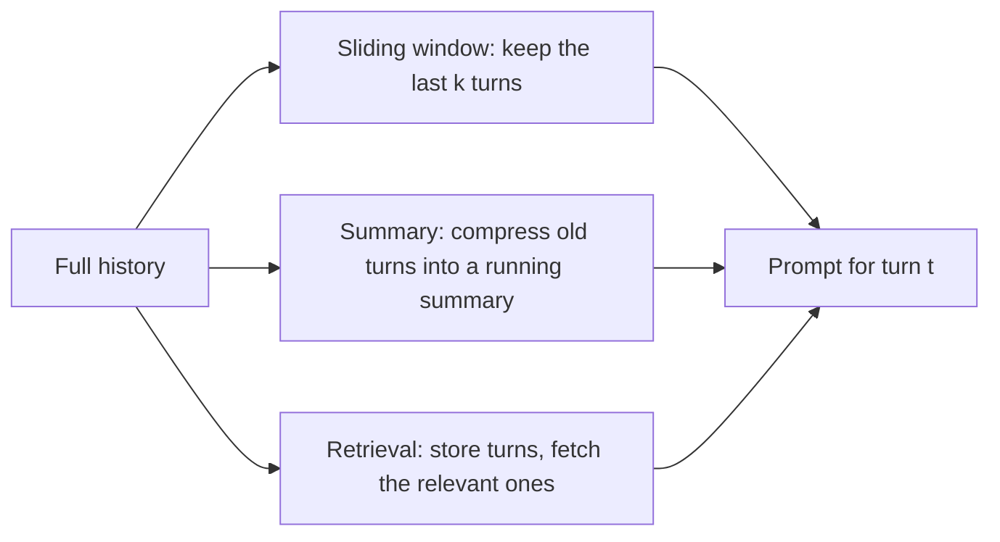

A chat model has no memory between calls. The feeling of an ongoing conversation is produced by your application, which re-sends the entire history on every turn: system prompt, every earlier user message, every earlier assistant reply, every tool result. Turn 20 of a conversation is a single request whose prompt contains turns 1 to 19.

That design is simple and robust, but it means a conversation gets more expensive with every turn, and not linearly. Each new turn pays again for all the old ones.

## The maths: the cost of history

Let the system prompt be $S$ tokens and let each turn (one user message plus one assistant reply) add $m$ tokens of history. On turn $t$ the prompt holds the system prompt plus $t$ turns' worth of messages (counting the current user message as part of turn $t$, which is a small overestimate), so its length is about $n_t = S + t\,m$. The total input tokens over a conversation of $T$ turns is

$$
N(T) = \sum_{t=1}^{T} (S + t\,m) = T\,S + m\,\frac{T(T+1)}{2}
$$

The first term grows linearly with the number of turns; the second grows with $T^2$. For long conversations the history term dominates.

```steps
A 20-turn support chat
System prompt $S = 1{,}000$ tokens, each turn adds $m = 150$ tokens, $T = 20$ turns.
---
System prompt total: $T S = 20 \times 1{,}000 = 20{,}000$ tokens.
---
History total: $m \, T(T+1)/2 = 150 \times 210 = 31{,}500$ tokens.
---
Total input: $N(20) = 51{,}500$ tokens. At a hypothetical \$3 per 1M input tokens, that is \$0.1545 for the conversation.
---
Double the length to $T = 40$: $40{,}000 + 150 \times 820 = 163{,}000$ tokens, \$0.489. Twice the turns, 3.2 times the input cost.
```

There is a second cost: the context window. The last turn's prompt is $n_T = S + T\,m$. With $S = 1{,}000$ and $m = 150$, a 16,000-token window fills when $1{,}000 + 150\,T \ge 16{,}000$, that is at $T = 100$ turns, minus whatever you reserve for the output. Agents that append large tool results (a 3,000-token web page per step) fill the window in a handful of steps.

```sim
token-cost
{"systemTokens": 1000, "inputWords": 115, "outputWords": 1, "language": "english", "inputPrice": 3, "outputPrice": 15, "requestsPerDay": 100000}
```

The sim prices one request, so use it to price single turns. It starts at turn 1 of the chat above: a 1,000-token system prompt plus 115 words (about 150 tokens) of history, 1,150 input tokens. Now set the user input to about 2,300 words, which is 3,000 tokens of history (turn 20): the input becomes 4,000 tokens and the cost per request more than triples. At 100,000 requests a day, compare the two daily costs to see what re-reading history costs a popular product.

## Strategies for long conversations



| Strategy | Prompt size on turn $t$ | What you lose |
|---|---|---|
| Full history | $S + t\,m$ (grows forever) | Nothing, until the window overflows |
| Sliding window of $k$ turns | $S + k\,m$ (constant) | Anything said more than $k$ turns ago |
| Running summary of $s$ tokens + last $k$ turns | $S + s + k\,m$ | Details the summary dropped |
| Retrieve $j$ relevant past turns | $S + j\,m + k\,m$ | Turns the retriever misses |

With a sliding window of $k = 6$ turns, every prompt is at most $1{,}000 + 6 \times 150 = 1{,}900$ tokens and a 40-turn conversation costs $40 \times 1{,}900 = 76{,}000$ tokens at most, under half of the 163,000 above. The price is that the model cannot see the order number the user gave on turn 2. A running summary keeps such facts at a small fixed cost, which is why many products combine a summary with a short window. [Choosing Context](/learn/prompt-and-context/context-selection) quantifies how much information survives compression.

## In practice

- **Pin the facts that matter.** Extract durable facts (account ID, the user's goal, decisions made) into a small structured block that is always included, so the window can slide without losing them.
- **Truncate tool output before it enters history.** Keep the parts the conversation needs; a 3,000-token page summarised to 300 tokens saves 2,700 tokens on every later turn.
- **Keep the stable part first.** System prompt, then pinned facts, then recent turns. A stable prefix can be cached across turns of the same conversation, which takes much of the sting out of the $T^2$ term.

```quiz
{"q": "With S = 500 tokens and m = 100 tokens per turn, how many total input tokens does a 10-turn conversation use with full history (using N(T) = TS + m·T(T+1)/2)?", "options": ["10,500", "1,500", "5,500", "15,500"], "answer": 0, "explain": "T·S = 5,000 and m·T(T+1)/2 = 100 × 55 = 5,500, total 10,500. 5,500 is only the history term; 1,500 is just the final turn's prompt (500 + 10 × 100)."}
```

```quiz
{"q": "Why does total input cost grow faster than the number of turns when you resend full history?", "options": ["Each turn re-sends all previous turns, so the history term sums 1 + 2 + … + T, which grows like T²", "Providers charge a per-turn surcharge", "Assistant messages are tokenized less efficiently on later turns", "The model generates longer answers as the conversation grows"], "answer": 0, "explain": "Turn t's prompt includes t turns of history, and summing t from 1 to T gives T(T+1)/2. Longer answers can make it worse, but the quadratic growth comes from re-sending history even if every answer is the same length."}
```
