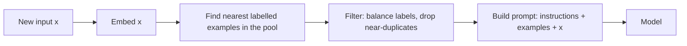

Which examples you show matters as much as how many. A model reading three examples that are all short, all positive and all about shipping will conclude that answers are short, usually positive and about shipping. Examples are evidence, and biased evidence produces biased conclusions.

There are two broad strategies. **Static** examples are a fixed, hand-picked set placed in every prompt: simple, cacheable, and easy to review. **Dynamic** examples are chosen per request, usually by retrieving the labelled examples most similar to the incoming input from a larger pool. Dynamic selection often gives a sizeable accuracy gain on tasks where inputs vary a lot (support tickets, code, extraction from different document types), because the model sees a worked case close to the one in front of it.



## The maths: similarity, balance and order

**Similarity.** With embedding vectors $\mathbf{u}$ for the input and $\mathbf{v}_j$ for pool example $j$, cosine similarity is

$$
\cos(\mathbf{u}, \mathbf{v}_j) = \frac{\mathbf{u} \cdot \mathbf{v}_j}{\lVert \mathbf{u} \rVert \, \lVert \mathbf{v}_j \rVert}
$$

Take a toy 2-D input $\mathbf{u} = (0.8, 0.6)$ (already unit length) and three pool examples, also unit length: $\mathbf{v}_A = (1, 0)$, $\mathbf{v}_B = (0.6, 0.8)$, $\mathbf{v}_C = (0, 1)$. The similarities are $\mathbf{u}\cdot\mathbf{v}_A = 0.8$, $\mathbf{u}\cdot\mathbf{v}_B = 0.48 + 0.48 = 0.96$ and $\mathbf{u}\cdot\mathbf{v}_C = 0.6$. Ranked: B, A, C. With $k = 2$ you would pick B and A.

**Diversity.** Pure nearest-neighbour selection can return three near-copies of the same example, which waste tokens. **Maximal marginal relevance (MMR)** trades off similarity to the input against similarity to examples already chosen:

$$
\text{score}(j) = \lambda \cos(\mathbf{u}, \mathbf{v}_j) - (1 - \lambda) \max_{i \in \text{chosen}} \cos(\mathbf{v}_i, \mathbf{v}_j)
$$

with $\lambda \in [0,1]$; $\lambda = 1$ is pure similarity. Continuing the example with $\lambda = 0.7$ after choosing B: for A, $\cos(\mathbf{v}_B, \mathbf{v}_A) = 0.6$, so $\text{score}(A) = 0.7 \times 0.8 - 0.3 \times 0.6 = 0.56 - 0.18 = 0.38$. For C, $\cos(\mathbf{v}_B, \mathbf{v}_C) = 0.8$, so $\text{score}(C) = 0.7 \times 0.6 - 0.3 \times 0.8 = 0.42 - 0.24 = 0.18$. A is still second, but the gap reflects both relevance and novelty.

**Label balance.** Models show a **majority-label bias**: if most examples carry one label, that label's probability rises for every input. A simple diagnostic is to feed a content-free input (such as "N/A") with your examples and read the label probabilities. If the examples are balanced and the model is unbiased, each of $C$ labels should get about $1/C$. Suppose with three classes you see $P(\text{positive} \mid \text{N/A}) = 0.6$. **Calibration** divides each label's probability by its content-free probability and renormalises. For a real input scoring $(0.5, 0.3, 0.2)$ over (positive, negative, mixed) with content-free probabilities $(0.6, 0.2, 0.2)$:

$$
\left(\tfrac{0.5}{0.6}, \tfrac{0.3}{0.2}, \tfrac{0.2}{0.2}\right) = (0.833, 1.5, 1.0) \;\xrightarrow{\text{normalise}}\; (0.25, 0.45, 0.30)
$$

The prediction flips from positive to negative once the examples' bias is removed. You will rarely calibrate like this in production (you usually lack label probabilities from hosted APIs), but the diagnostic tells you whether your example set is skewed.

**Order.** Models also show a **recency bias**: the label of the last example or two gets a boost. Put a mixed sequence at the end, randomise order across a few prompt variants when evaluating, and never sort examples by label.

## A checklist that works

| Property | Why | How |
|---|---|---|
| Representative | Examples should look like real traffic | Draw from logged production inputs, anonymised |
| Covers the hard cases | Easy cases need no examples | Include the borderline, the "unknown", the multi-part request |
| Balanced labels | Avoid majority-label bias | Roughly equal counts, or match the true class mix deliberately |
| Diverse | Each token should add information | MMR or manual de-duplication |
| Correct and consistent | Models copy format faithfully, including errors | Review every example as carefully as code |
| Fictional details | Avoid leaking names and numbers into answers | Use placeholder names and amounts |

## In practice

Teams usually start static (three to five reviewed examples), measure, and move to dynamic selection only if accuracy varies a lot across input types. With dynamic selection, the example pool becomes a dataset that needs versioning and review, because one bad example retrieved often can quietly damage thousands of answers.

```quiz
{"q": "Input u = (0.6, 0.8). Unit-length pool examples: P = (1, 0), Q = (0.8, 0.6), R = (0, 1). Which is most similar by cosine?", "options": ["R, with similarity 0.8", "Q, with similarity 0.96", "P, with similarity 0.6", "Q and R are tied"], "answer": 1, "explain": "u·P = 0.6, u·Q = 0.48 + 0.48 = 0.96, u·R = 0.8. Q wins. R is tempting because it shares u's larger second coordinate, but Q is closer in angle."}
```

```quiz
{"q": "Your 6 examples are 5 positive and 1 negative, and the model labels nearly every borderline review positive. What is the most direct fix?", "options": ["Rebalance the examples so the labels appear in roughly equal numbers", "Raise the temperature", "Add more positive examples so the format is clearer", "Move the instructions to the end of the prompt"], "answer": 0, "explain": "This is majority-label bias: skewed examples raise the prior on the common label. Rebalancing removes the cause. Temperature adds noise but not balance, and more positive examples make the skew worse."}
```
