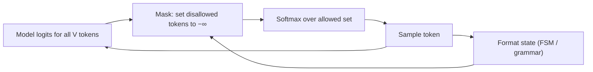

Asking nicely for JSON lowers the error rate. **Constrained decoding** removes it. At every generation step the model produces a score (a **logit**) for every token in the vocabulary. Normally all of them are eligible to be sampled. With constraints, a small program that knows the target format looks at what has been generated so far, works out which tokens could legally come next, and sets every other token's probability to zero before sampling. The model can only ever walk along valid paths, so the output is valid by construction.

Think of a train on a rail network. The driver (the model) still chooses which way to go at each junction, but switches that lead off the network are welded shut. Wherever the train goes, it stays on track.

## The maths: renormalised softmax over the allowed set

At one step the model gives logits $z_t$ for each token $t$ in the vocabulary $V$. Let $A \subseteq V$ be the set of tokens the format allows next, and define a **mask** $m_t = 1$ if $t \in A$ and $m_t = 0$ otherwise. Unconstrained, the next-token distribution is the softmax

$$
P(t) = \frac{e^{z_t}}{\sum_{j \in V} e^{z_j}}
$$

Constrained, disallowed logits are set to $-\infty$ (so $e^{-\infty} = 0$), and the softmax is taken over what remains:

$$
P_A(t) = \frac{m_t \, e^{z_t}}{\sum_{j \in V} m_j \, e^{z_j}} = \frac{P(t)}{\sum_{j \in A} P(j)} \quad \text{for } t \in A, \qquad P_A(t) = 0 \text{ otherwise}
$$

The second form says something useful: constraining is the same as taking the original probabilities of the allowed tokens and dividing by their total, $Z_A = \sum_{j \in A} P(j)$. Relative preferences *among allowed tokens* are unchanged.

```steps
Masking one step by hand
The model has written `{"sentiment": "` and the schema says the value must be one of positive, negative or neutral. Four candidate tokens have logits: Sure $2.5$, positive $2.0$, negative $1.0$, neutral $0.5$ (treat all other tokens as negligible).
---
Exponentiate: $e^{2.5} = 12.18$, $e^{2.0} = 7.389$, $e^{1.0} = 2.718$, $e^{0.5} = 1.649$. Sum $= 23.94$.
---
Unconstrained softmax: Sure $0.509$, positive $0.309$, negative $0.114$, neutral $0.069$. The single most likely token breaks the format.
---
Mask: Sure is not allowed, so $m = (0, 1, 1, 1)$. Allowed mass $Z_A = 0.309 + 0.114 + 0.069 = 0.491$.
---
Renormalise: positive $7.389 / 11.756 = 0.629$, negative $0.231$, neutral $0.140$. They sum to 1, and positive is still 2.7 times as likely as negative, exactly as before.
```

## How the allowed set is computed

For a fixed set of strings (an enum), the allowed set is just "tokens that keep us on a prefix of some allowed string". For a full JSON Schema or a regular expression, libraries compile the format into a **finite-state machine** (or, for nested structures, a grammar with a stack). Each state knows which characters may come next, and it is precomputed which vocabulary tokens are consistent with that, so at decode time the mask is a fast lookup rather than a scan of the whole vocabulary.



The token boundaries make this fiddly. A token like `"},` spans several characters and several grammar positions, and a format might allow `"pos` and then `itive"` but also `"positive"` as one token. The engine must accept any tokenisation that spells a valid string. That bookkeeping is why you should use a maintained library or a provider's structured-output feature instead of writing your own.

```sim
constrained-decoding
{"step": "plan", "temperature": 1, "constrained": true, "calls": 1000}
```

The sim starts at the `plan` field, whose enum allows only `pro` and `free`. Their logits are 5.2 and 4.4, so before and after masking `pro` is $e^{0.8} \approx 2.2$ times as likely as `free`: masking removes `premium` and `Pro` but leaves the ratio alone. Step to the age field to see a quoted `"36"` masked in favour of the integer, then raise the temperature to 2 and watch the masked mass grow, since a flatter distribution leaks more probability onto invalid tokens.

## In practice

- **Latency is usually small.** Masking is cheap per step once the format is compiled. The first request with a new schema can be slower while it compiles, so reuse schemas.
- **Constraints also save tokens.** Fixed parts of the output (keys, punctuation) are forced, and some engines skip ahead through forced tokens without asking the model at all.
- **It works only where you control decoding.** With your own serving stack you can mask logits directly. With a hosted API you depend on the provider's structured-output feature and its supported subset of JSON Schema.

```quiz
{"q": "Logits for four tokens are A: 1.0, B: 1.0, C: 2.0, D: 0.0. Only A and B are allowed. What is the constrained probability of A?", "options": ["0.5", "0.18", "0.27", "0.37"], "answer": 0, "explain": "A and B have equal logits, so after masking C and D and renormalising they split the mass equally: 0.5 each. The unconstrained P(A) = e¹ / (e + e + e² + 1) ≈ 0.20; forgetting to renormalise leaves you near 0.18–0.20."}
```

```quiz
{"q": "Before masking, P(positive) = 0.30 and P(negative) = 0.10, and these are the only two allowed tokens. After masking, what is the ratio P(positive) : P(negative)?", "options": ["3 : 1, unchanged", "1 : 1, because masking equalises allowed tokens", "Depends on the disallowed tokens' logits", "4 : 1"], "answer": 0, "explain": "Renormalising divides every allowed probability by the same Z_A = 0.40, so ratios among allowed tokens are preserved: 0.75 and 0.25. The disallowed logits affect Z_A but cancel out of the ratio."}
```
