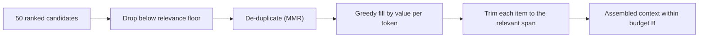

Once you know the budget, you have more candidates than room. A retriever returns 50 passages ranked by relevance; the conversation has 30 old turns; a tool returned a 9,000-token page. Which pieces go in?

The naive rule, "take the most relevant items until the budget is full", is a reasonable start and has two known flaws. It ignores **size**: one long, fairly relevant document can crowd out three short, highly relevant ones. And it ignores **redundancy**: the second-ranked passage is often a near-copy of the first, adding tokens but no information. Good selection accounts for value per token and for overlap.

## The maths: a knapsack with a twist

Give each candidate $i$ an estimated value $v_i$ (for example a relevance score, or a probability that it contains the needed fact) and a size $s_i$ in tokens. Choosing a set $X$ to maximise total value within budget $B$ is the **0/1 knapsack problem**:

$$
\max_{X} \sum_{i \in X} v_i \quad \text{subject to} \quad \sum_{i \in X} s_i \le B
$$

Exact solutions are expensive in general, but a good heuristic is **greedy by density**: sort by $v_i / s_i$ (value per token) and add items while they fit.

| Candidate | Value $v_i$ | Size $s_i$ | Density $v_i/s_i$ (per 1k tokens) |
|---|---|---|---|
| A | 0.9 | 600 | 1.50 |
| B | 0.8 | 300 | 2.67 |
| C | 0.7 | 400 | 1.75 |
| D | 0.5 | 200 | 2.50 |
| E | 0.3 | 100 | 3.00 |

With a budget $B = 1{,}000$ tokens:

```steps
Two selection rules, same budget
**Most relevant first:** take A (600 tokens, total 600), then B (300, total 900). C (400) and D (200) no longer fit; E (100) does. Set {A, B, E}, value $0.9 + 0.8 + 0.3 = 2.0$.
---
**Greedy by density:** E (100), B (300, total 400), D (200, total 600), C (400, total 1,000). A no longer fits. Set {B, C, D, E}, value $0.3 + 0.8 + 0.5 + 0.7 = 2.3$.
---
Checking the alternatives ({A, C} = 1.6, {A, D, E} = 1.7, {A, B, E} = 2.0) confirms 2.3 is the best possible here.
---
Density-greedy wins by 15% of value in the same 1,000 tokens, by leaving out the single most relevant but bulky document.
```

Greedy-by-density is not always optimal (a large item that exactly fills the budget can beat several small ones), but it is close enough in practice, and real relevance scores are too noisy for exact optimisation to matter.

**The twist: values are not additive.** If B and C say the same thing, including both does not double the value. **Maximal marginal relevance (MMR)** handles this by scoring each next candidate as

$$
\text{MMR}(i) = \lambda\, \text{rel}(i) - (1-\lambda) \max_{j \in X} \text{sim}(i, j)
$$

where $\text{rel}(i)$ is relevance to the query, $\text{sim}(i,j)$ similarity to an already-selected item, and $\lambda \in [0, 1]$ the trade-off. With $\lambda = 0.7$, a candidate with relevance 0.8 that is 0.9 similar to something already chosen scores $0.56 - 0.27 = 0.29$, below a candidate with relevance 0.6 and similarity 0.2, which scores $0.42 - 0.06 = 0.36$. The less relevant but novel passage goes in first.



## Beyond retrieval scores

- **A relevance floor.** Do not fill the budget just because it is there. If the tenth passage scores far below the first, leaving it out often helps (topic 6 quantifies why).
- **Trim inside items.** A 2,000-token document whose answer is in one paragraph can usually be cut to that paragraph plus a heading, raising its density tenfold.
- **Pinned items bypass the knapsack.** The question, safety instructions and facts the user stated are not optional; reserve them first.
- **Different sources, different values.** A user's own uploaded file is usually worth more than a web search result of the same score. Weight by source.

## In practice

Most RAG frameworks default to "top-$k$ by score". Replacing that with a token budget plus de-duplication is a small change that teams commonly report as a free win: fewer tokens, similar or better answers. Log the selected set and the scores for each request; when an answer is wrong, the first question is whether the needed passage was retrieved and then dropped by selection.

```quiz
{"q": "Budget 500 tokens. Candidates: X (value 0.9, 400 tokens), Y (0.6, 250), Z (0.5, 250). Which set has the highest total value?", "options": ["Y and Z, value 1.1", "X alone, value 0.9", "X and Y, value 1.5", "X and Z, value 1.4"], "answer": 0, "explain": "X + Y or X + Z would need 650 tokens, over budget. The feasible choices are X alone (0.9) or Y + Z (500 tokens, 1.1). The most relevant item is not in the best set."}
```

```quiz
{"q": "With λ = 0.5, candidate P has relevance 0.9 and similarity 0.8 to an already-selected item; Q has relevance 0.6 and similarity 0.1. Which does MMR pick next?", "options": ["Q, scoring 0.25 versus 0.05", "P, because it is more relevant", "P, scoring 0.85 versus 0.65", "They tie"], "answer": 0, "explain": "MMR(P) = 0.5 × 0.9 − 0.5 × 0.8 = 0.05; MMR(Q) = 0.5 × 0.6 − 0.5 × 0.1 = 0.25. Q adds new information. Adding instead of subtracting the similarity gives the 0.85 versus 0.65 distractor."}
```
