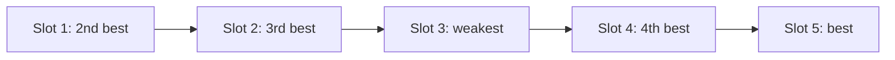

If position changes recall, then the order of your passages is a decision, not an accident. Most pipelines simply paste passages in retrieval-rank order, best first, and move on. That default places the second-best passage in the second slot, the third-best in the third, and so on down into the trough of the U-curve, while the worst passage ends up at the very end, in the strongest slot of all. We can do better with a short argument.

## The maths: the rearrangement argument

Suppose there are $n$ slots with recall $r_1, \dots, r_n$ (how likely the model is to use a passage placed in that slot), and $n$ passages with value $v_1, \dots, v_n$ (the probability that this passage holds the needed fact). Assigning passage $i$ to slot $\sigma(i)$ gives expected utility

$$
U(\sigma) = \sum_{i=1}^{n} v_i \, r_{\sigma(i)}
$$

By the **rearrangement inequality**, this sum is largest when the largest values are paired with the largest recalls, the second largest with the second largest, and so on. Intuitively, if a high-value passage sat in a weaker slot than a low-value one, swapping them would raise the total. So the optimal order does not follow retrieval rank; it follows slot strength: best passage in the best slot, second best in the second best slot.

Worked example with five passages, values $v = (0.50, 0.20, 0.15, 0.10, 0.05)$ in retrieval order, and slot recalls $r = (0.90, 0.70, 0.60, 0.70, 0.95)$ for slots 1 to 5:

| Ordering | Passage in slots 1 to 5 | Calculation | $U$ |
|---|---|---|---|
| Best first (default) | 1, 2, 3, 4, 5 | $0.5(0.90) + 0.2(0.70) + 0.15(0.60) + 0.1(0.70) + 0.05(0.95)$ | 0.7975 |
| Reversed (best last) | 5, 4, 3, 2, 1 | $0.05(0.90) + 0.1(0.70) + 0.15(0.60) + 0.2(0.70) + 0.5(0.95)$ | 0.8200 |
| Paired by slot strength | 2, 3, 5, 4, 1 | $0.2(0.90) + 0.15(0.70) + 0.05(0.60) + 0.1(0.70) + 0.5(0.95)$ | 0.8600 |

To see where the last row comes from, sort the slot recalls descending, $0.95, 0.90, 0.70, 0.70, 0.60$, and the values descending, $0.50, 0.20, 0.15, 0.10, 0.05$, then pair them:

$$
U^* = 0.50(0.95) + 0.20(0.90) + 0.15(0.70) + 0.10(0.70) + 0.05(0.60) = 0.475 + 0.18 + 0.105 + 0.07 + 0.03 = 0.86
$$

The best passage goes in slot 5 (recall 0.95), the second best in slot 1 (0.90), the third and fourth in slots 2 and 4 (0.70), and the weakest in slot 3 (0.60). The default best-first order gets 0.7975, so reordering alone lifts the chance of using the right passage by $0.86 - 0.7975 = 0.0625$, about 8% relative.

```steps
Computing the best order
List the recall of each slot and sort the slots from strongest to weakest.
---
Sort the passages from most to least likely to hold the answer.
---
Pair them off: strongest slot gets the best passage, next strongest the second best, and so on.
---
Read the passages back in slot order to get the prompt layout. For a U-shaped curve this puts the best passages at the end and the start and the weakest in the middle.
```



## Other ordering rules that matter

- **Chronological order for events.** If passages describe a sequence (meeting notes, a ticket's history), keep them in time order. Models follow a narrative better than a shuffled one, and the answer often depends on what came last.
- **Group by source.** Keep chunks from the same document adjacent and in their original order, with a header naming the source. It makes citations easy and reduces contradictions.
- **Instructions and question at the end.** Put the passages first and the task last, as the previous topic argued.
- **Stable prefix first.** Whatever is identical across requests (system prompt, tool definitions, fixed examples) goes at the very start so prefix caching can reuse it. Ordering for recall and ordering for caching rarely conflict, because the volatile material is the part you are rearranging.

```sim
context-position
{"contextTokens": 8192, "position": 50, "model": "older"}
```

The sim starts at 8k tokens with the fact in the middle. Note the recall there, then move the position to 100% and read the gain: that gap is the most you can win from ordering a single critical passage. Now raise the context to 32k and watch both the gap and the overall level change.

## In practice

Ordering gains are real but modest compared with retrieving the right passage in the first place. A common sequence of work is: fix retrieval, trim the context, then test two or three orderings on a golden set. Keep the winning rule in one function so that it is applied consistently, and log the order so you can diagnose a bad answer by asking whether the needed passage sat in a weak slot.

```quiz
{"q": "Slot recalls are (0.9, 0.6, 0.95) for slots 1 to 3 and passage values are (0.6, 0.3, 0.1). What is the best achievable expected utility?", "options": ["0.90", "0.815", "0.84", "0.885"], "answer": 0, "explain": "Pair strongest slot with best passage: 0.95 × 0.6 + 0.9 × 0.3 + 0.6 × 0.1 = 0.57 + 0.27 + 0.06 = 0.90. The default order (passage 1 in slot 1, and so on) gives 0.54 + 0.18 + 0.095 = 0.815."}
```

```quiz
{"q": "Why does the rearrangement argument say retrieval-rank order is usually not the best prompt order for a U-shaped recall curve?", "options": ["Rank order puts the second and third best passages in weak middle slots while the weakest passage takes the strongest end slot", "Retrieval scores are always wrong", "Models read prompts from the middle outwards", "Rank order breaks prefix caching"], "answer": 0, "explain": "Utility is a sum of value times slot recall, maximised by pairing high values with high recalls. Rank order pairs value with position monotonically, which only helps if recall also falls monotonically, and a U-shaped curve does not."}
```
