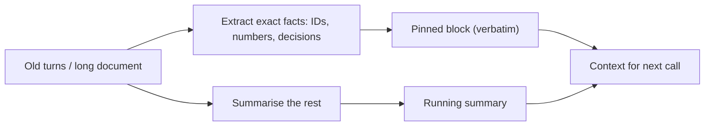

Sometimes the right material does not fit, or fits but costs too much to resend on every call. The alternative to dropping information is **compression**: replacing a long piece of context with a shorter one that keeps what the task needs. A meeting transcript becomes minutes. Thirty chat turns become a running summary. A 9,000-token web page becomes the three paragraphs that matter.

The methods, from cheap to expensive:

| Method | What it does | Typical ratio | Risk |
|---|---|---|---|
| Extractive trimming | Keep the relevant sentences or sections, drop the rest | 2x to 10x | Misses facts the scorer rated low |
| Boilerplate stripping | Remove HTML, navigation, signatures, repeated headers | 1.5x to 5x | Almost none |
| Format conversion | JSON to compact text, verbose keys to short ones | 1.3x to 2x | Readability, parsing |
| Abstractive summary | A model rewrites the text shorter | 4x to 20x | Dropped or invented details |
| Token-level pruning | A small model removes low-information tokens | 2x to 10x | Odd text, harder to debug |

Compression is lossy by definition, so the question is never "can we shrink it" but "how much of what the answer needs survives".

## The maths: ratio, savings and survival

Let a context have $L$ tokens and compress to $L'$ tokens. The **compression ratio** is $\rho = L'/L$, and the saving per reuse at input price $p$ is $(L - L')\,p$. Compression itself costs something: the compressor reads $L$ tokens and writes $L'$, at its own prices $p_c^{\text{in}}$ and $p_c^{\text{out}}$. If the compressed context is reused $n$ times (every later turn of a conversation, or every query against the same document), compression pays for itself when

$$
n\,(L - L')\,p > L\,p_c^{\text{in}} + L'\,p_c^{\text{out}}
$$

Worked example with hypothetical prices: main model \$3 per 1M input tokens, a small compressor model \$0.25 per 1M input and \$1.25 per 1M output. Compress $L = 8{,}000$ tokens to $L' = 2{,}000$ ($\rho = 0.25$).

- Saving per reuse: $6{,}000 \times 3\times10^{-6} = \$0.018$.
- Compression cost: $8{,}000 \times 0.25\times10^{-6} + 2{,}000 \times 1.25\times10^{-6} = 0.002 + 0.0025 = \$0.0045$.
- Break-even: $n > 0.0045 / 0.018 = 0.25$, so it pays off on the first reuse. Over 15 later turns, it saves $15 \times 0.018 - 0.0045 = \$0.2655$.

The money is rarely the hard part. The hard part is **survival**: what fraction of the facts the task needs make it through. If each needed fact survives independently with probability $s$, a question that depends on $f$ of them is answerable with probability $s^f$.

```steps
How fragile a summary is
Suppose a summariser keeps each individual fact with probability $s = 0.95$, which sounds excellent.
---
A question needing 1 fact is answerable with probability $0.95$.
---
A question needing 2 facts: $0.95^2 = 0.9025$.
---
A question needing 5 facts: $0.95^5 = 0.774$. A question needing 10 facts: $0.95^{10} = 0.599$.
---
So "95% fact retention" means about 40% of ten-fact questions can no longer be answered from the summary. Test compression against the questions you will actually ask, not an average of fact retention.
```

This is why summaries work well for the **gist** (what is this conversation about?) and poorly for **lookups** (what was the order number on turn 3?). The fix is to split the context by use. Facts you know will be looked up (IDs, amounts, decisions, user constraints) are extracted verbatim into a small pinned block that is never summarised. Everything else may be summarised freely.



A compression prompt that follows this split:

```text
Below is the earlier part of a support conversation.
1. List every identifier, amount, date and explicit user requirement verbatim, one per line, under "FACTS".
2. Then write at most 80 words summarising everything else under "SUMMARY".
Do not add anything that is not in the conversation.
```

## In practice

- **Compress offline when you can.** Summarising a document once at indexing time and reusing it across thousands of queries is far cheaper than compressing per request.
- **Keep the original retrievable.** If the model needs a detail the summary dropped, a tool that fetches the original span rescues the answer. A summary should point back to its source.
- **Measure with questions, not similarity.** Evaluate compression by running your golden question set against the compressed context and comparing accuracy with the uncompressed run. Text-similarity scores between summary and source say little about whether answers survive.
- **Beware summary drift.** A summary of a summary of a summary loses detail geometrically. Re-summarise from the original material or from verbatim pinned facts, not from the previous summary alone.

```quiz
{"q": "A summariser keeps each needed fact with probability 0.9, independently. A question needs 4 facts. What is the chance the summary still supports it?", "options": ["About 66%", "About 90%", "About 60%", "About 96%"], "answer": 0, "explain": "0.9⁴ = 0.6561. The per-fact rate overstates question-level survival because every needed fact must survive. Subtracting 4 × 10% from 100% gives 60%, which wrongly adds failure rates instead of multiplying survival rates."}
```

```quiz
{"q": "Compressing 5,000 tokens to 1,000 saves $0.012 per reuse at the main model's input price and costs $0.003 to run. After how many reuses has it paid for itself?", "options": ["Immediately: the first reuse saves $0.012, more than the $0.003 cost", "After 4 reuses", "After 12 reuses", "It never pays for itself"], "answer": 0, "explain": "Break-even n = 0.003 / 0.012 = 0.25, so even one reuse covers it. The 4 comes from dividing the wrong way round (0.012 / 0.003). The real risk is lost facts, not money."}
```
