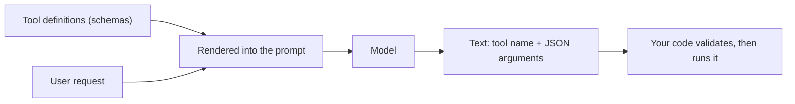

A language model can only produce text. It cannot look up an order, check the weather or send an email. **Tool calling** (also called **function calling**) is the convention that bridges the gap: you describe some functions to the model, the model replies with text in a fixed structure saying "call this function with these arguments", and your own code does the real work. The model never executes anything. It writes a request; you decide whether to honour it.

A tool is described by three things: a **name**, a natural-language **description** saying what it does and when to use it, and a **parameter schema** (JSON Schema) saying what arguments it takes.

```text
{
  "name": "get_order_status",
  "description": "Look up the shipping status of one order. Use when the customer asks where their order is. Do not use for refunds.",
  "parameters": {
    "type": "object",
    "properties": {
      "order_id": { "type": "string", "pattern": "^ORD-[0-9]{6}$", "description": "Order number, e.g. ORD-104233" },
      "include_history": { "type": "boolean", "description": "Also return past status changes. Default false." }
    },
    "required": ["order_id"],
    "additionalProperties": false
  }
}
```

Behind the scenes, the serving stack renders this definition into the prompt, usually as text in the system part of the template. So the model "sees" a tool the same way it sees any other instruction: as tokens it must read, understand and weigh. The description is not documentation for humans; it is part of the prompt, and its wording determines when the tool gets called.

## The maths: what definitions cost

Because definitions are tokens, they are paid for on every request, exactly like the system prompt. If a tool definition averages $d$ tokens, an application offering $n$ tools adds $n\,d$ tokens to every call. With $R$ requests per day and input price $p_{\text{in}}$ per token, the daily cost is

$$
C_{\text{tools}} = n \, d \, R \, p_{\text{in}}
$$

With $n = 20$ tools, $d = 150$ tokens, $R = 100{,}000$ requests a day and a hypothetical \$3 per 1M input tokens:

$$
C_{\text{tools}} = 20 \times 150 \times 100{,}000 \times 3\times10^{-6} = \$900 \text{ per day}
$$

If a cheap router or the conversation state lets you offer only the 5 relevant tools for each request, the cost falls to $5 \times 150 \times 100{,}000 \times 3\times10^{-6} = \$225$ per day, saving \$675 a day, about \$246,000 a year, with the same model.

```steps
Reading a tool definition as the model does
The name and description are the first signal. A model decides "this question is about order status" mostly from the description text, so say when to use the tool and, as important, when not to.
---
Parameter names and descriptions tell it what to fill in. `order_id` with an example value gets filled correctly far more often than `id` with no description.
---
Types, enums and patterns constrain the arguments: a closed `enum` is easier than a free string, and a `pattern` gives it the exact format.
---
`required` tells it which arguments it must supply, and which it may leave out. Leaving optional arguments out is usually safer than guessing.
---
Everything in this definition costs tokens on every call, so every sentence should either change when the tool is chosen or how its arguments are filled.
```

## Writing good definitions

| Habit | Example | Why |
|---|---|---|
| Describe when to use it and when not to | "Do not use for refunds" | Reduces wrong-tool calls between similar tools |
| Constrain with enums and patterns | `"status": {"enum": ["open", "closed"]}` | Removes invalid values at the source |
| Put an example in the description | "e.g. ORD-104233" | Anchors the format |
| Use distinct, verb-first names | `get_order_status`, `cancel_order` | Easy to tell apart |
| Keep parameters few and flat | 2 to 4 arguments | Nested optional objects are filled less reliably |
| Make dangerous actions explicit | `confirm: true` required for `cancel_order` | Forces a deliberate step |



## In practice

The most common first-week bug is a vague description. Two tools called `search_docs` and `search_tickets` with descriptions "Search stuff" are routinely confused. Rewriting each description in one sentence that says what it searches and what it returns, and adding a "do not use for" clause, typically does more for accuracy than any prompt change elsewhere. Treat definitions as code that gets reviewed and tested; the next lessons show how.

```quiz
{"q": "An assistant offers 12 tools of about 200 tokens each on every request, 50,000 requests a day, at a hypothetical $3 per 1M input tokens. What do the definitions cost per day?", "options": ["$360", "$36", "$3,600", "$120"], "answer": 0, "explain": "12 × 200 = 2,400 tokens per request; × 50,000 = 1.2 × 10⁸ tokens; × 3 × 10⁻⁶ = $360. A factor-of-ten slip gives $36 or $3,600."}
```

```quiz
{"q": "Who actually executes a function when a model 'calls' a tool?", "options": ["Your application code, after reading the model's structured request", "The model, inside its weights", "The tokenizer", "The provider's GPU, automatically"], "answer": 0, "explain": "The model only emits text naming a tool and arguments. Your code decides whether to run it, runs it, and returns the result. That gap is exactly where validation and permission checks belong."}
```
