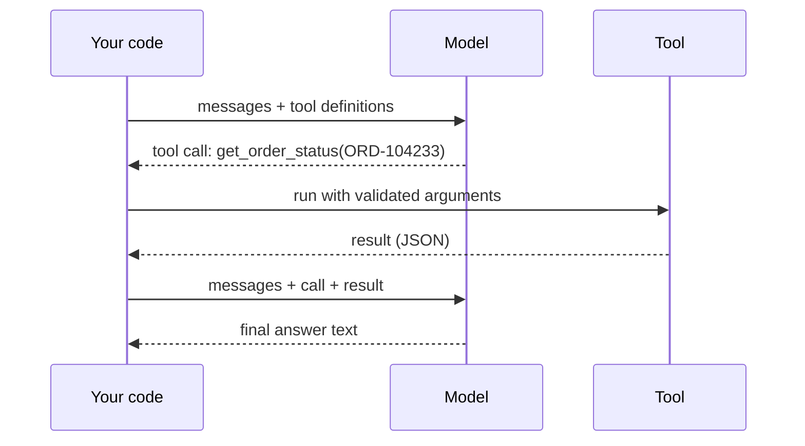

A single tool use takes at least two model calls. In the first, the model reads the question and emits a tool call instead of an answer. Your code runs the tool. In the second, you send the whole conversation again, now with the tool call and its result appended, and the model writes the final answer. If the answer needs another tool, the loop goes round again.



The messages in a round trip look like this in the conversation history:

```text
user: Where is my order ORD-104233?
assistant (tool call): get_order_status {"order_id": "ORD-104233"}
tool: {"status": "shipped", "carrier": "UPS", "eta": "2026-03-14"}
assistant: Your order shipped with UPS and should arrive on 14 March.
```

Because the model is stateless, every round resends everything before it: the system prompt, the tool definitions, the user's question and all earlier calls and results. This is the same history growth as the multi-turn chat from lesson 1, only faster, because tool results are often large.

## The maths: tokens and latency over $r$ rounds

Let $B$ be the fixed prompt (system prompt plus tool definitions plus question), $c$ the tokens in one tool call, and $u$ the tokens in one tool result. Round $j$ (starting at $j = 1$) sends

$$
n_j = B + (j - 1)(c + u) \quad \text{input tokens}
$$

so the total input over $r$ rounds is

$$
N_{\text{in}}(r) = rB + (c + u)\,\frac{r(r-1)}{2}
$$

Worked example: $B = 2{,}000$, $c = 60$, $u = 400$ (so each round adds 460 tokens), and the task needs $r = 4$ rounds, three tool calls and then the final answer.

```steps
Pricing a four-round tool task
Round inputs: $2{,}000$, $2{,}460$, $2{,}920$, $3{,}380$ tokens.
---
Total input: $4 \times 2{,}000 + 460 \times \frac{4 \times 3}{2} = 8{,}000 + 2{,}760 = 10{,}760$ tokens.
---
Output: three tool calls of 60 tokens plus a 200-token answer: $3 \times 60 + 200 = 380$ tokens.
---
At a hypothetical \$3 per 1M input and \$15 per 1M output: $10{,}760 \times 3\times10^{-6} = \$0.03228$ input plus $380 \times 15\times10^{-6} = \$0.0057$ output, **\$0.03798** in total.
---
If the same three results were known in advance and supplied in one call, it would cost about $(2{,}000 + 1{,}200)\times 3\times10^{-6} + 200 \times 15\times10^{-6} = \$0.0126$. The loop is useful because the model chooses what to fetch, but it is not free.
```

**Latency** adds up the same way. If each model call takes $t_m$ seconds (prefill over a growing prompt, then decode) and each tool takes $t_t$ seconds, a task with $r$ model calls and $r - 1$ tool calls takes about

$$
T \approx r\,t_m + (r - 1)\,t_t
$$

With $t_m = 0.8$ s and $t_t = 0.3$ s, $r = 4$ gives $3.2 + 0.9 = 4.1$ s before the user sees a final answer. Streaming the last response helps the perceived wait, but the earlier rounds are dead time.

## Two useful variations

- **Parallel tool calls.** If the model needs two independent facts, it can emit both calls in one turn. Your code runs them concurrently, and one round replaces two. Latency becomes $\max(t_{t,1}, t_{t,2})$ instead of the sum.
- **Forced and disabled tool use.** Most APIs let you require a particular tool (useful for extraction, where the "tool" is just a schema for the output) or forbid tools for a turn. Forcing a call with a schema is another route to structured output.

## In practice

- **Cap the rounds.** A loop limit of 5 to 10 prevents a confused model from calling tools forever, and a cost ceiling per request catches runaway loops.
- **Log every round** with its token counts. When a task suddenly costs three times as much, the trace shows which tool result ballooned.
- **Keep results short.** The $u$ term is multiplied through every later round. Cutting a 400-token result to 100 tokens would take this example from 10,760 to 8,000 + 160 × 6 = 8,960 input tokens, a 17% saving. The next topics return to this.
- **Idempotency matters.** Retries and parallel calls can run a tool twice. Reads are harmless; a `send_email` call that runs twice is an incident. Module 7 covers this in depth.

```quiz
{"q": "B = 1,500 tokens, each round adds 300 tokens (call plus result), and a task takes 3 rounds. How many input tokens in total?", "options": ["5,400", "4,500", "5,100", "6,300"], "answer": 0, "explain": "Rounds send 1,500, 1,800 and 2,100 tokens: total 5,400. Using the formula: 3 × 1,500 + 300 × (3 × 2 / 2) = 4,500 + 900 = 5,400. Forgetting the growth gives 4,500."}
```

```quiz
{"q": "A task needs two independent lookups that each take 0.5 s. A model call takes 0.8 s. How long is the tool-and-model time with sequential calls versus one parallel round, counting 3 model calls versus 2?", "options": ["Sequential 3.4 s, parallel 2.1 s", "Sequential 2.9 s, parallel 2.1 s", "Sequential 3.4 s, parallel 2.6 s", "Both 2.4 s"], "answer": 0, "explain": "Sequential: 3 × 0.8 + 2 × 0.5 = 3.4 s. Parallel: 2 × 0.8 + max(0.5, 0.5) = 2.1 s. Counting the two parallel tools as 1.0 s gives the 2.6 s distractor."}
```
