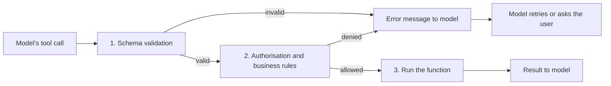

The model's tool call is a request from an untrusted author. It might be well-formed and sensible. It might contain a typo in an ID, a string where you wanted an integer, a date in the wrong format, or, if a user or document steered it, an argument you would never willingly run. So the code between "model emitted a call" and "function ran" is a gate, and it does three jobs: **validate** the arguments, **authorise** the action, and **report** failures in a form the model can recover from.



## Layer 1: schema validation

Check the call against the same JSON Schema you gave the model: required fields present, types right, enum values legal, patterns matched, no extra keys. This catches malformed calls cheaply and deterministically. If the provider offers constrained decoding for tool calls, many of these errors never occur, but validate anyway because your server should not trust its inputs.

## Layer 2: authorisation and business rules

Schema validity does not mean the call is *allowed*. `get_order_status("ORD-104233")` is a perfectly valid call, but if order 104233 belongs to a different customer, running it is a data leak. The check belongs in your code, using the session's real identity, never the model's claim about who the user is. Likewise, "refund $5,000" can be schema-valid and still above the limit this agent may issue. Enforce permissions in code at the tool boundary; do not rely on the prompt to say "only look up the current customer's orders".

## Layer 3: errors the model can use

When validation fails, send the model a short, specific message in the tool-result slot, not a stack trace and not a bare "error":

```text
Error: order_id "104233" does not match the required pattern ORD-[0-9]{6}.
Expected a value like ORD-104233. Ask the customer to confirm the order number if you are unsure.
```

A message that names the field, states the rule and suggests the next step lets the model fix the call on the next round. A message like "400 Bad Request" gives it nothing to work with.

## The maths: reliability with validate-and-retry

Suppose the first attempt at a call is valid with probability $v = 0.90$. When the call is invalid and you return a specific error, suppose the model fixes it on a given retry with probability $f = 0.70$. With up to $k$ retries and independent attempts, the probability of eventually producing a valid call is

$$
P(\text{valid}) = 1 - (1 - v)(1 - f)^k
$$

```steps
Effect of error feedback
No retries ($k = 0$): $P = 1 - 0.10 = 0.90$.
---
One retry: $P = 1 - 0.10 \times 0.30 = 1 - 0.03 = 0.97$.
---
Two retries: $P = 1 - 0.10 \times 0.30^2 = 1 - 0.009 = 0.991$.
---
Cost: expected extra rounds $= (1 - v)\left(1 + (1-f) + \dots\right) \approx 0.10 \times 1.3 = 0.13$ rounds per call. For a 460-token round, that is about 60 extra tokens on average, a small price for moving from 90% to 99.1%.
```

The independence assumption is the weak spot. When the model fails because of an ambiguity in the user's request (two possible order numbers), a retry usually fails again; only asking the user resolves it. So a good loop distinguishes **fixable** errors (format, missing optional field) from **missing information** errors (ask the user), and caps retries at 1 or 2.

Now chain it. A 3-step task where each call is valid with $P = 0.97$ after one retry and the right tool is chosen with 0.98 each time: step success $0.98 \times 0.97 = 0.9506$, task success $0.9506^3 = 0.859$. Without retries it would be $(0.98 \times 0.90)^3 = 0.882^3 = 0.686$. A single retry with a good error message lifts the task from 69% to 86%.

## In practice

- **Return structured errors**: a code, the offending field, the rule and a hint. Keep them under 100 tokens.
- **Never include secrets or internals** in error text; it goes into the model's context and possibly to the user.
- **Make dangerous tools two-step.** A `cancel_order` call returns a confirmation request first, and only a second call with the confirmation token cancels. This turns a single wrong call into a harmless one.
- **Log invalid calls** (with the arguments) as a metric. A rise in schema failures after a prompt or model change is an early regression signal, and each failure is a candidate golden-set case.

```quiz
{"q": "First attempts are valid with probability 0.85. When invalid, a retry with a specific error message fixes the call with probability 0.6. What is P(valid) after one retry?", "options": ["0.94", "0.91", "0.85", "0.99"], "answer": 0, "explain": "P = 1 − 0.15 × 0.4 = 1 − 0.06 = 0.94. Adding 0.15 × 0.6 = 0.09 to 0.85 also gives 0.94; 0.91 would come from using 0.4 as the fix rate."}
```

```quiz
{"q": "A call is schema-valid but asks for another customer's order. Where should this be stopped?", "options": ["In your code at the tool boundary, using the session's verified identity", "In the system prompt, by telling the model to be careful", "By the JSON Schema, with an enum of allowed order IDs", "It need not be stopped: schema-valid calls are safe"], "answer": 0, "explain": "Authorisation is a property of who is asking, which the schema cannot know. A prompt instruction is a probabilistic request; a check in code is a guarantee. Schema validity says nothing about permission."}
```
