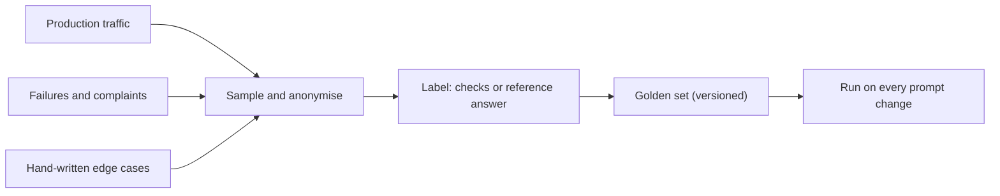

A **golden set** is a collection of inputs, each paired with a way to decide whether an output is acceptable. It is the unit test suite for a prompt. Each case says: given this input (and any context or tool results), a good output has these properties. Running the prompt over the set produces a **pass rate**, the single most useful number for deciding whether a change is safe.

A case has three parts:

```text
id: refund-014
input: "I was charged twice for order ORD-104233, please fix this"
checks:
  - schema: triage-v2.json
  - field category == "billing"
  - field urgency >= 3
  - summary mentions "charged twice"
tags: [billing, duplicate-charge, english]
```

The checks are the heart of it. Prefer checks that code can run: schema validity, exact field values, regular expressions, "must not contain" lists, tool-call equality. For open-ended text, use a rubric scored by a model or a person (module 5), but keep as many deterministic checks as the task allows, since they are free, instant and unambiguous.

## Where cases come from

1. **Real traffic**, anonymised and sampled. Real inputs have the typos, mixed languages and odd phrasing a synthetic writer would never invent.
2. **Failures.** Every production bug, support complaint or reviewer flag becomes a case. This is how a golden set grows exactly where the product is weak.
3. **Edge cases written by hand**: empty input, very long input, another language, a request outside scope, an attempted injection, ambiguous requests where "unknown" is correct.
4. **Slices.** Tag cases (language, category, length, customer tier) so you can report pass rates per slice. An overall 94% can hide a slice at 70%.



## The maths: how big should it be?

Each case is a pass or a fail, so the number of passes in $n$ cases is a **binomial** count: if the true pass rate is $p$, then passes $K \sim \text{Binomial}(n, p)$ with mean $np$ and variance $np(1-p)$. The measured pass rate $\hat{p} = K/n$ has **standard error**

$$
\text{SE}(\hat{p}) = \sqrt{\frac{p(1-p)}{n}}
$$

This tells you how much $\hat{p}$ wobbles from sample to sample. Notice that SE shrinks only with $\sqrt{n}$: to halve the noise you need four times the cases.

To measure a pass rate to within $\pm E$ with about 95% confidence (multiplier $z = 1.96$), you need

$$
n \ge \frac{z^2\, p(1-p)}{E^2}
$$

```steps
Sizing a golden set
You expect a pass rate near $p = 0.92$ and want a margin of $E = 0.03$ (plus or minus 3 points).
---
$n \ge \dfrac{1.96^2 \times 0.92 \times 0.08}{0.03^2} = \dfrac{3.8416 \times 0.0736}{0.0009} \approx 314.2$, so $n = 315$.
---
If you do not know $p$, assume the worst case $p = 0.5$: $n \ge \dfrac{3.8416 \times 0.25}{0.0009} \approx 1{,}067.1$, so $n = 1{,}068$.
---
Halve the margin to $E = 0.015$ and $n$ quadruples: about 1,257 cases at $p = 0.92$.
---
Takeaway: a few hundred cases measures a pass rate to a few points; detecting small differences between two versions needs much more (topic 4).
```

Size depends on what you are doing. 50 to 100 cases is a smoke test: it catches disasters, not 2-point drops. 300 to 500 cases estimates a rate within about 3 points. Thousands are needed to compare two close versions reliably, which is why teams build several tiers: a fast 100-case set for every edit, and a larger set before a release.

## In practice

- **Hold out a set you never tune on.** If you edit the prompt until the golden set passes, you have fitted the prompt to those cases, and the pass rate will overstate real performance. Keep a separate, rarely used test set for the final decision.
- **Version the set.** Record the golden-set version next to every result, or old and new numbers cannot be compared.
- **Review labels.** In many first golden sets, 3 to 8% of "failures" turn out to be wrong labels. A disagreement between prompt and label deserves a human look in both directions.
- **Keep it representative.** If you over-sample hard cases the overall pass rate will look worse than production; that is fine for regression tracking, but do not report it as the live accuracy.

```quiz
{"q": "You expect a pass rate near 0.90 and want ±4 points at 95% confidence. About how many cases do you need (z = 1.96)?", "options": ["About 217", "About 120", "About 600", "About 54"], "answer": 0, "explain": "n = 3.8416 × 0.90 × 0.10 / 0.04² = 0.3457 / 0.0016 ≈ 216.1, so 217. Using p = 0.5 would give 600; forgetting to square the margin gives far too few."}
```

```quiz
{"q": "To cut the margin of error on a measured pass rate from ±4 points to ±2 points, roughly how much larger must the golden set be?", "options": ["4 times", "2 times", "8 times", "Unchanged: the margin does not depend on size"], "answer": 0, "explain": "The margin scales as 1/√n, so halving it needs n four times larger. Doubling the set only shrinks the margin by about 29%."}
```
