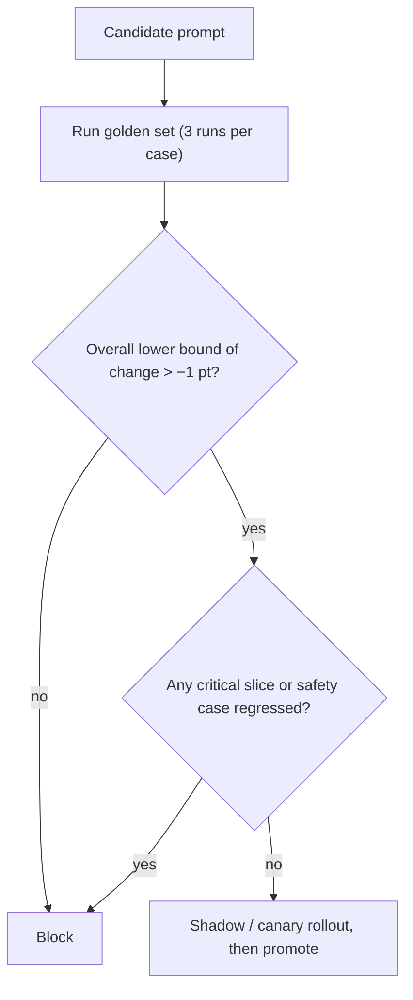

Once a golden set runs automatically on every change, you need a rule that turns its results into a decision: merge or block. A good **release gate** blocks real regressions and lets harmless changes through. A bad one either lets regressions slip (too lenient) or fails so often on noise that the team learns to ignore it (too strict). Two sources of noise do most of the damage: cases whose outcome varies from run to run, and the sheer number of comparisons a test suite makes.

## Flaky cases: the same prompt scores differently twice

If you sample at temperature above zero, the same case can pass on one run and fail on the next. Even at temperature 0, hosted models are not always bit-for-bit deterministic. Say a case passes with true probability $p_i$ on each run. One run of the whole suite of $n$ cases has a pass rate with variance

$$
\text{Var}(\hat{p}) = \frac{1}{n^2}\sum_{i=1}^{n} p_i (1 - p_i)
$$

Cases with $p_i$ near 0 or 1 contribute almost nothing; cases near 0.5 contribute the most. Take $n = 300$ cases of which 30 are flaky with $p_i = 0.5$ and the rest are stable:

$$
\text{Var}(\hat{p}) = \frac{30 \times 0.25}{300^2} = \frac{7.5}{90{,}000} = 8.33 \times 10^{-5}, \qquad \text{SD} = 0.0091
$$

So the *identical* prompt scores with a standard deviation of 0.9 points from run to run. The difference between two runs of the same prompt has SD $\sqrt{2} \times 0.91 = 1.3$ points, so a gate that blocks any drop larger than 1 point will fire on noise about two times in ten: the chance that the difference falls below $-1$ is $1 - \Phi(1/1.29) \approx 0.22$.

```steps
Taming flaky cases
Run each case several times (3 to 5) and score the fraction of passes, so a case contributes a rate instead of a coin flip.
---
For a case with $p_i = 0.8$, one run passes 80% of the time. Requiring all of 3 runs to pass succeeds only $0.8^3 = 0.512$ of the time; accepting a majority (at least 2 of 3) succeeds $3(0.8)^2(0.2) + 0.8^3 = 0.384 + 0.512 = 0.896$ of the time.
---
Decide per case what "pass" means. Safety checks should require every run to pass; style checks can use the majority.
---
Quarantine cases that stay flaky at temperature 0: investigate whether the check is ambiguous, the prompt underspecified, or the label wrong.
```

## Many tests, many chances to be wrong

A test with significance level $\alpha = 0.05$ has a 5% chance of a false alarm when nothing has changed. A suite that reports pass rates on 20 slices and checks each one for regression has 20 chances. If the slices were independent and nothing changed, the chance that at least one slice raises a false alarm is

$$
1 - (1 - \alpha)^m = 1 - 0.95^{20} = 1 - 0.358 = 0.642
$$

Nearly two out of three harmless changes would be blocked by something. The standard fix is the **Bonferroni correction**: test each slice at $\alpha/m = 0.05/20 = 0.0025$. Then the overall false-alarm chance is $1 - 0.9975^{20} \approx 0.049$, back near 5%. The cost is lower power per slice, so important slices (safety, a major language) get a looser budget by design while minor ones share a stricter one.



## Designing the gate

- **Block on non-inferiority, not on improvement.** Most prompt changes aim to cut tokens or fix one slice, not to raise the average. A sensible gate is "the lower bound of the confidence interval for the change is above $-1$ point", meaning we are confident we have not lost more than a point.
- **Zero tolerance where it matters.** Safety and security cases (injection attempts, forbidden content, schema validity) pass or fail individually; one new failure blocks.
- **Separate the cheap and the expensive tests.** Deterministic checks run on every commit; model-judged rubrics run nightly or on release candidates.
- **Track the cost too.** Record tokens per request and latency for each version, and gate on them (a version that raises pass rate by 0.5 points and adds 600 input tokens may lose on net).
- **After the gate, watch production.** Offline tests see only your cases. Staged rollout (module 8) catches what they cannot.

## In practice

When a gate fails, the first question is "is this noise?" Re-run once with a different seed. If a case flips back and forth, it is flaky and belongs in quarantine, not in the gate. If a real regression appears, write the failing input into the golden set before fixing the prompt, so the regression can never return unnoticed.

```quiz
{"q": "A suite checks 10 independent slices, each at α = 0.05, after a change that did nothing. What is the chance of at least one false alarm?", "options": ["About 40%", "About 5%", "About 50%", "About 10%"], "answer": 0, "explain": "1 − 0.95¹⁰ = 1 − 0.599 = 0.401. Adding 10 × 5% = 50% overcounts because it double-counts changes that trip several slices; 5% is the single-test rate."}
```

```quiz
{"q": "A case passes with probability 0.9 on each independent run. If you run it 3 times and require all 3 to pass, how often does a correct prompt pass this case?", "options": ["72.9%", "90%", "81%", "97.2%"], "answer": 0, "explain": "0.9³ = 0.729. Requiring every run to pass punishes even a good prompt on a case that is only mostly reliable; accepting a majority would give 0.972, the last option."}
```
