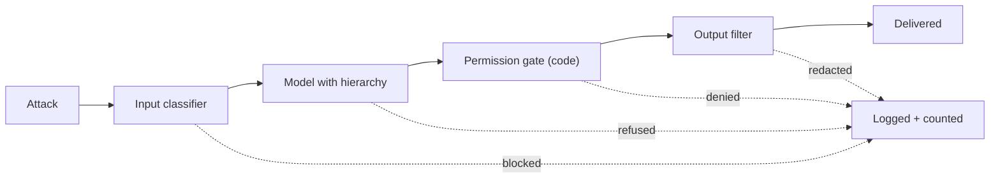

No single control stops every injection. The sound approach, borrowed from security engineering generally, is **defence in depth**: stack several independent controls so that an attack has to defeat all of them. A castle has a moat, a wall, a gate and guards; no one expects the moat to be perfect.

The layers available for an LLM application, roughly in the order a request meets them:

| Layer | What it does | Typical weakness |
|---|---|---|
| Input classifier | Scores incoming text (user and retrieved) for injection patterns | Misses novel phrasing; false blocks |
| Prompt design | Clear roles, delimiters, a conflict rule, untrusted labels | A learned tendency, not a lock |
| Trained instruction hierarchy | The model ranks system over user over data | Imperfect under adaptive attacks |
| Capability limits | Least privilege, scoped tools, no outward channel | Costs some product convenience |
| Permission gate in code | Validates every tool call against policy and identity | Only as good as the policy |
| Output filter | Checks responses for leaks, URLs, forbidden content | Can be evaded by encoding |
| Human confirmation | A person approves consequential actions | Approval fatigue |
| Monitoring and rate limits | Detects patterns, throttles repeated attempts | Detects after the fact |

## The maths: residual risk and correlation

Let layer $i$ stop a fraction $b_i$ of the attacks that reach it. If the layers failed independently, the fraction of attacks that get through all of them is

$$
\text{residual} = \prod_{i=1}^{m} (1 - b_i)
$$

```steps
Four layers, independent
Instruction hierarchy plus prompt design stops 90% ($b_1 = 0.9$), an input classifier stops 80% of what remains ($b_2 = 0.8$), an output filter stops 70% ($b_3 = 0.7$), and a code-level permission gate stops 95% of harmful tool calls ($b_4 = 0.95$).
---
Residual: $(0.1)(0.2)(0.3)(0.05) = 0.0003$, which is 0.03%.
---
Compare with the best single layer alone: the permission gate leaves 5% through. Stacking cut the residual by a factor of about 170.
---
At 100,000 attack attempts, about 30 get through, instead of 5,000 with the gate alone.
```

That calculation is the optimistic case. The assumption of independence is rarely true. Layers share blind spots: an attack in an unusual language or an encoding can fool the classifier, the model and the output filter for the same reason. Consider the extreme: a fraction $c$ of attacks are "universal" and slip past every layer. Then the residual is at least $c$, however many layers you add.

$$
\text{residual} \ge c, \qquad \text{e.g. } c = 0.02 \Rightarrow \text{residual} \ge 2\%, \text{ not } 0.03\%
$$

The remedy is **diversity**: choose layers that fail for different reasons. A trained model, a keyword or regex rule, a code-level permission check and a human confirmation each look at the problem differently. Layers that are all "another LLM reading the same text" are strongly correlated; a deterministic permission gate is nearly independent of them, which is why it carries so much weight.



## Design principles

- **Make one layer deterministic and unfoolable.** At least one control should not depend on the model's judgement: allow-lists, identity checks, spending limits, "no outbound call to unknown domains".
- **Fail closed.** If the classifier or filter errors out, deny the risky action instead of allowing it.
- **Layer by consequence.** Low-risk actions need light controls; irreversible ones (payments, deletion, external sharing) need strong controls plus a human.
- **Measure the stack, not the parts.** Run the red-team suite through the whole system and report the end-to-end ASR, with an interval.
- **Log the blocks.** Every blocked attempt is information about what attackers try, and a candidate regression case.

## In practice

Defence in depth costs latency and money (a classifier call per request, an output filter, a confirmation step), so teams allocate it by risk. A read-only FAQ bot may run with a prompt and an output filter. An agent that moves money runs every layer, and design reviews ask for the residual risk in dollars per month and who accepted it.

```quiz
{"q": "Three independent layers stop 70%, 80% and 90% of the attacks that reach them. What fraction of attacks get through all three?", "options": ["0.6%", "6%", "24%", "0.06%"], "answer": 0, "explain": "(0.3)(0.2)(0.1) = 0.006, which is 0.6%. Averaging the stop rates or adding the leak rates is not how independent layers combine; they multiply."}
```

```quiz
{"q": "Why can stacking five more LLM-based filters fail to reduce residual risk much?", "options": ["They are likely to share blind spots, so a universal attack passes all of them and the residual stays at least the fraction of such attacks", "LLM filters cost too much", "Layers cancel each other out", "More layers always increase false negatives"], "answer": 0, "explain": "Correlated layers fail together. If 2% of attacks fool every model-based layer, residual risk is at least 2% however many are added. Mixing in a different kind of control, such as a code-level permission check, breaks the correlation."}
```
