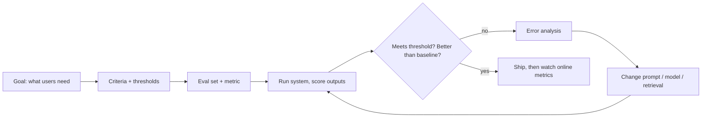

```callout-before
Before you start
You need fractions, averages and a square root. No statistics background is assumed: every formula in this module is built up from these.
```

Imagine tasting a soup to decide whether the new recipe is better. One spoonful is pleasant, so you declare victory. Tomorrow the soup is too salty for half the table. A single taste told you almost nothing, because one spoonful is a tiny, unrepresentative sample of what the pot will do across many bowls.

Changing a prompt, a model or a retrieval setting and then trying three questions in a chat window is the same spoonful. LLM outputs vary from input to input and from run to run, so a handful of good-looking replies is weak evidence. This habit is often called a **vibe check**. It is useful for spotting obvious breakage, and useless for deciding between two versions that are both "fine".

**Evaluation** replaces the spoonful with a procedure: a fixed set of inputs (the **eval set**), a rule that scores each output (the **metric**), and a summary across the set (usually an average). Once those three pieces exist, "is version B better?" becomes a question with a number for an answer, and the number comes with an error bar.

## The maths: a score is an average, and averages have noise

Write the eval set as $n$ examples $(x_i, y_i)$, where $x_i$ is the input and $y_i$ is whatever reference or rubric defines a good answer. The system produces an output $\hat{y}_i = f(x_i)$. A metric $m$ scores one output, and the system score is the mean:

$$
S = \frac{1}{n}\sum_{i=1}^{n} m(\hat{y}_i, y_i)
$$

When $m$ is pass/fail (1 or 0), $S$ is just the **pass rate** $\hat{p}$: the share of examples that passed. That pass rate is an estimate of the true rate $p$ you would see on all possible inputs like these, and it wobbles from sample to sample. Its typical wobble is the **standard error**:

$$
\mathrm{SE}(\hat{p}) = \sqrt{\frac{\hat{p}(1-\hat{p})}{n}}
$$

A rough 95% range for the true rate is $\hat{p} \pm 1.96\,\mathrm{SE}$. Lesson 4 derives this properly; here it is enough to see what it says about small samples.

```steps
How much does a 10-example check tell you?
You try 10 questions and 8 look right: $\hat{p} = 0.8$.
---
$\mathrm{SE} = \sqrt{0.8 \times 0.2 / 10} = \sqrt{0.016} = 0.126$.
---
The 95% range is $0.8 \pm 1.96 \times 0.126 = 0.8 \pm 0.25$: anywhere from about 55% to 100%. Ten examples cannot tell a 60% system from a 95% one.
---
With 50 examples and 41 passes, $\hat{p} = 0.82$ and $\mathrm{SE} = \sqrt{0.82 \times 0.18/50} = 0.054$, so the range is $0.82 \pm 0.11$. Better, but still too wide to separate 80% from 85%.
```

The error bar shrinks with $\sqrt{n}$, not $n$: to halve it you need four times as many examples. That single fact drives most of the planning in this module.

## The evaluation loop

Measurement only pays off when it sits inside a loop you run on every change.



Each box is a lesson in this module: criteria (this lesson), metrics against references (lesson 2), model judges when there is no single right answer (lesson 3), honest comparisons (lesson 4), reading failures (lesson 5) and measuring with real users (lesson 6).

## What gets measured

LLM systems are evaluated on more than correctness. A typical feature has several families of measure:

| Family | Example measure | Usually scored by |
|---|---|---|
| Task quality | answer correct, summary faithful | reference match, rubric, judge model |
| Format | valid JSON, under 120 words | code check |
| Safety | no leaked personal data, no harmful advice | classifier, rules, red-team set |
| Experience | latency p95, cost per request | logs |
| Outcome | ticket resolved without escalation | product analytics |

Code checks are cheap, exact and should be used wherever they apply. Quality usually needs references or judgement. Outcomes are what the business cares about but arrive slowly and noisily, which is why offline evals exist at all.

## In practice

Teams that ship reliable LLM features keep a versioned eval set in the repository next to the prompts, run it in CI on every change, and store per-example results, not just the average, so a regression can be traced to the examples that flipped. A common mistake is to tune a prompt against the same 20 examples you then report on: the score climbs, but you have fitted the prompt to those 20 cases. Keep a held-out portion you look at rarely.

```quiz
{"q": "Your new prompt passes 9 of 10 hand-picked questions; the old one passed 8 of 10. What is the most defensible conclusion?", "options": ["The new prompt is about 10 points better", "The new prompt is better, but only slightly", "The data cannot distinguish them; each estimate has an error bar of roughly ±20 to 25 points", "The old prompt is better because it was tested first"], "answer": 2, "explain": "With $n = 10$, $\\mathrm{SE} \\approx \\sqrt{0.85 \\times 0.15/10} \\approx 0.11$, so each 95% range is about ±0.22. A one-question difference is well inside the noise. Reading 90% vs 80% as a real 10-point gain is the tempting mistake."}
```

```quiz
{"q": "An eval of 100 examples gives a 95% range of about ±8 points. Roughly how many examples would give ±4 points?", "options": ["200", "400", "150", "800"], "answer": 1, "explain": "The standard error scales as $1/\\sqrt{n}$. Halving it needs $\\sqrt{n}$ to double, so $n$ must quadruple: 400. Doubling to 200 only shrinks it by a factor of $\\sqrt{2} \\approx 1.41$."}
```
