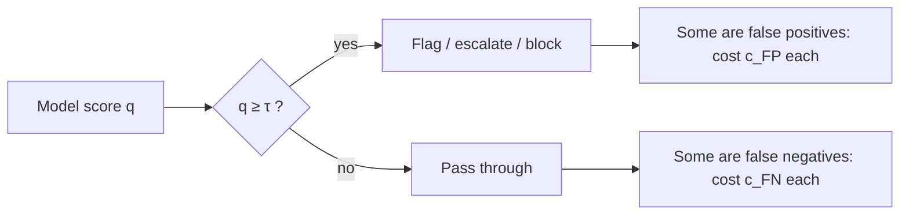

Most classifiers and judges in an LLM system do not output "yes" or "no". They output a **score**: a probability that a message is an attack, a confidence that a ticket needs a human, a 0-to-1 grade from a judge model. Someone has to pick the **threshold** $\tau$ above which the score counts as "yes". That single number decides the precision and recall you get.

Move the threshold down and you say "yes" more often: recall rises, precision falls. Move it up and the reverse happens. There is no setting that is best in the abstract. The right threshold is the one that makes the cheapest mix of mistakes for *your* product, which means you have to put a price, even a rough one, on each kind of mistake.

## The maths: expected cost of an operating point

Let $c_{FP}$ be the cost of one false positive and $c_{FN}$ the cost of one false negative. At threshold $\tau$ the classifier produces counts $FP(\tau)$ and $FN(\tau)$ on a representative sample. The total cost is

$$
C(\tau) = c_{FP}\cdot FP(\tau) + c_{FN}\cdot FN(\tau)
$$

and you choose $\tau^* = \arg\min_\tau C(\tau)$: the threshold with the smallest cost. Costs can be in money, minutes of agent time, or any common unit; only their ratio $c_{FN}/c_{FP}$ affects which threshold wins.

```steps
Routing support tickets to a human
1,000 tickets, of which 100 truly need a human. An LLM scores each ticket; we test three thresholds.
---
$\tau = 0.3$: flags 245 tickets, catching $TP = 95$, so $FP = 150$, $FN = 5$. Precision $= 95/245 = 0.39$, recall $= 0.95$.
---
$\tau = 0.5$: flags 145, $TP = 85$, $FP = 60$, $FN = 15$. Precision $= 0.59$, recall $= 0.85$.
---
$\tau = 0.7$: flags 85, $TP = 65$, $FP = 20$, $FN = 35$. Precision $= 0.76$, recall $= 0.65$.
---
Price the errors: an unnecessary handoff costs 5 minutes of agent time ($c_{FP} = 5$); a missed one costs a 20-minute recovery ($c_{FN} = 20$). Costs: $C(0.3) = 5(150) + 20(5) = 850$, $C(0.5) = 5(60) + 20(15) = 600$, $C(0.7) = 5(20) + 20(35) = 800$. The middle threshold wins.
```

The same table summarised:

| Threshold | Flagged | TP | FP | FN | Precision | Recall | Cost ($c_{FP}=5$, $c_{FN}=20$) |
|---|---|---|---|---|---|---|---|
| 0.3 | 245 | 95 | 150 | 5 | 0.39 | 0.95 | 850 |
| 0.5 | 145 | 85 | 60 | 15 | 0.59 | 0.85 | **600** |
| 0.7 | 85 | 65 | 20 | 35 | 0.76 | 0.65 | 800 |

Now change the business: if a missed escalation means a regulatory complaint costing 50 units, $C(0.3) = 750 + 250 = 1000$, $C(0.5) = 300 + 750 = 1050$, $C(0.7) = 100 + 1750 = 1850$, and the low threshold wins. Same model, same scores, different correct threshold. This is why a threshold is a product decision and belongs in the success criteria, not buried in code.

## The decision rule behind it

If the score is a well-calibrated probability $q$ that the item is positive, flagging it costs $c_{FP}(1-q)$ in expectation and not flagging costs $c_{FN}\,q$. Flag when the second is larger:

$$
c_{FN}\, q > c_{FP}(1-q) \iff q > \frac{c_{FP}}{c_{FP} + c_{FN}}
$$

With $c_{FP} = 5$ and $c_{FN} = 20$ this gives $q > 5/25 = 0.2$. Our empirical search picked 0.5, not 0.2: the scores from an LLM are usually not calibrated probabilities, so you choose the threshold on labelled data, as above, rather than trusting the formula. The formula is still useful for intuition: the more expensive misses are, the lower the threshold should go.

## Constraint form: "at least this recall"

Sometimes costs are hard to price, but a hard requirement exists: "catch at least 90% of prompt-injection attempts". Then you fix recall $\ge 0.9$ and choose the highest threshold that still meets it, which gives the best precision available under the constraint. The guardrail lesson in the production module plays with exactly this trade-off.



## In practice

Pick the threshold on one labelled set and report performance on another; otherwise the reported precision and recall are optimistic. Re-check the threshold whenever the model, the prompt or the traffic mix changes, because the score distribution moves even when the threshold does not. And log the score itself, not just the decision, so you can re-run threshold analysis later without re-scoring everything.

```quiz
{"q": "Using the table above, a new policy makes false positives cost 10 and false negatives cost 20. Which threshold has the lowest cost?", "options": ["0.3 (cost 1600)", "0.5 (cost 900)", "0.7 (cost 900)", "0.5 and 0.7 tie at 900"], "answer": 3, "explain": "$C(0.3) = 10(150) + 20(5) = 1600$; $C(0.5) = 10(60) + 20(15) = 900$; $C(0.7) = 10(20) + 20(35) = 900$. They tie, so you would choose on other grounds (for example, reviewer workload favours 0.7)."}
```

```quiz
{"q": "For a calibrated score, misses cost 9 times as much as false alarms. Above what probability should you flag?", "options": ["0.9", "0.5", "0.1", "0.11"], "answer": 2, "explain": "Flag when $q > c_{FP}/(c_{FP} + c_{FN}) = 1/(1 + 9) = 0.1$. Answering 0.9 inverts the costs; 0.11 is $1/9$, which forgets to add the two costs in the denominator."}
```
