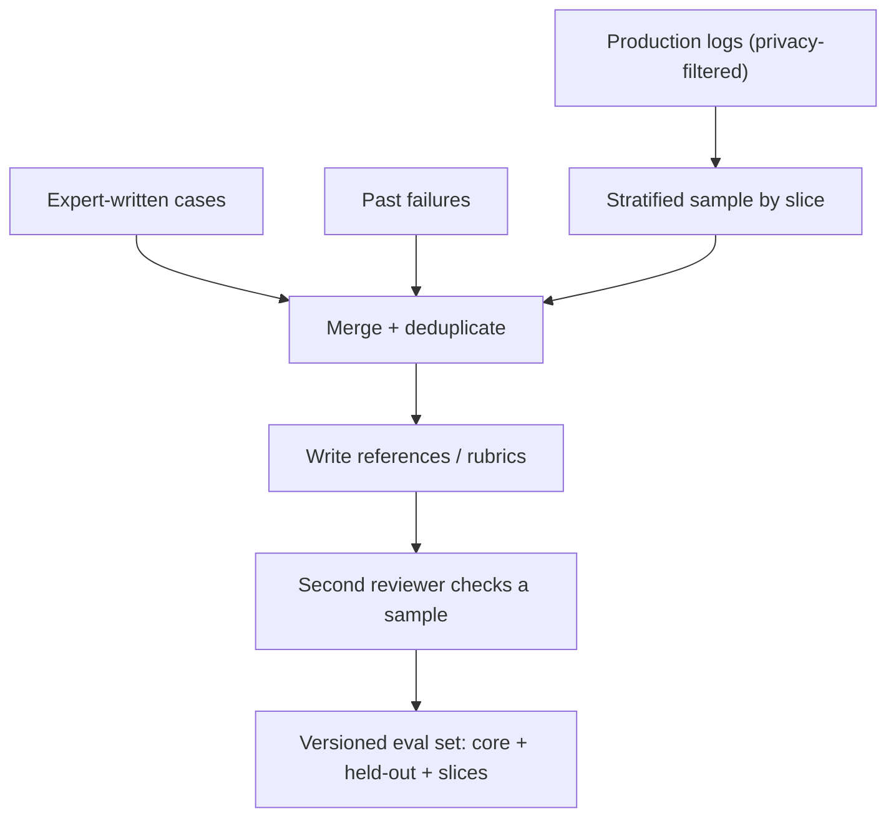

A metric is only as meaningful as the examples it is averaged over. Score a customer-support bot on 300 polite, English, single-question tickets and you will learn how it handles polite, English, single-question tickets. Real traffic includes typos, angry customers, three questions in one message, other languages, and people trying to make the bot misbehave.

An **eval set** (also called a golden set or test set) is a fixed, versioned collection of inputs, each with whatever is needed to score the output: a reference answer, a rubric, or a list of facts that must appear. Its job is to be a small, faithful model of the inputs your system will face, plus deliberate extra coverage of the cases that matter most.

## Where examples come from

| Source | Strength | Weakness |
|---|---|---|
| Sampled production logs | realistic phrasing and mix | needs privacy review; references must be written |
| Hand-written by domain experts | covers known important cases | too clean; misses what users actually do |
| Past failures and bug reports | targets known weaknesses | over-represents what already broke |
| Synthetic (generated by a model) | cheap, can fill rare slices | can be repetitive and easier than real data |
| Adversarial / red-team prompts | covers safety and abuse | not representative of normal traffic |

Most good eval sets combine them in **slices**: a representative core sampled from real traffic, plus targeted slices for rare but important behaviour. Report each slice separately, because a single average lets a large easy slice hide a small broken one.

## The maths: how many examples do you need?

Lesson 4 treats comparisons; here the question is simpler: how many examples does it take to measure one system's pass rate to within a chosen **margin of error** $E$ at 95% confidence? Start from the 95% range $\hat p \pm 1.96\,\sqrt{p(1-p)/n}$ and require the half-width to be at most $E$:

$$
1.96\sqrt{\frac{p(1-p)}{n}} \le E \quad\Longrightarrow\quad n \ge \frac{1.96^2\, p(1-p)}{E^2}
$$

Here $p$ is your best guess of the pass rate (use 0.5 if you have no idea, since $p(1-p)$ is largest there, giving the most conservative $n$).

```steps
Sizing the core set
You expect a pass rate near $p = 0.8$ and want the estimate within $E = 0.03$ (±3 points).
---
$p(1-p) = 0.8 \times 0.2 = 0.16$, and $1.96^2 = 3.8416$.
---
$n \ge 3.8416 \times 0.16 / 0.03^2 = 0.6147 / 0.0009 = 683$.
---
Relax to $E = 0.05$: $n \ge 0.6147/0.0025 = 246$. Knowing nothing about $p$ and wanting ±3 points: $n \ge 3.8416 \times 0.25 / 0.0009 = 1068$.
```

So a few hundred examples gives a usable estimate of one number. A slice of 40 examples has a margin around ±12 points at $p = 0.8$, which is enough to spot a slice that is badly broken, but not to track small changes on it.

## Contamination and leakage

An eval set must not overlap with what the system learned from or was tuned on:

- **Training contamination**: public benchmarks are often present in model pretraining data. High scores on them can reflect memorisation. Prefer private, recent examples for decisions that matter.
- **Prompt leakage**: if your few-shot examples are copied from the eval set, the model sees the answers.
- **Tuning leakage**: iterating on a prompt while watching the eval score slowly fits the prompt to those examples. Keep a separate **held-out** set that you score only at milestones.

## Writing references that hold up

For each example record the input, the expected answer or rubric, the slice tags, and where it came from. Write references that a checker can apply: list the required facts ("refund window: 30 days", "must mention the returns portal") instead of one ideal paragraph that a correct but differently worded answer would fail to match. Have a second person review a sample of references; a few percent of wrong references is common and silently caps your measured accuracy.



## In practice

Start with 50 to 100 examples so the loop exists at all, then grow toward several hundred as decisions get finer. Refresh the set periodically from new traffic, because what users ask drifts. Version the set like code: if the set changes, scores from the old and new versions are not comparable, so re-run the baseline on the new version before comparing.

```quiz
{"q": "You expect a pass rate around 90% and want a ±2 point margin at 95% confidence. Approximately how many examples do you need?", "options": ["About 220", "About 860", "About 2400", "About 90"], "answer": 1, "explain": "$n \\ge 1.96^2 \\times 0.9 \\times 0.1 / 0.02^2 = 3.8416 \\times 0.09 / 0.0004 = 864$. Using $p = 0.5$ would give 2401, which is safe but larger than needed if you are confident $p$ is near 0.9."}
```

```quiz
{"q": "Your eval set is 95% simple English questions and 5% non-English. The overall score rises from 88% to 90% after a change. What should you check before celebrating?", "options": ["Nothing: a 2-point gain is significant", "The non-English slice separately, since it could have dropped sharply and still be hidden by the average", "Whether the eval set is larger than 1,000", "The latency only"], "answer": 1, "explain": "The 5% slice moves the average by at most 5 points even if it collapses entirely. Slice-level reporting is how you catch a regression that the overall number hides."}
```
