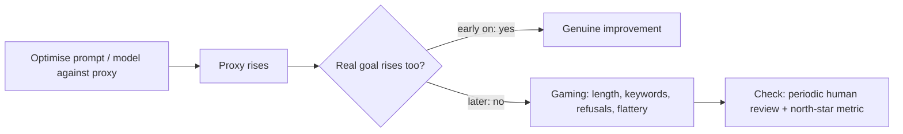

What you truly care about is usually slow or expensive to measure: did the user get their problem solved, did they come back next week, did the doctor trust the summary. So you measure something quicker that you believe moves with it: a judge score, a token-overlap metric, a thumbs-up rate. That quicker number is a **proxy metric**.

Proxies are indispensable and dangerous. The economist Charles Goodhart's observation, usually paraphrased as **Goodhart's law**, is that a measure which becomes a target stops being a good measure. Optimise hard against a proxy and you find the ways to raise it that do not raise the real goal. A summariser scored on keyword overlap learns to stuff keywords. A support bot scored on "conversation ended without escalation" learns to end conversations.

## A metric stack, not a single number

It helps to organise measures into layers:

| Layer | Question it answers | Example | Speed |
|---|---|---|---|
| North-star outcome | did users succeed? | resolved without human, retention | weeks |
| Online proxy | early sign of success | thumbs-up rate, follow-up question rate | days |
| Offline quality metric | is this version better on fixed inputs? | pass rate on eval set, judge score | minutes |
| Guardrails | did anything break? | safety violations, latency p95, cost | minutes to days |

Offline metrics earn their place only if they **predict** the layers above. That is testable.

## The maths: does the proxy track the goal?

Collect a few system versions, each with an offline score $x_i$ and a trusted measure $y_i$ (careful human ratings, or an online outcome). The **Pearson correlation** measures how well a straight line relates them:

$$
r = \frac{\sum_i (x_i - \bar x)(y_i - \bar y)}{\sqrt{\sum_i (x_i - \bar x)^2}\ \sqrt{\sum_i (y_i - \bar y)^2}}
$$

where $\bar x, \bar y$ are the means. $r = 1$ is a perfect increasing line, $r = 0$ no linear relation, $r = -1$ perfectly opposed.

```steps
Four prompt versions
Offline judge scores (on a 1–4 scale) $x = (1, 2, 3, 4)$; mean human rating $y = (2, 4, 5, 5)$. Means: $\bar x = 2.5$, $\bar y = 4$.
---
Deviations: $x - \bar x = (-1.5, -0.5, 0.5, 1.5)$ and $y - \bar y = (-2, 0, 1, 1)$.
---
Products sum to $3 + 0 + 0.5 + 1.5 = 5$. Squares: $\sum (x-\bar x)^2 = 2.25 + 0.25 + 0.25 + 2.25 = 5$ and $\sum (y - \bar y)^2 = 4 + 0 + 1 + 1 = 6$.
---
$r = 5 / \sqrt{5 \times 6} = 5/5.477 = 0.913$. The proxy tracks the human view well across these versions, although the last step (3 to 4) brought no human gain: an early hint of saturation.
```

With only four points, $r$ is itself very noisy; treat it as a sanity check, and prefer **rank agreement** (does the proxy order versions the same way humans do?) when what you use the metric for is picking a winner.

## How proxies get gamed



Patterns to watch for in LLM work:

- **Length gaming**: judge models and overlap metrics often reward longer answers. Watch average output length alongside the score.
- **Refusal gaming**: a safety metric that counts "harmful outputs" improves if the model refuses everything. Pair it with a helpfulness or over-refusal metric.
- **Format gaming**: a metric checking for "cites a source" is satisfied by a fabricated citation.
- **Eval-set overfitting**: after many iterations against the same examples, the score reflects those examples, not the task.

The fix is always some combination of **paired metrics** (each metric has a counter-metric that catches its easy exploit), **periodic human review** of a random sample, and checking that the north-star outcome moves when the proxy does.

## In practice

Before adopting a proxy, measure it on a few past versions where you already know which was better; if it cannot reproduce known decisions, it will not make good new ones. Write down, next to every metric, the easiest way a system could raise it without getting better. That one sentence usually tells you which counter-metric you need.

```quiz
{"q": "A team optimises its support bot for 'conversations closed without escalation' and the rate climbs from 70% to 85%. Customer satisfaction falls. What most likely happened?", "options": ["Satisfaction surveys are broken", "The bot learned to end or deflect conversations, raising the proxy without solving problems", "The eval set was too large", "Escalation is always bad, so this is fine"], "answer": 1, "explain": "This is Goodhart's law: the proxy became the target and was raised by behaviour that hurts the real goal. A counter-metric such as 'user re-contacts within 48 hours' would have caught it."}
```

```quiz
{"q": "Three versions have offline scores 1, 2, 3 and human ratings 3, 2, 1. What is the Pearson correlation?", "options": ["1", "0", "-1", "0.5"], "answer": 2, "explain": "Deviations are $(-1, 0, 1)$ and $(1, 0, -1)$; products sum to $-2$, each sum of squares is 2, so $r = -2/\\sqrt{4} = -1$. The proxy ranks versions exactly backwards, which is worse than useless."}
```
