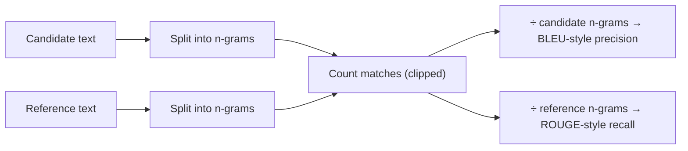

Token F1 ignores word order: "dog bites man" and "man bites dog" score a perfect 1.0 against each other. For longer outputs such as translations and summaries, two older metrics add a little order sensitivity by counting **n-grams**: runs of $n$ consecutive words. "the cat sat" contains the bigrams (2-grams) "the cat" and "cat sat".

The two metrics lean in opposite directions, and the names tell you which. **BLEU** came from machine translation and is precision-oriented: how many of the candidate's n-grams appear in the reference? **ROUGE** came from summarisation and is recall-oriented: how much of the reference does the candidate cover? You will meet both in papers and older benchmarks. Understanding them mainly helps you know when *not* to trust them.

## BLEU: clipped n-gram precision

For each $n$ from 1 to $N$ (usually $N = 4$), the **clipped precision** $p_n$ counts candidate n-grams that appear in the reference, but credits each one at most as many times as it occurs in the reference (so "the the the the" cannot score well against "the cat"):

$$
p_n = \frac{\sum_{g \in \text{n-grams}(\hat y)} \min\big(c_{\hat y}(g),\ c_y(g)\big)}{\sum_{g \in \text{n-grams}(\hat y)} c_{\hat y}(g)}
$$

Precision alone would reward a two-word candidate that happens to be correct, so BLEU multiplies by a **brevity penalty** that punishes candidates shorter than the reference. With candidate length $c$ and reference length $r$:

$$
\mathrm{BP} = \begin{cases} 1 & c \ge r \\ e^{\,1 - r/c} & c < r \end{cases}, \qquad \mathrm{BLEU} = \mathrm{BP}\cdot \exp\Big(\frac{1}{N}\sum_{n=1}^{N}\ln p_n\Big)
$$

The exponential of the average log is the **geometric mean** of the $p_n$, so if any $p_n$ is zero, BLEU is zero. Real implementations add smoothing for short texts, and corpus-level BLEU pools counts across all sentences before dividing.

```steps
BLEU-2 by hand
Reference: "the cat is on the mat". Candidate: "the cat sat on the mat". Both have 6 words, so $\mathrm{BP} = 1$.
---
Unigrams: candidate has the, cat, sat, on, the, mat. The reference contains "the" twice, so both are credited; cat, on, mat match; sat does not. $p_1 = 5/6 = 0.833$.
---
Bigrams: candidate has "the cat", "cat sat", "sat on", "on the", "the mat". Reference bigrams are "the cat", "cat is", "is on", "on the", "the mat". Matches: 3. $p_2 = 3/5 = 0.6$.
---
$\mathrm{BLEU\text{-}2} = 1 \times \sqrt{0.833 \times 0.6} = \sqrt{0.5} = 0.707$.
---
A 3-word candidate "the cat is" would have $p_1 = p_2 = 1$, but $\mathrm{BP} = e^{1 - 6/3} = e^{-1} = 0.368$, so BLEU-2 $= 0.368$.
```

## ROUGE-N and ROUGE-L

**ROUGE-N** is the recall twin: matched n-grams divided by the number of n-grams in the reference. **ROUGE-L** uses the **longest common subsequence** (LCS): the longest sequence of words that appears in both texts in the same order, not necessarily adjacent. With $\ell = \mathrm{LCS}(\hat y, y)$:

$$
R_{L} = \frac{\ell}{|y|}, \qquad P_{L} = \frac{\ell}{|\hat y|}, \qquad F_{L} = \frac{2 P_L R_L}{P_L + R_L}
$$

For the cat example, the LCS is "the cat on the mat" ($\ell = 5$), so $R_L = P_L = 5/6$ and $F_L = 0.833$. LCS rewards keeping the reference's order without demanding contiguous matches.



## Why these metrics struggle with LLM outputs

BLEU and ROUGE assume a good output looks like the reference. That held reasonably for phrase-based translation, where systems produced outputs close to human references. A modern LLM can write a perfectly good summary that shares few exact n-grams with the one reference you have, and a fluent but wrong one that shares many.

| Failure | Example | Effect |
|---|---|---|
| Paraphrase | "the firm's profits doubled" vs "earnings rose 100%" | low score for a correct output |
| Small factual error | "profits doubled in 2021" vs "...in 2022" | high score for a wrong output |
| One reference only | many valid summaries exist | scores depend on which one was written |
| Length effects | ROUGE recall rises with longer outputs | rewards verbosity |

Studies of summarisation and dialogue have repeatedly found weak correlation between these metrics and human judgements at the level of single outputs. They remain useful for **tracking** a fixed system over time on a fixed set, where systematic biases cancel, and for tasks where wording should be close to a reference (templated messages, translations of fixed strings).

## In practice

If you report BLEU, name the implementation and settings (tokenisation alone can move scores by several points); standard tools exist precisely to make numbers comparable. For LLM summaries and open answers, prefer claim-level checks ("does the summary state each of these five facts?") or a judge model with a rubric, and keep ROUGE as a cheap regression alarm rather than the decision metric.

```quiz
{"q": "Candidate: \"the cat\". Reference: \"the cat is on the mat\". What is the brevity penalty?", "options": ["1", "$e^{-2} \\approx 0.135$", "$e^{-3} \\approx 0.050$", "$1/3$"], "answer": 1, "explain": "$c = 2 < r = 6$, so $\\mathrm{BP} = e^{1 - 6/2} = e^{-2} \\approx 0.135$. Using $e^{-r/c} = e^{-3}$ forgets the $1 +$ in the exponent."}
```

```quiz
{"q": "A model's summary is fully correct but paraphrases the reference with almost no shared phrases. What do ROUGE-2 and a careful human say?", "options": ["Both high", "ROUGE-2 low, human high", "ROUGE-2 high, human low", "Both low"], "answer": 1, "explain": "ROUGE counts shared n-grams, so a paraphrase scores low even though it is correct. This false-fail pattern is why overlap metrics correlate weakly with human judgement for LLM outputs."}
```
