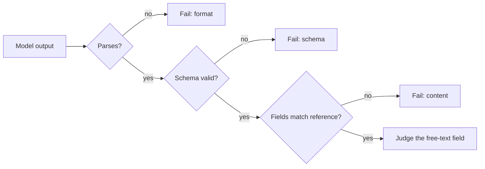

The most reliable metric is one that does not need to interpret language at all. If the output is supposed to be JSON matching a schema, parse it. If it is SQL, run it against a test database and compare the rows. If it is code, run the unit tests. If it is an email that must stay under 150 words and mention the order number, count the words and search for the number. These **programmatic checks** are exact, nearly free, and never disagree with themselves.

Many LLM tasks that look open-ended contain a checkable core. A support reply has free-form wording but a refund amount that must equal the policy figure. A summary has style but a list of entities that must all appear. Extracting those checkable pieces and testing them in code is usually the highest-value evaluation work you can do, and it leaves only the genuinely subjective part for judges.

## Execution-based scoring for code

For code generation, the standard metric is **functional correctness**: does the generated program pass hidden tests? Because sampling is random, one attempt can fail where another succeeds. That leads to **pass@k**: the probability that at least one of $k$ sampled attempts passes. It matters because many real workflows sample several candidates and keep one that passes the tests.

## The maths: an unbiased pass@k estimate

The naive approach (draw exactly $k$ samples per problem, record whether any passed) is noisy. Instead, draw $n \ge k$ samples per problem, count the $c$ that pass, and compute the probability that a random subset of $k$ of those $n$ contains at least one pass. A subset with no passes must be drawn entirely from the $n - c$ failures, so

$$
\text{pass@}k = 1 - \frac{\binom{n-c}{k}}{\binom{n}{k}}
$$

where $\binom{a}{b}$ is the number of ways to choose $b$ items from $a$ (and is 0 when $b > a$, which makes pass@k equal 1 whenever $n - c < k$). Average this over all problems.

```steps
pass@1 and pass@5 for one problem
Sample $n = 10$ programs; $c = 3$ pass the tests.
---
pass@1 $= 1 - \binom{7}{1}/\binom{10}{1} = 1 - 7/10 = 0.3$. For $k = 1$ the formula reduces to $c/n$, the plain pass rate.
---
pass@5: $\binom{7}{5} = 21$ ways to pick 5 failures, $\binom{10}{5} = 252$ ways to pick any 5.
---
pass@5 $= 1 - 21/252 = 1 - 0.0833 = 0.917$.
---
Compare with the tempting shortcut $1 - (1 - 0.3)^5 = 1 - 0.168 = 0.832$. That treats samples as independent draws with replacement; the combinatorial form is the exact estimate from the 10 samples you actually have.
```

## A menu of checks

| Output | Programmatic check | What it misses |
|---|---|---|
| JSON / function call | parses; validates against schema; required fields present | whether the values are right |
| Extracted fields | exact or numeric match per field, with tolerance | fields the schema does not cover |
| SQL | executes; result set equals the reference query's result | queries that are right by coincidence on the test data |
| Code | unit tests pass; no forbidden imports; runs within time limit | untested behaviour; style |
| Classification | label in allowed set; equals reference label | nothing, if the label set is right |
| Text constraints | length, language detected, contains required strings, no banned strings | everything about quality |

Notice the right column. Every check verifies a **necessary** condition, rarely a sufficient one. Valid JSON with wrong values passes the schema check. That is fine as long as you know which part of "correct" each check covers, and stack them: schema validity, then field accuracy, then a judge on the free-text field.



Ordering checks from cheapest to most expensive means most failures are caught before you pay for a judge call, and each failure gets a precise label, which feeds straight into error analysis (lesson 5).

## In practice

Write checks as ordinary unit tests over a fixed set of inputs and run them in CI. Report each stage's pass rate separately: "97% parse, 93% valid schema, 81% correct fields" tells you where to work far better than a single 81%. For code tasks, sandbox execution (no network, CPU and time limits), and watch for tests that are too weak: a model can pass a single test by hard-coding its expected output.

```quiz
{"q": "You sample $n = 5$ solutions to a problem and $c = 2$ pass. What is the unbiased pass@2?", "options": ["0.40", "0.64", "0.70", "0.80"], "answer": 2, "explain": "pass@2 $= 1 - \\binom{3}{2}/\\binom{5}{2} = 1 - 3/10 = 0.70$. The independence shortcut $1 - 0.6^2 = 0.64$ is the tempting wrong answer; 0.40 is pass@1."}
```

```quiz
{"q": "An extraction model's outputs are 99% valid JSON, but users report wrong invoice totals. Why didn't the eval catch it?", "options": ["JSON validation is unreliable", "Schema validity is a necessary condition only: it confirms the format, not that the values are right", "The eval set was too large", "pass@k should have been used"], "answer": 1, "explain": "A total of 0 or a copied subtotal is still a valid number. Add a field-level comparison against reference totals, with a numeric tolerance."}
```
