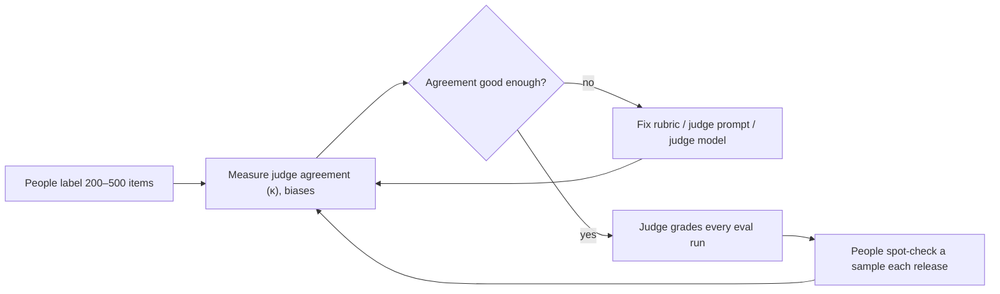

```callout-before
Before you start
This lesson builds on the confusion matrix and thresholds from [Success Criteria](/learn/evaluation/success-criteria). You do not need to know how judge models are trained; we treat a judge as a classifier whose behaviour we measure.
```

Reference metrics work when a correct answer has one shape. Most LLM outputs do not. A good reply to "my parcel is late and I'm furious" can take a hundred forms, and the question that matters ("is it accurate, polite, and does it offer the right next step?") needs reading comprehension to answer. Human reviewers can answer it, but they are slow and expensive, and they get tired.

The **LLM-as-judge** pattern hands that reading to a second model. You give the judge the input, the output, often a reference or source document, and a **rubric**, and ask for a verdict. It is the same idea as a teacher with a marking scheme: the scheme, not the teacher's mood, should decide the grade. Done carefully, a strong judge agrees with careful human reviewers about as often as two humans agree with each other on many tasks. Done carelessly, it produces confident, biased numbers.

## Two shapes of judge

- **Pointwise** (single-answer grading): the judge sees one output and returns a score or pass/fail against the rubric. Good for absolute thresholds ("ship if 90% pass").
- **Pairwise**: the judge sees two outputs for the same input and says which is better (or a tie). Good for comparing two versions; topic 3 compares the two in detail.

A pointwise judge prompt has a recognisable structure:

```steps
Anatomy of a judge prompt
**Role and task**: "You are grading customer-support replies against the policy below."
---
**Inputs**: the customer message, the reply to grade, and the relevant policy excerpt (the judge should check facts against a source, not its own memory).
---
**Rubric**: binary questions with a pass and fail example each. "Does the reply state the refund amount correctly? Does it offer the returns link? Does it avoid promising anything the policy does not allow?"
---
**Reasoning, then verdict**: ask for a short justification first, then the verdict in a fixed format such as `{"correct_amount": true, "offers_link": false, "verdict": "fail"}`.
---
**Determinism**: temperature 0, fixed judge model version, and the prompt itself versioned in the repository like any other code.
```

Asking for the reasoning before the verdict tends to make verdicts more consistent and gives you something to read when the judge is wrong. Binary rubric items are judged far more consistently than a single 1-to-10 score.

## The maths: is it worth it?

Judges are attractive mostly because of cost and speed. Suppose each judgement reads $t_{in}$ input tokens and writes $t_{out}$ output tokens, at prices $c_{in}$ and $c_{out}$ per million tokens. For $N$ items:

$$
\text{cost} = N \cdot \frac{t_{in}\, c_{in} + t_{out}\, c_{out}}{10^6}
$$

```steps
Judge vs human cost for 2,000 items
Each judgement: $t_{in} = 1500$ tokens (input, output, policy, rubric), $t_{out} = 200$ tokens. Prices: $c_{in} = 3$ and $c_{out} = 15$ (USD per million tokens).
---
Input: $2000 \times 1500 = 3{,}000{,}000$ tokens, costing $3 \times 3 = 9$ USD.
---
Output: $2000 \times 200 = 400{,}000$ tokens, costing $0.4 \times 15 = 6$ USD. Total: **15 USD**, finished in minutes.
---
Human review at 0.50 USD per item (fast, low-skill) is 1,000 USD and a few days; expert review at 5 USD per item is 10,000 USD.
```

The comparison is only meaningful if the judge's verdicts are trustworthy, which is what the rest of this lesson measures. The usual design is a hybrid: people label a few hundred items to validate the judge, the judge grades thousands, and people spot-check a random sample every time the judge or the task changes.



## Ground rules that prevent most problems

| Rule | Why |
|---|---|
| Give the judge the source or reference | it otherwise grades plausibility from its own memory |
| Use a stronger or different model than the one being graded | judges tend to favour outputs that resemble their own |
| Binary rubric items with examples | fine scales drift and disagree |
| Fix judge model version and temperature | otherwise scores move when the judge changes, not the system |
| Validate on human labels before trusting | a judge is a classifier with unknown precision and recall |

## In practice

Treat the judge prompt as a product: version it, test it on labelled examples, and record its agreement numbers alongside it. When a judge-reported score jumps, first check whether the judge changed (model version, prompt edit) before believing the system improved. And never let the system being evaluated see the judge's rubric during development in a way that lets it game the wording.

```quiz
{"q": "Each judgement uses 1,000 input and 100 output tokens. At 2 USD per million input and 10 USD per million output tokens, what do 5,000 judgements cost?", "options": ["10 USD", "15 USD", "5 USD", "60 USD"], "answer": 1, "explain": "Input: $5000 \\times 1000 = 5$M tokens × 2 = 10 USD. Output: $5000 \\times 100 = 0.5$M × 10 = 5 USD. Total 15 USD. Forgetting output tokens gives 10."}
```

```quiz
{"q": "Why ask the judge to cite the policy excerpt rather than grade from its own knowledge?", "options": ["It makes the prompt shorter", "Without the source, the judge rewards answers that sound plausible to it, including ones that contradict your actual policy", "Judges cannot read long inputs", "It removes position bias"], "answer": 1, "explain": "Correctness is relative to your source of truth. A judge relying on general knowledge will pass a fluent answer that matches typical policies but not yours. It does nothing for position bias, which needs order swapping."}
```
