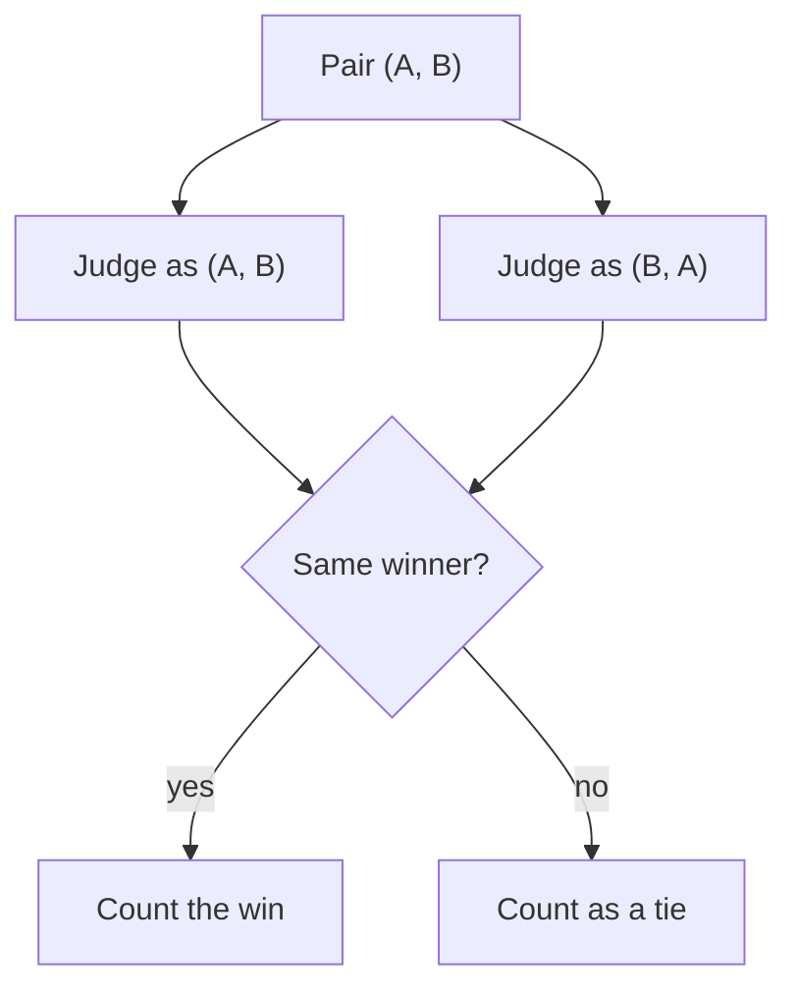

A judge is a model, and models have habits. Two habits show up in almost every pairwise judge. **Position bias** is a tendency to favour the answer shown first (or, for some models, the one shown second), regardless of content. **Verbosity bias** is a tendency to favour the longer answer, because length looks like effort and thoroughness. A related one, **self-preference**, is a tendency to favour outputs that resemble the judge's own writing.

None of these is a bug you can see in one verdict. Each is a statistical skew, visible only when you compare many verdicts under controlled changes. That is the method for this topic: change one irrelevant thing (the order, the length) and count how often the verdict changes.

## Measuring position bias: swap the order

Run every pair twice, once as (A, B) and once as (B, A). A judge with no position bias gives the same winner both times. Define the **swap-consistency rate**: the share of pairs where the same answer wins in both orders. Also count how often the *first* slot wins across all runs; with no bias that is 50%.

```steps
A swap test on 100 pairs
Each pair is judged in both orders: 200 verdicts in total.
---
In 70 pairs the same answer wins in both orders: swap-consistency $= 70/100 = 70\%$. Each of those pairs contributes exactly one first-slot win, so 70 first-slot wins.
---
In 30 pairs the verdict flips with the order. In 24 of them the judge picked whichever answer came first (2 first-slot wins each, 48), and in 6 it picked whichever came second (0 first-slot wins).
---
First-slot wins: $70 + 48 = 118$ of 200, so the first slot wins $59\%$ of the time instead of the unbiased 50%.
---
Those 30 flipped pairs are the ones the judge cannot decide on content. Treat them as ties, or exclude them.
```

The fix for the bias is built into the measurement. Judge both orders and combine. With a score margin $m^{AB}$ (positive favours A, from the (A, B) run) and $m^{BA}$ (from the (B, A) run, where A is now second), the debiased margin is

$$
m = \frac{m^{AB} + m^{BA}}{2}
$$

If the judge adds a constant bonus $\beta$ to whichever answer is first, then $m^{AB} = d + \beta$ and $m^{BA} = d - \beta$ where $d$ is the true margin for A, so the average is exactly $d$: the bias cancels.

## Measuring verbosity bias: control for length

Swapping cannot cancel verbosity bias, because the longer answer is long in both orders. Instead, look at pairs where the length cue and quality point in different directions. Take pairs where humans say the **shorter** answer is better, and check how often the judge still picks the longer one.

| Humans prefer | Number of pairs | Judge picks the longer answer |
|---|---|---|
| the longer answer | 100 | 90 |
| the shorter answer | 100 | 36 |
| overall | 200 | 126 (63%) |

If length carried no weight, the judge would pick the longer answer in the first row as often as it is right and in the second row only when it errs. A 36% rate of picking the longer answer in the second row means roughly a third of the pairs where length misleads are lost. Another test is to take a good answer, pad it with filler, and see whether the judge's score goes up.

```sim
judge-agreement
{"accuracy": 0.85, "positionBias": 0.6, "verbosityBias": 0, "tieBand": 0, "swapAverage": false, "seed": 11}
```

The simulation starts with a strong position bias and no verbosity bias. Note the agreement and kappa, and the share of pairs whose verdict changes when the order is swapped. Switch **Judge both orders and average** on: kappa recovers, because the position term cancels. Now set position bias to 0 and verbosity bias to 0.6 and toggle swap-averaging again: this time it barely helps, exactly as the maths says.

## Mitigations

| Bias | Mitigation | Limit |
|---|---|---|
| Position | judge both orders; average or require consistency | doubles the judge cost; some pairs become ties |
| Verbosity | rubric says "length is not a quality"; ask for the shortest sufficient answer; compare at matched length | prompts reduce but rarely remove it |
| Verbosity | statistically adjust: include a length term in the analysis | needs enough pairs |
| Self-preference | judge with a different model family than the one being graded | still imperfect |
| All | validate on human-labelled pairs; keep sampling for spot checks | cost of human labels |



## In practice

Always randomise or swap order in pairwise evals; it is the cheapest bias control there is. Log the average length of each system's outputs next to its win rate: a "win" that comes with a 40% longer answer deserves suspicion. When two systems are close, report the swap-consistency rate too, because a low rate tells you the judge was guessing on many pairs and the win rate is built on a thinner base than it looks.

```quiz
{"q": "In a swap test on 50 pairs, the same answer wins in both orders in 35 pairs. What is the swap-consistency rate, and what does a 'first slot wins 50%' result tell you?", "options": ["70%; nothing about bias on its own, since flips could split evenly between first-picks and second-picks", "35%; the judge has no position bias", "30%; the judge is unbiased", "70%; the judge is definitely unbiased"], "answer": 0, "explain": "$35/50 = 70\\%$. A balanced first-slot rate shows no net direction, but the 15 flipped pairs still show the judge is unstable on those pairs. Check both numbers."}
```

```quiz
{"q": "Why does averaging the verdicts from both orders cancel position bias but not verbosity bias?", "options": ["Verbosity bias is smaller", "A position bonus switches sides when the order swaps, so it averages out; a length bonus stays with the same answer in both orders", "Averaging only works for numeric scores", "Verbosity does not exist for strong judges"], "answer": 1, "explain": "With margins $d + \\beta$ and $d - \\beta$ the average is $d$. A length bonus goes to the longer answer in both runs, so averaging leaves it in place."}
```
