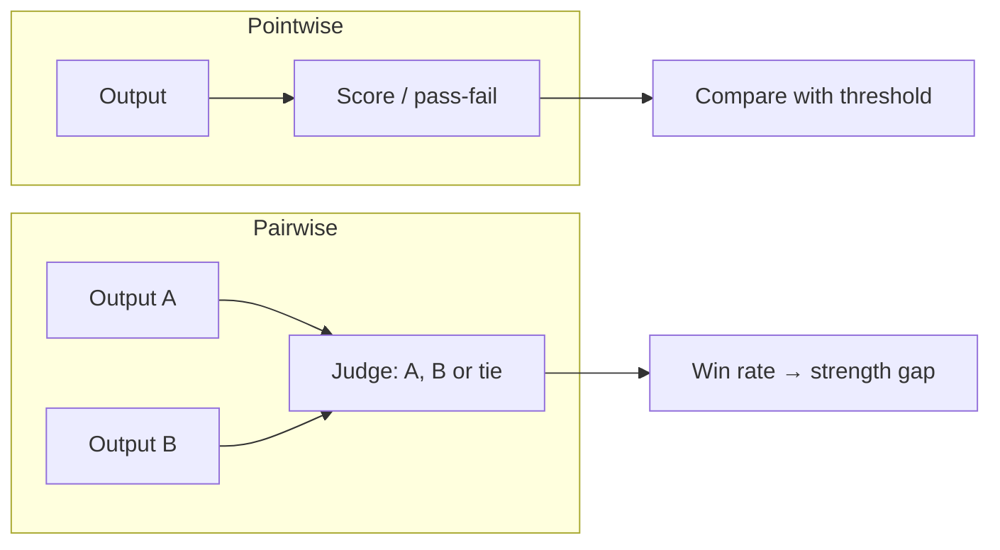

You can ask a judge two kinds of question. "Is this answer good?" (**pointwise**) returns a grade for one output. "Which of these two is better?" (**pairwise**) returns a preference. Each suits a different job, and mixing them up causes confusion about what the numbers mean.

Pointwise grades are absolute, so you can compare a score to a threshold, track it over months, and evaluate one system without needing a rival. They suffer from **scale drift**: what counts as a 4 out of 5 shifts between prompts and judge versions, and judges bunch their scores near the top. Pairwise preferences are relative and easier for a model, much as people find it easier to say which of two wines they prefer than to score each out of ten. The price is that they only compare, and the work grows quickly with the number of systems.

| | Pointwise | Pairwise |
|---|---|---|
| Question | does it meet the rubric? | which is better? |
| Output | pass/fail or score | A / B / tie |
| Good for | release gates, monitoring a single system | choosing between candidates |
| Weak spot | score drift, compressed scale | position bias, only relative |
| Cost for $k$ systems, $N$ items | $kN$ judgements | $\binom{k}{2}N$ pairs, double with order swap |

For 5 systems and 400 items, pointwise needs $5 \times 400 = 2000$ judgements. Pairwise with order swapping needs $\binom{5}{2} \times 400 \times 2 = 10 \times 400 \times 2 = 8000$.

## The maths: win rate with ties

For a pair of systems, count wins $w_A$, wins $w_B$ and ties $t$ across $N = w_A + w_B + t$ items. The usual **win rate** for A gives each tie half a win:

$$
\text{WR}_A = \frac{w_A + t/2}{N}
$$

so $\text{WR}_A + \text{WR}_B = 1$ and 0.5 means no preference.

```steps
A win rate from 250 pairs
Out of $N = 250$ items, A wins 120, B wins 80, and 50 are ties.
---
$\text{WR}_A = (120 + 50/2)/250 = 145/250 = 0.58$.
---
The ties matter: ignoring them gives $120/(120+80) = 0.60$. Counting a tie as a loss for A gives $120/250 = 0.48$, which flips the story, so say how ties were counted.
---
Standard error (treating each item as one Bernoulli trial at 0.58): $\sqrt{0.58 \times 0.42/250} = 0.031$. A 95% range is about $0.58 \pm 0.06$, i.e. 52% to 64%. A preference, but not a huge one.
```

## From win rate to a strength gap

The **Bradley-Terry** model says each system has a latent strength $s$, and the chance A beats B depends only on the difference:

$$
P(A \succ B) = \frac{1}{1 + e^{-(s_A - s_B)}} = \sigma(s_A - s_B)
$$

where $\sigma$ is the logistic function. Inverting gives the strength gap from an observed win rate $p$:

$$
s_A - s_B = \ln\frac{p}{1-p}
$$

For $p = 0.58$ the gap is $\ln(0.58/0.42) = 0.32$. A gap of 0 means 50%; a gap of 0.8 means $\sigma(0.8) = 0.69$. Arena-style leaderboards and Elo ratings are fitted versions of this idea: with many pairwise matchups you solve for one strength per system that best explains all the outcomes. The model also encodes **transitivity**, which real preferences sometimes break (A beats B, B beats C, C beats A), a reason to check the fit.



## In practice

Use pointwise binary rubrics for gates and monitoring, and pairwise judging for head-to-head decisions between a baseline and a candidate. Report the win rate, the tie rate, the sample size and the interval, never just "B wins 58%". For small differences, remember that a 52% vs 48% win rate on 250 items is well within noise (the interval above spans 0.5). Pairwise judging is also what preference-tuning data looks like (the preference-tuning lesson uses the same Bradley-Terry form), so judge quality and training-data quality are linked problems.

```quiz
{"q": "System A wins 90 comparisons, B wins 60, and 50 are ties (200 total). What is A's win rate counting ties as half a win?", "options": ["0.60", "0.45", "0.575", "0.675"], "answer": 2, "explain": "$(90 + 25)/200 = 115/200 = 0.575$. 0.60 ignores ties by dropping them; 0.45 counts ties as losses."}
```

```quiz
{"q": "Under the Bradley-Terry model, a win rate of 0.75 corresponds to a strength gap of about:", "options": ["0.75", "1.10", "0.25", "3.00"], "answer": 1, "explain": "$\\ln(0.75/0.25) = \\ln 3 = 1.10$. The odds ratio is 3, and the gap is the log odds, not the probability."}
```
