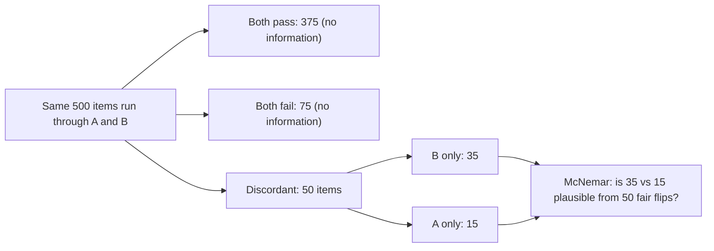

When two systems answer the same 500 questions, the questions are shared. Some are easy (both pass), some are hopeless (both fail), and neither kind tells you anything about which system is better. The informative items are the **discordant** ones, where exactly one system passes. Throwing the shared difficulty into the noise, as the unpaired test does, wastes information.

Think of two runners timed over the same ten courses. Course difficulty makes both times vary a lot, but the *difference* between runners on each course is much steadier. Pairing removes the course-to-course noise.

## The 2×2 table

Cross-tabulate the two systems' results item by item:

| | B passes | B fails |
|---|---|---|
| **A passes** | $a$ (both) | $c$ (A only) |
| **A fails** | $b$ (B only) | $d$ (neither) |

Using our running example (A passes 390, B passes 410, $n = 500$) with $b = 35$ and $c = 15$: both pass $a = 375$, neither passes $d = 500 - 375 - 35 - 15 = 75$.

| | B passes | B fails | Total |
|---|---|---|---|
| **A passes** | 375 | 15 | 390 |
| **A fails** | 35 | 75 | 110 |
| **Total** | 410 | 90 | 500 |

The difference in pass rates depends only on the discordant cells: $\hat p_B - \hat p_A = (b - c)/n = 20/500 = 0.04$.

## The maths: McNemar's test

Under the null (no real difference), each discordant item is equally likely to favour either system, so among the $b + c$ discordant items the number favouring B is Binomial$(b + c, \tfrac12)$. With a normal approximation, **McNemar's test** statistic is

$$
\chi^2 = \frac{(b - c)^2}{b + c}, \qquad z = \frac{b - c}{\sqrt{b + c}}
$$

$\chi^2$ is compared with the chi-squared distribution with one degree of freedom (equivalently, $z$ with the normal; $\chi^2 = z^2$). The 5% critical value of $\chi^2_1$ is 3.84.

```steps
McNemar on the same 78% vs 82% data
Discordant counts: $b = 35$ (B right, A wrong) and $c = 15$ (A right, B wrong). $b + c = 50$.
---
$\chi^2 = (35 - 15)^2/50 = 400/50 = 8.0$. Equivalent $z = 20/\sqrt{50} = 2.83$.
---
$p = 2(1 - \Phi(2.83)) = 0.0047$. The exact binomial version (probability of 35 or more out of 50 fair coin flips, doubled) is $p = 0.0066$.
---
Significant. The unpaired test on identical pass rates gave $p = 0.114$; pairing turns an inconclusive result into a clear one.
---
Interval for the gap: $\mathrm{SE} = \frac{1}{n}\sqrt{b + c - (b-c)^2/n} = \frac{\sqrt{50 - 0.8}}{500} = 0.0140$, so $0.04 \pm 1.96 \times 0.0140 = (0.0125,\ 0.0675)$. Compare the unpaired interval $(-0.0095, 0.0895)$: about 45% narrower.
```

Why is it so much stronger? The unpaired standard error (0.0253) counts all the variation in who passes. The paired one (0.0140) counts only the 50 items where the systems disagreed. The more the systems agree on most items (as two versions of the same prompt typically do), the larger the gain.

## See it

The pairing is easiest to see by contrasting with the unpaired simulation, which treats the arms as independent.

```sim
ab-significance
{"pA": 0.78, "pB": 0.82, "n": 500, "alpha": "0.05"}
```

This shows $p = 0.114$ for the unpaired reading of the same data. Your McNemar result above ($p \approx 0.005$) is what you get by recognising that both systems saw the same items. To feel how the result depends on disagreement rather than on pass rate, imagine setting $n = 500$ for the sim but keeping the pass rates fixed: the unpaired sim can never exploit shared items, which is exactly why pairing matters.



## Paired tests for scores, not just pass/fail

For graded scores (a judge's 1–5 grade, a token F1), compute the per-item difference $\delta_i = s_{B,i} - s_{A,i}$, take their mean $\bar\delta$ and standard deviation $s_\delta$, and use the interval $\bar\delta \pm 1.96\, s_\delta/\sqrt{n}$ (a **paired t-test** for small $n$). It has exactly the same logic: the interval depends on the spread of the differences, not of the scores.

## In practice

Always run both systems on the identical items, and store per-item results so paired analysis is possible. Report $b$ and $c$ (the wins and losses), not only the pass rates: "B fixed 35 items and broke 15" is far more informative than "78% to 82%", and the 15 broken items are where error analysis should start. If the discordant count $b + c$ is small (under about 25), use the exact binomial form rather than the normal approximation.

```quiz
{"q": "Systems A and B are run on the same 200 items. B only passes 18, A only passes 6, and the rest agree. What is McNemar's $\\chi^2$?", "options": ["6.0", "12.0", "144", "0.72"], "answer": 0, "explain": "$(18 - 6)^2/(18 + 6) = 144/24 = 6.0$, which exceeds 3.84, so the difference is significant at 0.05. Dividing by $n = 200$ instead of $b + c$ gives 0.72 and misses the point that only discordant items count."}
```

```quiz
{"q": "Why can a paired test detect a difference that an unpaired test on the same pass rates cannot?", "options": ["It uses a larger sample", "It cancels item difficulty shared by both systems, leaving only the discordant items as noise", "It assumes B is better", "It uses a one-sided threshold"], "answer": 1, "explain": "Items both systems pass or both fail carry no information about which is better. The paired test's variance depends only on discordant items, which is much smaller when the systems largely agree."}
```
