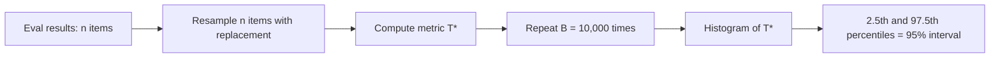

The standard error formulas so far work for pass rates and simple differences. But LLM evals produce messier quantities: a median latency, an F1 averaged over classes, the difference between two judge-based win rates, the ratio of costs. Each would need its own derivation. The **bootstrap** sidesteps all of them with one idea: treat the eval set as if it were the whole population, and re-run the experiment on it many times by resampling.

To resample, draw $n$ items **with replacement** from your $n$ items. Some items appear twice or three times, others not at all. Compute your metric on that resampled set. Repeat thousands of times. The spread of the resulting values approximates how much the metric would vary across real fresh samples.

## The algorithm

For a metric $T$ (any function of the data) on a dataset of $n$ items:

1. For $b = 1, \dots, B$ (typically $B = 10{,}000$): draw a bootstrap sample of $n$ items with replacement; compute $T_b^{*}$.
2. The **bootstrap standard error** is the standard deviation of $T_1^*, \dots, T_B^*$.
3. The **percentile interval** at 95% is the range from the 2.5th to the 97.5th percentile of the $T_b^*$: sort them and read off the values at positions $0.025B$ and $0.975B$.



```python
import random

def paired_bootstrap(deltas, reps=10_000, seed=7):
    """deltas[i] = score_B[i] - score_A[i] (1, 0 or -1 for pass/fail data)."""
    rng = random.Random(seed)
    n = len(deltas)
    means = sorted(sum(rng.choices(deltas, k=n)) / n for _ in range(reps))
    return means[int(0.025 * reps)], means[int(0.975 * reps)]

# 35 items B fixed, 15 items B broke, 450 items unchanged (from the McNemar topic)
deltas = [1] * 35 + [-1] * 15 + [0] * 450
print(paired_bootstrap(deltas))   # about (0.012, 0.068)
```

Resampling **paired items** (keeping each item's A and B results together) is the key: it preserves the pairing, and the bootstrap interval for the same data comes out at about $(0.012,\ 0.068)$ for the gap, matching the McNemar interval $(0.0125, 0.0675)$. The result is checkable: the sample mean of the resampled gaps is about 0.040.

## Why it works, and a small hand example

The resampled datasets are plausible alternative worlds consistent with what you saw. If a handful of items drive the difference, resamples that happen to drop them will show a smaller gap, and the interval widens to say so.

```steps
A tiny bootstrap by hand
Five paired differences (B minus A): $\delta = (1, 0, 1, -1, 0)$. Mean $\bar\delta = 1/5 = 0.2$.
---
Resample 1: draw 5 with replacement, say items 1, 1, 3, 5, 2 giving $(1, 1, 1, 0, 0)$, mean $0.6$.
---
Resample 2: items 4, 5, 5, 2, 4 giving $(-1, 0, 0, 0, -1)$, mean $-0.4$.
---
Resample 3: items 1, 2, 3, 3, 5 giving $(1, 0, 1, 1, 0)$, mean $0.6$.
---
Repeat 10,000 times: the means spread from about $-0.4$ to $0.8$ for $n = 5$, a very wide interval that honestly says "five items tell you almost nothing".
```

## When to use which tool

| Situation | Method |
|---|---|
| One pass rate | formula (or Wilson interval for extremes) |
| Two systems, pass/fail, same items | McNemar or paired bootstrap |
| Two systems, graded scores, same items | paired t-test or paired bootstrap |
| Medians, percentiles (latency p95), ratios, F1, anything unusual | bootstrap |
| Data in clusters (turns within conversations) | cluster bootstrap: resample whole clusters |

Bootstrap limitations: it needs a reasonably representative sample, since it cannot invent cases you did not collect; extreme statistics such as the maximum are unreliable; and with very small $n$ (under about 20) the percentile interval tends to be too narrow. It also costs compute, though evaluating a stored table of per-item scores 10,000 times takes seconds.

## In practice

Store the per-item score table from every eval run (item id, system, score). With it you can bootstrap any new summary you invent without re-running the model. For latency and cost, which are skewed with long tails, bootstrap the percentile you care about (p95) rather than reporting a mean with a normal-theory interval. Fix the random seed so reports are reproducible.

```quiz
{"q": "In a bootstrap, why do you resample with replacement?", "options": ["To make resampled sets smaller than the original", "So each resample has the same size as the original but a different mix of items, mimicking a fresh sample", "To remove outliers", "Because sampling without replacement would be too slow"], "answer": 1, "explain": "Without replacement, drawing $n$ from $n$ just reproduces the original data. With replacement, each resample varies, and the spread of the metric across resamples estimates its sampling variability."}
```

```quiz
{"q": "You bootstrap the gap between two systems evaluated on the same items, but resample A's results and B's results independently. What goes wrong?", "options": ["Nothing", "The pairing is destroyed, so the interval is too wide, ignoring the benefit of shared item difficulty", "The interval becomes too narrow", "The metric becomes biased upward"], "answer": 1, "explain": "Independent resampling treats the arms as unrelated, which is the unpaired analysis. On the running example it gives roughly $(-0.010, 0.088)$ instead of the paired $(0.012, 0.068)$."}
```
