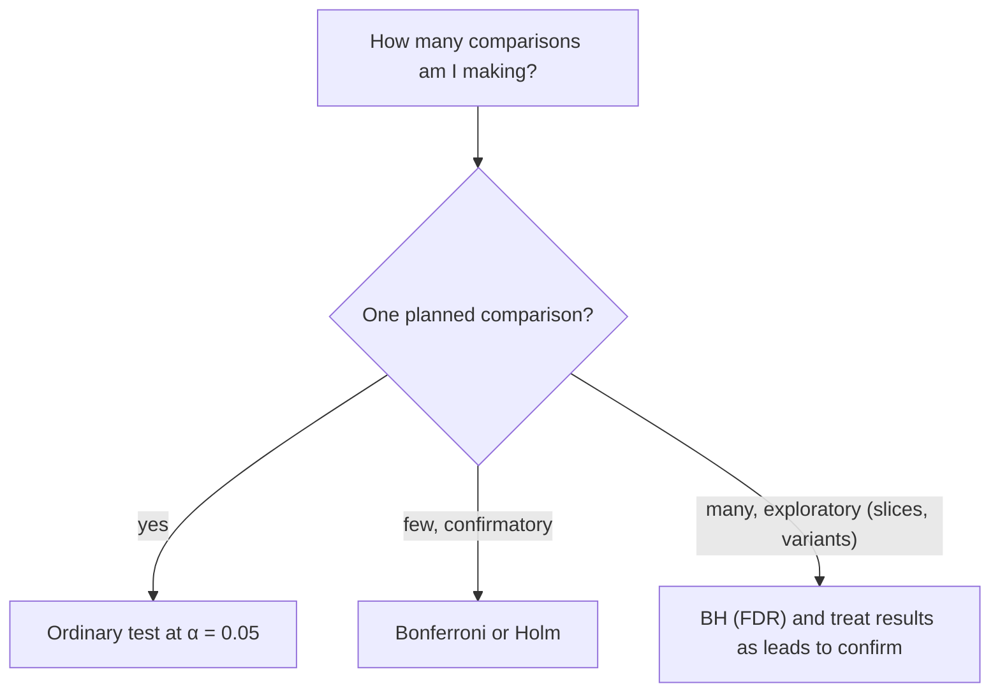

If a casino sold lottery tickets at one in twenty odds, you would not be shocked that someone buying twenty tickets won once. Statistical tests have the same property. A test at $\alpha = 0.05$ has a 5% chance of a false alarm when there is no real effect. Run many tests and some will come out "significant" by luck alone.

Evaluation invites this constantly. You try ten prompt variants, compare each against the baseline, report the best one. Or you split results into eight slices and highlight the slice where the new model "significantly" wins. Each of those is a **multiple comparisons** problem, and the nominal 5% no longer describes your real false-positive risk.

## The maths: family-wise error

If you run $m$ independent tests, each at level $\alpha$, and every null is true, the probability of at least one false positive is the **family-wise error rate**:

$$
\mathrm{FWER} = 1 - (1 - \alpha)^m
$$

```steps
How fast the false-alarm rate grows
$\alpha = 0.05$ per test, all variants actually identical to baseline.
---
$m = 1$: $1 - 0.95 = 0.05$.
---
$m = 5$: $1 - 0.95^5 = 1 - 0.774 = 0.226$.
---
$m = 10$: $1 - 0.95^{10} = 1 - 0.599 = 0.401$. Comparing ten useless variants gives a 40% chance of a "significant" winner.
---
$m = 20$: $1 - 0.95^{20} = 0.642$.
```

## Corrections

**Bonferroni** simply tightens each test: use $\alpha/m$ as the per-test threshold. For 10 comparisons that is $0.05/10 = 0.005$, and the family-wise error becomes $1 - (1 - 0.005)^{10} = 0.049$, about the intended 5%. It is simple, safe and conservative, so power drops. In terms of effort: at $\alpha = 0.005$, $z_{\alpha/2} = 2.81$, so $(2.81 + 0.84)^2 = 13.3$ instead of 7.85, about 70% more data per comparison.

**Holm's method** is uniformly more powerful and equally safe. Sort the p-values $p_{(1)} \le \dots \le p_{(m)}$. Compare the smallest with $\alpha/m$, the next with $\alpha/(m-1)$, and so on; stop at the first one that fails, and declare only the earlier ones significant.

**Benjamini-Hochberg (BH)** controls a different quantity, the **false discovery rate** (FDR): the expected share of your declared discoveries that are false. Sort the p-values; find the largest $k$ with $p_{(k)} \le \frac{k}{m}q$ (where $q$ is the target FDR); declare the $k$ smallest significant. It is looser than Bonferroni and suits exploratory work with many slices.

```steps
Five slice comparisons, three corrections
Sorted p-values: 0.004, 0.012, 0.030, 0.041, 0.20. Target $\alpha = q = 0.05$, $m = 5$.
---
Uncorrected: four of five are below 0.05: "four significant slices".
---
Bonferroni: threshold $0.05/5 = 0.01$. Only 0.004 passes.
---
Holm: 0.004 vs $0.05/5 = 0.01$ passes; 0.012 vs $0.05/4 = 0.0125$ passes; 0.030 vs $0.05/3 = 0.0167$ fails, stop. Two significant.
---
BH: thresholds $k \times 0.05/5$ are 0.01, 0.02, 0.03, 0.04, 0.05. The largest $k$ with $p_{(k)} \le$ threshold is $k = 3$ (0.030 ≤ 0.03), so three are significant (0.041 > 0.04 and 0.20 > 0.05 fail).
```

The same data yields four, one, two or three "findings" depending on the stance you took. The correct stance is the one you chose *before* looking.



## Other ways to fool yourself

- **Choosing the best of many variants, then reporting its score.** The winner's score is biased upward (selection bias). Confirm on fresh data before believing the number.
- **Slicing until something is significant.** The more slices you inspect, the more false leads. Pre-register the important slices, treat the rest as exploration.
- **Peeking and stopping early**, discussed earlier, is also a multiple-comparisons problem across time.
- **Re-running until it passes.** A flaky eval run repeated three times and the best taken has a hidden $m = 3$.

## In practice

Name the one primary comparison before the experiment: a single baseline, a single candidate, a single metric. Everything else is secondary and labelled exploratory. When you must compare many variants, hold out a fresh confirmation set and evaluate only the winner on it, a procedure that keeps the headline number honest at the cost of some data. Count your comparisons honestly: the ones you tried in notebooks and discarded count too.

```quiz
{"q": "You compare 8 prompt variants against a baseline at $\\alpha = 0.05$ each, and none truly differs. Roughly what is the chance that at least one looks significant?", "options": ["5%", "34%", "40%", "8%"], "answer": 1, "explain": "$1 - 0.95^8 = 1 - 0.663 = 0.337$. 5% applies to a single test; 40% is the figure for 10 tests."}
```

```quiz
{"q": "Sorted p-values are 0.001, 0.009, 0.02, 0.4 with $m = 4$, $\\alpha = 0.05$. How many are significant under Bonferroni?", "options": ["3", "2", "1", "4"], "answer": 1, "explain": "The Bonferroni threshold is $0.05/4 = 0.0125$. 0.001 and 0.009 pass; 0.02 does not. Three would be the uncorrected count at 0.05 (0.001, 0.009, 0.02)."}
```

```lab
is-it-really-better
```
