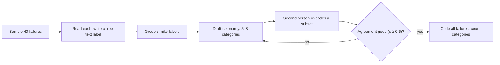

```callout-before
Before you start
This lesson needs an eval run with per-item results: for every example, the input, the output, the score. If you only keep the average, start by changing that.
```

An 80% pass rate is a thermometer reading. It says the patient has a fever, not what the infection is. To improve a system you need to know **why** the 20% fail, and that requires reading the actual failing outputs. This is the single most productive and most skipped step in LLM work. Fifteen minutes with 30 failures usually tells you more than a day of prompt tweaking in the dark.

The method comes from qualitative research and is called **open coding**. You read each failure and write a short, descriptive label for what went wrong, without deciding the categories in advance. Labels repeat; similar ones get merged; and a small set of categories (the **taxonomy**) emerges from the data rather than from your assumptions.

## Step 1: sample the failures properly

You rarely need to read all failures. A random sample is enough to reveal the common causes, and the arithmetic of rare categories tells you how big it needs to be. If a failure category accounts for a share $q$ of failures, the chance that a random sample of $k$ failures contains at least one of them is

$$
P(\text{see it}) = 1 - (1 - q)^k
$$

```steps
How many failures must you read?
A cause accounts for 5% of failures ($q = 0.05$). You read $k$ failures at random.
---
$k = 20$: $1 - 0.95^{20} = 1 - 0.358 = 0.64$. You would miss it a third of the time.
---
$k = 50$: $1 - 0.95^{50} = 1 - 0.077 = 0.92$.
---
To be 95% sure of seeing it: $k = \ln(0.05)/\ln(0.95) = 58.4$, so about 59 failures.
---
For a 20% cause, $k = 14$ is enough for 95%. So: 30 to 50 failures finds all the large causes; 100+ also surfaces the smaller ones.
```

Sample randomly, not "the ones that look interesting", which biases you towards memorable oddities. Also read a handful of **passes**: sometimes a metric marks an output as passing for the wrong reason, and the only way to find that is to look.

## Step 2: code each failure

For each sampled failure, record:

1. What the user asked, and what the system answered (read the whole trace if there is retrieval or tool use).
2. What would a correct answer have looked like?
3. A short free-text label for the first thing that went wrong, such as "cited the 2022 policy, not the 2024 one" or "answered in English to a Spanish question".

Label the *first point of failure* in a pipeline: if retrieval fetched the wrong document, "wrong document retrieved" is the cause even though the final answer was also fluent and wrong.



## Step 3: check the coders agree

A taxonomy is only useful if two people would put the same failure in the same category. Re-use Cohen's kappa from lesson 3. Two coders independently label 40 failures as "retrieval problem" or "not": both say yes 12, coder 1 yes and coder 2 no 3, coder 1 no and coder 2 yes 2, both no 23.

$$
p_o = \frac{12 + 23}{40} = 0.875, \qquad q_1 = \frac{15}{40} = 0.375,\ q_2 = \frac{14}{40} = 0.35
$$

$$
p_e = 0.375 \times 0.35 + 0.625 \times 0.65 = 0.131 + 0.406 = 0.5375, \qquad \kappa = \frac{0.875 - 0.5375}{1 - 0.5375} = 0.73
$$

A kappa of 0.73 is good. If it comes out near 0.3, the category definitions are vague: rewrite them with examples and re-code.

## In practice

Use a spreadsheet: one row per failure, columns for the id, input, output, expected, label and notes. Time-box the first pass (an hour for 40 failures). Write the labels in plain words as you go; resist tidy categories until you have read at least 20, because early categories tend to be wrong. And do this regularly: every release, because the dominant failure mode changes as you fix things.

```quiz
{"q": "A failure category makes up 10% of all failures. About how many randomly sampled failures must you read to have a 90% chance of seeing at least one?", "options": ["10", "22", "50", "90"], "answer": 1, "explain": "$1 - 0.9^k \\ge 0.9 \\Rightarrow k \\ge \\ln 0.1/\\ln 0.9 = 21.9$, so 22. The tempting 10 reflects 'one in ten', but a sample of 10 contains the category only $1 - 0.9^{10} = 65\\%$ of the time."}
```

```quiz
{"q": "A RAG answer is wrong because the retriever fetched an outdated document, and the generator faithfully summarised it. How should you label the failure?", "options": ["Hallucination", "Generator error", "Retrieval error: outdated document, since that is where the first thing went wrong", "Bad prompt"], "answer": 2, "explain": "Label the first point of failure. The generator behaved correctly given its context, so changing the prompt would not help; fixing retrieval or document freshness would."}
```
