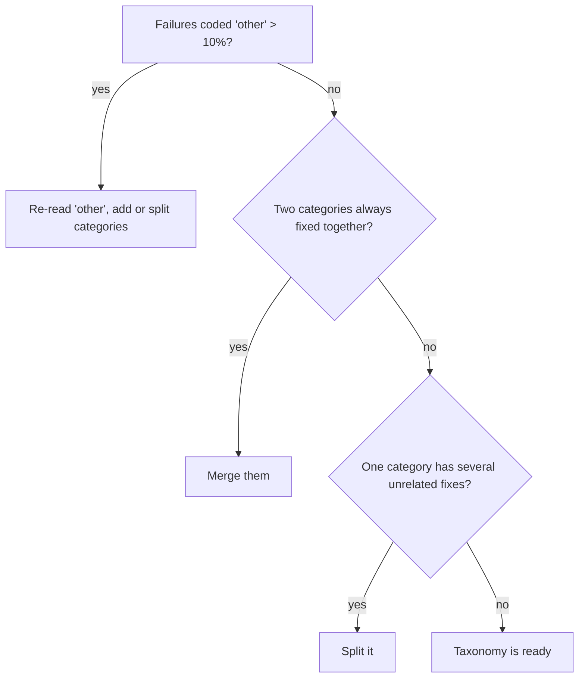

After reading a few dozen failures, patterns emerge. Some outputs are wrong because the system never had the information. Some are wrong because it had the information and ignored it. Some are not wrong at all, but fail an overly strict metric. A **failure taxonomy** is the named set of categories that captures these patterns, and it is the interface between "reading" and "fixing": each category should suggest a different kind of fix.

## What makes a good taxonomy

| Property | Why it matters |
|---|---|
| Mutually exclusive (one primary label per failure) | counts add up to the total |
| Collectively exhaustive (with an "other" bucket under 10%) | nothing important is hidden |
| Actionable: each category points at a lever | otherwise it is a description, not a diagnosis |
| 5 to 10 categories | fewer is vague, more is unusable |
| Defined with one example and one counter-example | coders agree (kappa) |

If a category has no obvious fix, split it until the pieces do. "Wrong answer" is not a category; "calculation error in a multi-step problem" is.

## A common taxonomy for a RAG support assistant

| Category | What it looks like | Typical lever |
|---|---|---|
| Retrieval miss | the right document was never retrieved | chunking, query rewriting, hybrid search, reranking |
| Stale or wrong source | retrieved document is out of date or for another product | data freshness, metadata filters |
| Ignored context | answer is in the retrieved text but the model contradicts it | prompt, model choice, context ordering |
| Unsupported claim | answer includes facts found nowhere in the context | grounding instructions, citation checks, lower temperature |
| Reasoning or arithmetic slip | right facts, wrong calculation or logic | tools (calculator), step-by-step, stronger model |
| Format or policy violation | invalid JSON, missing disclaimer, wrong tone | structured outputs, prompt, constraints |
| Over-refusal | refuses a legitimate request | prompt, safety thresholds |
| Eval artefact | the answer is acceptable but the reference or metric is wrong | fix the reference, loosen the metric |

The last row deserves emphasis. In almost every error analysis, a noticeable share of "failures" (often 5 to 15%) are mistakes in the eval itself: a reference that is out of date, a rubric that is too narrow, an item with two correct answers. Fixing these raises your measured score without touching the model, and stops you from optimising toward the wrong target.

## The maths: counts, shares, and uncertainty in each share

Let $f_k$ be the number of failures in category $k$ and $F = \sum_k f_k$ the total. The share is $s_k = f_k/F$. Because you usually code a *sample* of $F$ failures, each share has an interval, just like a pass rate:

$$
s_k \pm 1.96\sqrt{\frac{s_k(1-s_k)}{F}}
$$

```steps
How certain is a category share?
You coded $F = 120$ failures. 46 were "retrieval miss": $s = 46/120 = 0.383$.
---
$\mathrm{SE} = \sqrt{0.383 \times 0.617/120} = \sqrt{0.00197} = 0.0444$.
---
95% interval: $0.383 \pm 1.96 \times 0.0444 = 0.383 \pm 0.087$, i.e. 30% to 47%.
---
A category with 9 of 120 ($s = 0.075$): $\mathrm{SE} = \sqrt{0.075 \times 0.925/120} = 0.024$, interval $0.075 \pm 0.047$, i.e. 3% to 12%.
---
So retrieval misses are clearly the biggest group, but the ranking among the small categories is not reliable at this sample size.
```

Small differences between small categories are noise. Use the counts to find the big levers; do not over-read the exact order of the tail.

## Refining the taxonomy



## In practice

Keep the taxonomy in the repository next to the eval set and record the label on each failing item. When the taxonomy is stable, label failures in every eval run; the category counts over time become a dashboard that shows whether a change fixed what you meant it to fix or just moved failures from one bucket to another. When two categories could apply, record a primary label and optionally a secondary one, but only count the primary.

```quiz
{"q": "You coded 200 failures; 'unsupported claim' has 30. What is the 95% interval for its share of failures?", "options": ["15% ± 2.5%", "15% ± 4.9%", "15% ± 9.8%", "15% ± 15%"], "answer": 1, "explain": "$s = 0.15$, $\\mathrm{SE} = \\sqrt{0.15 \\times 0.85/200} = 0.0252$, and $1.96 \\times 0.0252 = 0.049$. ±2.5% is a single standard error."}
```

```quiz
{"q": "Which is the best taxonomy category for guiding a fix?", "options": ["Wrong answer", "Bad output", "Ignored context: the answer is in the retrieved passage but the model contradicts it", "Model error"], "answer": 2, "explain": "A useful category implies a lever (prompt, context order, model choice). The others describe the symptom and suggest nothing to change."}
```
