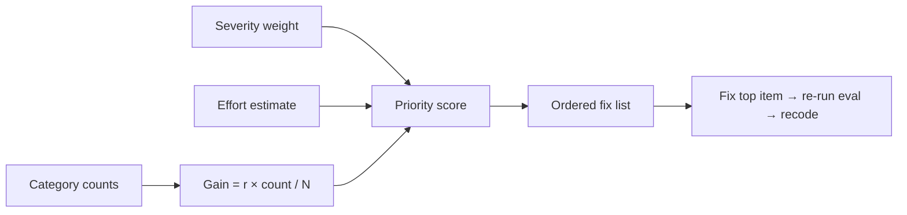

You now have counts per failure category. The temptation is to fix the most interesting one, or the one a stakeholder complained about yesterday. A more reliable guide is the **Pareto principle**: a small number of causes usually account for most of the effect. In error analysis, two or three categories typically explain half to three quarters of all failures. Fix those first.

A **Pareto chart** sorts categories from largest to smallest and plots the cumulative share. Where the cumulative line flattens shows where extra effort stops paying.

## The maths: expected gain from fixing a category

Suppose $N$ eval items, $F$ failures, so the pass rate is $(N - F)/N$. Category $k$ has $f_k$ failures. If a fix removes a fraction $r_k$ of that category (its **resolution rate**, rarely 100%), the new pass rate is

$$
\text{pass}' = \frac{N - F + r_k f_k}{N}, \qquad \text{gain} = \frac{r_k f_k}{N}
$$

```steps
Pareto on 600 items with 120 failures (80% pass)
Counts: retrieval miss 46, ignored context 28, unsupported claim 17, format 12, reasoning 9, eval artefact 8. Total $F = 120$.
---
Shares: 38.3%, 23.3%, 14.2%, 10.0%, 7.5%, 6.7%.
---
Cumulative: 38.3%, 61.7%, 75.8%, 85.8%, 93.3%, 100%. The top three categories explain 76% of failures.
---
Fully fixing retrieval misses ($r = 1$): pass rate $= (600 - 120 + 46)/600 = 526/600 = 87.7\%$, a gain of 7.7 points. Realistically $r = 0.6$: gain $= 0.6 \times 46/600 = 4.6$ points.
---
Fixing the top three completely: $(480 + 91)/600 = 571/600 = 95.2\%$. Fixing the eval artefacts (8 items, just correct the references): gain $8/600 = 1.3$ points for almost no engineering.
```

| Category | Count | Share | Cumulative | Gain if fully fixed |
|---|---|---|---|---|
| Retrieval miss | 46 | 38.3% | 38.3% | +7.7 pts |
| Ignored context | 28 | 23.3% | 61.7% | +4.7 pts |
| Unsupported claim | 17 | 14.2% | 75.8% | +2.8 pts |
| Format or policy | 12 | 10.0% | 85.8% | +2.0 pts |
| Reasoning slip | 9 | 7.5% | 93.3% | +1.5 pts |
| Eval artefact | 8 | 6.7% | 100% | +1.3 pts |

## Gain is not the only axis

Rank by expected gain divided by effort, and weight by severity. A category of 12 format failures that breaks a downstream parser and crashes a workflow can outrank 28 mild wording issues. A useful working score is

$$
\text{priority}_k = \frac{r_k \cdot f_k \cdot w_k}{\text{effort}_k}
$$

where $w_k$ is a severity weight (say 1 for cosmetic, 3 for wrong answer, 10 for safety or data loss) and effort is a rough estimate in days. The numbers are judgement calls, but writing them down makes the trade-off explicit and arguable.



## Fixes move the distribution

After you fix the top category, the others do not stay put in proportion: some of the fixed items now fail for a second reason, and a new top category emerges. That is why error analysis is a cycle, not a one-off. Re-sample and re-code after each fix; the Pareto chart after the change shows whether the failures you meant to remove are gone and what replaced them.

A caution on tails: a category with 3 failures out of 600 might be a symptom of a rare but severe issue (a safety failure, say). Pareto ranks by frequency; treat severe categories as a separate list that is never ignored because of its count.

## In practice

Present the Pareto chart and the gain table when you propose work: "Retrieval misses cause 38% of failures; a reranker should resolve about 60% of them, worth about 4.6 points on this set; two days of work." That is a far stronger argument than "retrieval seems weak". Afterwards, add the fixed failures to the eval set as permanent regression tests, so a later change cannot silently reintroduce them.

```quiz
{"q": "In the table above, you expect a fix to resolve 50% of 'ignored context' failures (28 of 600 items). What is the expected pass-rate gain?", "options": ["2.3 points", "4.7 points", "7.7 points", "1.2 points"], "answer": 0, "explain": "$r f/N = 0.5 \\times 28/600 = 14/600 = 2.33$ points. 4.7 assumes the fix resolves every failure in the category ($r = 1$)."}
```

```quiz
{"q": "Why might you fix a category of 8 format failures before one of 20 wording failures?", "options": ["Smaller categories are always easier", "If the format failures are severe (break a parser) and cheap to fix, severity-weighted gain per day of effort can dominate raw count", "Pareto charts rank by severity", "Wording failures cannot be fixed"], "answer": 1, "explain": "Raw frequency is only one axis. Priority combines resolution rate, count, severity and effort."}
```
