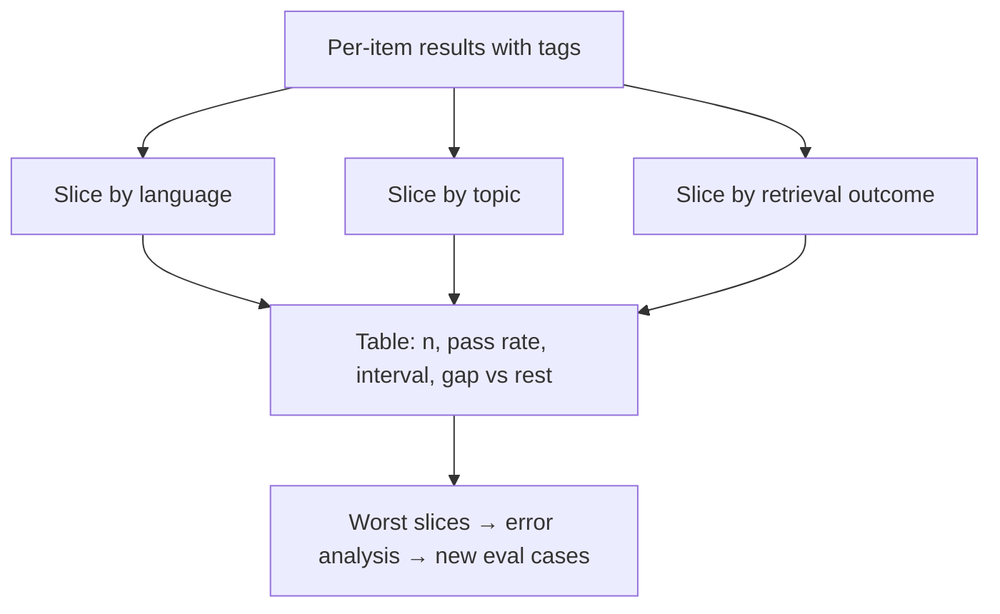

An overall pass rate is an average across very different kinds of input, and averages hide the groups where a system is bad. A model that handles English perfectly and Hindi poorly can post an excellent overall number if 90% of traffic is English. The people sending the Hindi queries still get a broken product.

A **slice** is a subset of the eval set defined by a property of the input: language, topic, input length, user tier, document type, presence of a tool call. **Slice metrics** are the same metric computed per slice. They are the standard way to find where a system fails, to catch regressions that cancel out in the average, and to check fairness across groups.

## The maths: per-slice rates with honest intervals

For slice $s$ with $n_s$ items and $x_s$ passes, compute $\hat p_s = x_s/n_s$ and its interval $\hat p_s \pm 1.96\sqrt{\hat p_s(1-\hat p_s)/n_s}$. The overall rate is the size-weighted average of the slice rates:

$$
\hat p = \sum_s \frac{n_s}{N}\,\hat p_s
$$

which shows why a small slice barely moves the average, however broken it is.

```steps
Three slices of a 400-item eval
English: 300 items, 270 pass. Hindi: 50 items, 25 pass. Code-mixed: 50 items, 35 pass.
---
Overall: $\hat p = (270 + 25 + 35)/400 = 330/400 = 82.5\%$. Looks healthy.
---
English: $\hat p = 0.90$, interval $\pm 1.96\sqrt{0.09/300} = \pm 0.034$.
---
Hindi: $\hat p = 0.50$, interval $\pm 1.96\sqrt{0.25/50} = \pm 0.139$: 36% to 64%.
---
Code-mixed: $\hat p = 0.70$, interval $\pm 1.96\sqrt{0.21/50} = \pm 0.127$: 57% to 83%.
---
Hindi against all the rest (305 of 350 pass, 87.1%): gap $= 0.871 - 0.5 = 0.371$, $\mathrm{SE} = \sqrt{0.25/50 + 0.871 \times 0.129/350} = 0.073$, $z = 5.1$. Not luck: Hindi is genuinely worse. Raising Hindi to 90% would lift the overall rate by $50 \times 0.4/400 = 5$ points.
```

The intervals also show the limit of slicing: a slice with 50 items carries an interval of about ±13 points. It can reveal a gross problem; it cannot track small changes. If a slice matters, give it enough items (a rule of thumb: at least 100 per important slice).

## Useful slice dimensions for LLM systems

| Dimension | Example slices | What it can reveal |
|---|---|---|
| Language / script | English, Hindi, code-mixed | uneven multilingual quality |
| Input length | under 100 tokens, 100 to 1,000, over 1,000 | long-context failures ("lost in the middle") |
| Topic / intent | billing, returns, account security | one domain with stale docs |
| Query type | single fact, multi-hop, calculation, comparison | reasoning vs lookup weaknesses |
| Retrieval outcome | right document retrieved vs not | separates retrieval from generation failures |
| User segment | free vs enterprise, new vs returning | different traffic, different needs |
| Difficulty | easy, medium, hard (by human or by baseline) | whether gains are only on easy items |

The retrieval-outcome slice is especially valuable for RAG systems: if accuracy is 92% when the right document was retrieved and 20% when not, the generator is fine and retrieval is the problem. That one split is often worth more than a week of prompt changes.

## Slices and regressions

When you compare two systems, compute the difference **per slice** as well as overall. A change that lifts the overall rate by 2 points can still lose 8 points on a critical slice, hidden because the slice is small. Treat slice regressions as a release criterion in the success criteria: "no slice may drop by more than 3 points, with at least 100 items in the slice".



## The cost of many slices

Slicing runs into the multiple-comparisons problem from lesson 4: look at 30 slices and a couple will look bad by chance. Pre-decide the important slices (the ones tied to product risk), apply a correction when you scan many, and confirm a surprising slice with fresh data before acting.

## In practice

Tag every eval item with a few attributes when you build the set (language, topic, difficulty, source). It is much cheaper than retro-fitting tags later. Report a table, not a single number: slice name, items, pass rate with interval, and the gap versus the rest. And pay attention to the **worst slice**, not only the average: it is often the right number for a "no group left behind" gate.

```quiz
{"q": "A slice with 25 items passes 20 (80%). Its 95% interval half-width is closest to:", "options": ["±3%", "±8%", "±16%", "±30%"], "answer": 2, "explain": "$1.96\\sqrt{0.8 \\times 0.2/25} = 1.96 \\times 0.08 = 0.157$. With so few items the interval is 64% to 96%: too wide to call this slice good or bad."}
```

```quiz
{"q": "A new prompt raises overall pass rate from 82% to 84%, but drops the 40-item 'billing' slice from 85% to 70%. What is the best reading?", "options": ["The overall improvement is what matters", "The slice drop is a warning: 15 points on 40 items is a big, uncertain change worth checking with more billing examples before shipping", "The slice is too small to ever matter", "The prompt is definitely worse"], "answer": 1, "explain": "A 40-item slice has an interval of about ±12 points, so the drop could be partly noise, but it is large and in a product-critical area. Collect more billing items and check the paired result on those items."}
```
