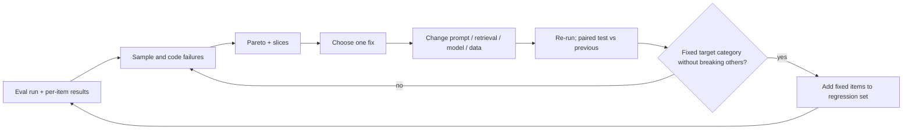

Error analysis ends in action, and a specific kind of action: a change to the system, a change to the eval, and a new permanent test. If the analysis produces only a slide, the same failures return next quarter.

The loop has four stages. **Diagnose** (read, label, count), **decide** (rank by priority), **change** (one thing at a time), **verify** (re-run, compare with proper statistics, recode). The verification stage is where the earlier lessons come together: a fix is real only if the paired comparison against the previous version shows it.



## Which lever matches which failure

| Failure category | First lever to try | Check afterwards |
|---|---|---|
| Retrieval miss | query rewriting, chunking, hybrid search, reranking | recall@k on the miss items |
| Ignored context | clearer instructions, move key passage, shorter context | faithfulness on those items |
| Unsupported claim | "say you don't know" instruction, citation requirement | rate of unsupported claims by claim checker |
| Reasoning slip | tool use (calculator, code), decomposition, stronger model | accuracy on the calculation slice |
| Format violation | constrained decoding / structured outputs | parse rate |
| Over-refusal | prompt policy wording, thresholds | refusal rate on benign set vs harmful set |
| Eval artefact | correct the reference or rubric | recompute baseline |

Change one thing at a time, otherwise you cannot tell which change helped. Make the change targeted at the largest category, and check that the failures in *other* categories did not grow: fixing "unsupported claims" by making the model more cautious often creates over-refusals.

## The maths: did the fix work, and what did it break?

The paired table from lesson 4 answers both questions. Let $b$ be the items the new version passes and the old fails, and $c$ the reverse. The net gain is $(b - c)/N$. But $b$ and $c$ tell different stories, so look at *which categories* they fall in.

```steps
A fix, evaluated honestly
600 items. A reranker is added to cure 'retrieval miss' (46 failures before).
---
Result: $b = 34$ items newly pass, $c = 9$ items newly fail. Net $= (34 - 9)/600 = 4.2$ points.
---
McNemar: $\chi^2 = (34 - 9)^2/(34 + 9) = 625/43 = 14.5$, far above 3.84. The gain is real.
---
Recode the 9 new failures: 6 are 'latency timeout' (the reranker slowed some queries past the limit) and 3 are 'ignored context'. The fix introduced a new, specific problem to address next.
---
Recode the 34 fixes: 30 were retrieval misses (resolution rate $30/46 = 65\%$) and 4 were incidental. The prediction was 60%: the plan matched the outcome.
```

Comparing the predicted gain (from the Pareto analysis) with the measured gain tells you whether your diagnosis was right. If you predicted 4.6 points and got 0.5, the category was mislabelled or the fix addresses a different cause.

## Turn failures into permanent tests

Every fixed failure becomes an item in a **regression set**: inputs that once failed and must now pass. This set grows over time and acts as a ratchet; any later change that breaks an old fix shows up immediately. Add also *near-miss variants* (the same failure with different wording or entities), because a fix that works only on the exact string is not a fix.

Keep the regression set separate from the held-out set used to estimate overall quality: because you tuned against the regression items, their pass rate is not an unbiased estimate of anything. It is a safety net, not a thermometer.

## When the failures are noisy or unfixable

Sometimes a category reflects genuine ambiguity: two reasonable answers, or a question the documents cannot answer. These do not need model fixes but product decisions: ask a clarifying question, show the sources, or hand off to a human. Mark those items so they do not drag the metric forever, and track the product behaviour you chose ("asked a clarifying question in 90% of ambiguous cases").

## In practice

Keep an error-analysis log: date, version, sample size, taxonomy counts, top three findings, fixes chosen and predicted gain, and later the measured gain. After a few cycles this log is the most valuable document the team has. It records what the system's weak points are, what has already been tried, and how accurate the team's predictions were.

```quiz
{"q": "A fix produces $b = 40$ newly passing items and $c = 10$ newly failing items on 500 examples. What is the net gain in pass rate?", "options": ["8 points", "6 points", "10 points", "2 points"], "answer": 1, "explain": "$(40 - 10)/500 = 0.06$. Counting only the fixes ($40/500 = 8$ points) ignores the regressions the change caused."}
```

```quiz
{"q": "Why should the regression set not be used as the headline quality estimate?", "options": ["It is too large", "You tuned the system on exactly those items, so their pass rate is optimistically biased", "It contains only easy items", "Regression sets cannot be scored automatically"], "answer": 1, "explain": "Items chosen because they once failed, and then fixed, will pass at a rate that overstates real-world quality. Use a held-out set for estimating quality and the regression set as a safety net."}
```
