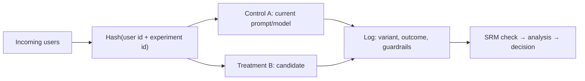

```callout-before
Before you start
Offline evals use a fixed set of examples you chose. An online test uses real users making real requests. You need the sample-size formula from the previous lesson; this topic applies it.
```

Offline evaluation answers "is this version promising?" It cannot answer "do users get more done with it?", because your eval set is a model of traffic, and users have a habit of doing things your model did not include. The final arbiter is an **A/B test** (also called an online controlled experiment): split real traffic at random between the current system (control, A) and the candidate (treatment, B), and compare a metric that reflects user success.

Randomisation is what makes this powerful. Because chance alone decides who sees which version, the two groups are alike in everything else (time of day, user mix, device, task difficulty), so any systematic difference in the outcome is caused by the change. This is the one situation where "correlation" becomes "causation" without heroic assumptions.

## The design checklist

| Decision | Guidance |
|---|---|
| **Unit of randomisation** | usually the user (not the request), so one person always sees one variant and their conversations stay coherent; use sessions only when users are anonymous |
| **Primary metric** | exactly one, chosen in advance, tied to the goal: task success, resolution without escalation, 7-day return |
| **Guardrail metrics** | metrics that must not get worse: latency, cost, safety flags, complaint rate (next topic) |
| **Minimum effect of interest** | the smallest gain worth shipping, $\delta$ |
| **Sample size and duration** | from the power calculation; run whole weeks to cover weekday and weekend patterns |
| **Allocation** | 50/50 maximises power; a small treatment share (5%) limits risk but needs longer |
| **Stopping rule** | fix the sample size or use a sequential method; do not stop when the p-value first dips below 0.05 |

## The maths: sizing the test

Reuse the formula from the comparing-systems lesson. Say the primary metric is "conversation resolved without human handoff", currently $p = 0.30$, and a 1.5-point gain is the smallest worth shipping ($\delta = 0.015$), at $\alpha = 0.05$ and 80% power:

$$
n \approx \frac{(z_{\alpha/2} + z_\beta)^2\; 2p(1-p)}{\delta^2} = \frac{7.85 \times 2 \times 0.3 \times 0.7}{0.015^2}
$$

```steps
How long does the test run?
$2p(1-p) = 2 \times 0.3 \times 0.7 = 0.42$.
---
$n = 7.85 \times 0.42/0.000225 = 3.297/0.000225 = 14{,}652$ users per arm.
---
Traffic: 5,000 users a day, split 50/50, gives 2,500 per arm per day. Time to reach 14,652: $14{,}652/2{,}500 = 5.9$ days.
---
Round up to **7 days** so that every weekday appears once: about 17,500 users per arm, comfortably above the minimum.
---
If only 5% of traffic may see the candidate (a risk limit), the treatment arm gets $0.05 \times 5000 = 250$ users per day, so reaching 14,652 takes $14{,}652/250 = 59$ days. Small exposure buys safety with time.
```

## Checking the experiment itself: sample-ratio mismatch

Before reading any result, verify that the split matches what you configured. A 50/50 split of 20,000 users that produced 10,300 and 9,700 looks close, but use a chi-squared check against the expected 10,000 each:

$$
\chi^2 = \sum \frac{(\text{observed} - \text{expected})^2}{\text{expected}} = \frac{300^2}{10000} + \frac{300^2}{10000} = 9 + 9 = 18
$$

The 5% critical value (1 degree of freedom) is 3.84, and 18 is far beyond it ($p < 0.0001$). This is a **sample-ratio mismatch (SRM)**: something in the system (a crash in one variant, a bot filter, a logging bug, a slower variant that causes users to leave before being counted) is biasing who ends up in each group. Results from an experiment with SRM are not trustworthy; fix the cause and re-run. It is one of the most common and most valuable checks in practice.



Assigning by a hash of the user id and the experiment id gives a stable, effectively random split without a database lookup, and different experiments get independent splits.

## See the numbers

```sim
ab-significance
{"pA": 0.3, "pB": 0.315, "n": 15000, "alpha": "0.05"}
```

This is the design above (a 1.5-point lift at about 15,000 per arm). The readout shows power near 80% and a minimum detectable effect near 1.5 points. Cut $n$ to 5,000 and see the minimum detectable effect grow to about 3.6 points: the test could no longer see the effect you care about. The "no significant difference" result of an underpowered test is not evidence of no effect.

## In practice

Write the plan before launching: hypothesis, primary metric, guardrails, sample size, end date, decision rule. Resist the urge to look daily; if you must monitor, use guardrails only, or a sequential testing method designed for continuous monitoring. Beware **novelty effects** (users try a new thing then revert) and **learning effects** (users adapt slowly): run long enough that early behaviour has settled. For LLM features also record the model and prompt versions in every log line so you can trace a result to its cause.

```quiz
{"q": "A 50/50 test of 20,000 users ends with 10,500 in A and 9,500 in B. What do you conclude?", "options": ["Fine: the split is within 5% of even", "Sample-ratio mismatch: $\\chi^2 = 50$ far exceeds 3.84, so the assignment or logging is broken", "B is better because it has fewer users", "Re-weight the groups and continue"], "answer": 1, "explain": "Each term is $500^2/10000 = 25$, so the statistic is $25 + 25 = 50$, far above 3.84. A 5% imbalance sounds small but is hugely unlikely from random assignment at this size. Do not interpret outcome metrics until the cause is found."}
```

```quiz
{"q": "Baseline resolution is 30%, you want to detect +1.5 points at 80% power and $\\alpha = 0.05$ (about 14,650 users per arm). Traffic is 2,000 users per day split 50/50. How many days is the minimum?", "options": ["About 7", "About 15", "About 29", "About 59"], "answer": 1, "explain": "1,000 per arm per day, so $14{,}650/1000 \\approx 14.7$ days; round up to 15 (or 21 to cover whole weeks). Using 2,000 per day per arm would give the 7-day figure."}
```
