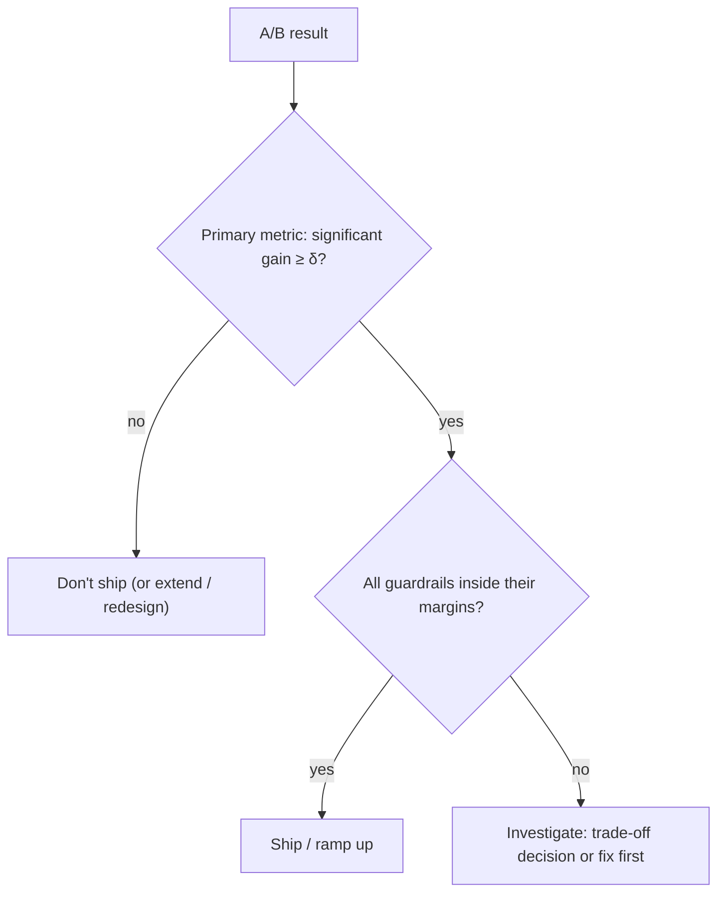

A new prompt raises task success by two points. It also doubles the cost per request, adds a second of latency and makes the assistant occasionally rude. If you only watched the primary metric, you shipped a regression. **Guardrail metrics** are the numbers you do not want to get worse while you chase the primary one. They convert "don't break anything important" into something testable.

Typical guardrails for an LLM feature:

| Family | Example guardrail | Direction we protect |
|---|---|---|
| Cost | tokens or dollars per request | must not rise by more than 10% |
| Latency | p95 time to final answer | must not exceed 3 s |
| Safety | rate of flagged unsafe outputs | must not rise |
| Quality floor | complaint rate, escalation rate | must not rise |
| Reliability | error and timeout rate | must not rise |
| Fairness | primary metric on key slices | no slice drops more than 3 points |

The primary metric decides whether to ship; guardrails can veto. Fix both, and the thresholds, before the test starts.

## The maths: showing a guardrail did not get worse

For a guardrail where *higher is worse* (say complaint rate), the question is not "is it different?" but "can I rule out an increase larger than my tolerance $m$?" That is a **non-inferiority** test. Compute the confidence interval for the difference $\Delta = \hat p_B - \hat p_A$ and compare its upper end with the margin $m$:

$$
\Delta \pm 1.96\sqrt{\frac{\hat p_A(1-\hat p_A)}{n_A} + \frac{\hat p_B(1-\hat p_B)}{n_B}}, \qquad \text{safe if upper bound} < m
$$

```steps
Complaint rate, 10,000 users per arm
A: 12.0% complained ($1{,}200$ users). B: 12.6% ($1{,}260$ users). Tolerance: no more than $m = +1.0$ point.
---
$\Delta = 0.126 - 0.120 = 0.006$ (+0.6 points).
---
$\mathrm{SE} = \sqrt{0.12 \times 0.88/10000 + 0.126 \times 0.874/10000} = \sqrt{1.056 \times 10^{-5} + 1.101 \times 10^{-5}} = 0.00465$.
---
95% interval: $0.006 \pm 1.96 \times 0.00465 = 0.006 \pm 0.0091$, i.e. $(-0.31, +1.51)$ points.
---
The upper bound, 1.51, exceeds the margin of 1.0. We cannot claim the guardrail is safe, even though the observed change (+0.6) is under 1.0. The data are consistent with a harmless change and with a 1.5-point rise.
---
How much data would settle it? If the true change really is +0.6, we need $0.006 + 1.96\,\mathrm{SE} < 0.010$, so $\mathrm{SE} < 0.00204$. Since $\mathrm{SE}$ scales as $1/\sqrt{n}$ from 0.00465 at $n = 10{,}000$, this needs $n > 10{,}000 \times (0.00465/0.00204)^2 \approx 52{,}000$ per arm. At 25,000 per arm the interval would be $(+0.02, +1.18)$: still not safe.
```

Notice what happened: "no significant difference" was not enough. A guardrail check needs enough power to rule out harm, and proving the *absence* of an effect takes much more data than detecting a large one. Often the honest choices are a larger sample, a looser margin agreed with the product owner, or fixing the cause of the rise.

## See the relation between sample size and what you can rule out

```sim
ab-significance
{"pA": 0.88, "pB": 0.874, "n": 10000, "alpha": "0.05"}
```

This plots the complementary view (satisfaction rates 88.0% vs 87.4%, the mirror of the complaint numbers above). Try $n = 10000$ and note that the interval for the difference includes zero. Raise $n$ to 30,000 and see the minimum detectable effect fall; then raise $n$ further and watch the gap between the curves look "significant" when it is still only 0.6 points: statistical significance and importance are different things.

## Cost and latency guardrails

For continuous metrics (tokens per request, latency) means are misleading because of long tails: a few very long conversations can dominate. Compare **percentiles** (p50, p95, p99) or trimmed means, and put intervals on them with a bootstrap (lesson 4). A change that leaves the mean latency flat but doubles p99 is a real regression for the 1% of users who hit it.

The cost guardrail is a straightforward ratio:

$$
\Delta\text{cost} = \frac{\overline{c}_B - \overline{c}_A}{\overline{c}_A}
$$

If control costs 0.8 cents per request on average and treatment 0.92, then $\Delta\text{cost} = 0.12/0.8 = +15\%$. Whether a +15% cost is acceptable for a +2 point success gain is a product decision, but it should be made with the number in front of you.



## In practice

Define two or three guardrails per experiment, not twenty; with many guardrails some will move by chance (the multiple-comparisons problem again). Make the veto rule explicit before the test. Segment guardrails by user group for safety and fairness checks. And alert on guardrails during the test itself: a safety or error-rate guardrail breach should stop the experiment early, even if the primary metric looks great.

```quiz
{"q": "A guardrail test of complaint rate gives a 95% interval of $(-0.4, +0.9)$ points for B minus A, with a tolerance of +1.0 point. What is the conclusion?", "options": ["Guardrail not shown safe: the interval includes zero", "Guardrail satisfied: the upper bound 0.9 is below the margin 1.0", "B is significantly better", "The test must be repeated"], "answer": 1, "explain": "Non-inferiority asks whether the upper bound is under the margin. $0.9 < 1.0$, so a rise bigger than 1 point is ruled out at this confidence. Including zero is irrelevant: the question is about harm, not difference."}
```

```quiz
{"q": "Treatment mean latency equals control mean latency, but p99 doubles. Which statement is right?", "options": ["No regression: means are equal", "A regression for the slowest 1% of requests that a mean-only guardrail hides", "p99 is too noisy to use", "Latency is not a guardrail"], "answer": 1, "explain": "Tail latency affects real users and is invisible to means. Track p95 and p99 with bootstrap intervals."}
```
