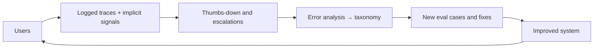

Once real people use the feature, they leave traces. Some traces are deliberate: a thumbs-up or thumbs-down, a star rating, a written complaint. These are **explicit feedback**. Others are side effects of behaviour: copying the answer, regenerating it, editing it before sending, rephrasing the question, abandoning the chat, escalating to a human. These are **implicit feedback**. Both are cheap compared with expert review and arrive at the scale of real traffic, but both come with a catch: the people who respond are not a random sample.

## Why thumbs lie

Explicit ratings suffer from **response bias**. Unhappy users are usually more motivated to click than satisfied ones, and most users click nothing. Suppose 85% of responses truly satisfy the user. Satisfied users leave a thumbs-up with probability 2%, unsatisfied users leave a thumbs-down with probability 6%.

$$
\text{observed up-share} = \frac{s\, r_{\uparrow}}{s\, r_{\uparrow} + (1 - s)\, r_{\downarrow}}
$$

where $s$ is the true satisfaction rate and $r_\uparrow$, $r_\downarrow$ are the rating probabilities of satisfied and unsatisfied users.

```steps
A biased satisfaction number
True satisfaction $s = 0.85$. Satisfied users rate with $r_\uparrow = 0.02$; unsatisfied with $r_\downarrow = 0.06$.
---
Per request: thumbs-up probability $0.85 \times 0.02 = 0.017$; thumbs-down probability $0.15 \times 0.06 = 0.009$.
---
Observed share of thumbs that are up: $0.017/(0.017 + 0.009) = 0.654$.
---
The dashboard says 65% satisfaction while the truth is 85%. Only 2.6% of requests got any rating at all, so the rated sample is small and self-selected.
---
Reverse the rating rates (satisfied users more eager) and the bias flips upward. The direction depends on your product, which is the problem: you cannot read the absolute number.
```

What you can use thumbs for: **trend** (if the rating behaviour is stable, a change in the up-share signals a change in quality), **finding failures** (read the thumbs-downs; they are a ready-made error-analysis sample), and **building labelled data** (with review, rated conversations become eval items).

## Reading implicit signals

| Signal | Plausible meaning | Confound |
|---|---|---|
| Copy or insert answer into document | answer was useful | users sometimes copy to fix it |
| Regenerate | first answer not good | some users regenerate for variety |
| Edit distance between answer and what the user sent | how much of the answer survived | style preferences |
| Re-ask / rephrase within 1 minute | misunderstood or wrong | complex tasks naturally take turns |
| Abandonment after the answer | maybe satisfied, maybe frustrated | can't tell which |
| Escalation to human | failure to resolve | some tasks always need a human |
| Return within 7 days | overall value | slow signal; influenced by many things |

No single signal is the truth. A useful practice is to **validate each implicit signal against human labels**: sample 200 conversations, have people judge success, and check how well the signal predicts it. A signal with weak agreement (kappa near 0.2) should be demoted to a diagnostic, not a decision metric.

## The maths: turning a signal into a metric with a measured accuracy

Treat an implicit signal $S$ (say "user copied the answer") as a classifier of true success. From the labelled sample, estimate $\text{TPR}$ (share of truly successful conversations where $S = 1$) and $\text{FPR}$ (share of unsuccessful ones where $S = 1$). Then the observed signal rate $q$ relates to the true success rate $p$ exactly as in the judge-calibration topic:

$$
p = \frac{q - \text{FPR}}{\text{TPR} - \text{FPR}}
$$

If copying happens in 60% of successful and 15% of unsuccessful conversations, and the live copy rate is 0.42, then $p = (0.42 - 0.15)/(0.60 - 0.15) = 0.27/0.45 = 0.60$. If the copy rate moves from 0.42 to 0.45 in a test, success moved by $0.03/0.45 = 6.7$ points: the signal is *amplified* by $1/(\text{TPR} - \text{FPR}) = 2.2$. Weak signals magnify noise.

## See it in an A/B test

Implicit metrics are typically analysed as rates with the same two-proportion test. Say regenerate rate falls from 18% to 16% on 15,000 users per arm:

```sim
ab-significance
{"pA": 0.82, "pB": 0.84, "n": 15000, "alpha": "0.05"}
```

(Here the sim's "pass rate" is the non-regeneration rate, 82% vs 84%.) The z-score is large and the p-value tiny: with 15,000 per arm, a 2-point shift is easily detected. Then lower $n$ to 1,500 and watch it become non-significant. Large traffic makes implicit metrics sensitive; whether a 2-point drop in regenerations matters to users is a separate question to answer with the validation above.

## Feedback as a data flywheel



Treat user feedback as a source of eval items and failure examples, not only a score. Consent and privacy matter: strip personal data, follow retention policies, and tell users how their feedback is used.

## In practice

Collect both kinds but never confuse them with ground truth. Report implicit metrics as proxies with the validation numbers beside them. Ask for explicit feedback at the right moment with low friction (one click), and consider a short random "was this helpful?" prompt shown to a random subset so that raters are sampled, not self-selected. That small design change removes much of the response bias.

```quiz
{"q": "True satisfaction is 70%. Satisfied users give a thumbs-up with probability 3%, unsatisfied users a thumbs-down with probability 9%. What share of received thumbs are up?", "options": ["70%", "43.75%", "21%", "56%"], "answer": 1, "explain": "Up rate per request $0.7 \\times 0.03 = 0.021$; down $0.3 \\times 0.09 = 0.027$. Share up $= 0.021/0.048 = 0.4375$. The dashboard would suggest 44% satisfaction against a true 70%."}
```

```quiz
{"q": "A random 'was this helpful?' prompt shown to 5% of sessions, chosen at random, is better than an always-visible thumbs button because:", "options": ["It yields more ratings", "Raters are a random sample rather than self-selected, which reduces response bias", "Users prefer prompts", "It removes the need for implicit signals"], "answer": 1, "explain": "A random sample estimates the population satisfaction directly (with a standard error), whereas self-selected raters over-represent strong opinions. It produces fewer ratings, not more."}
```
