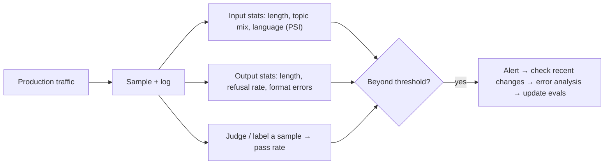

A system that passed every eval last month can degrade this month without a single code change. Users start asking about a new product. A provider silently updates the model behind an endpoint. A document source changes its format. The inputs, the model or the world moved, and your offline eval, frozen in the past, cannot see it. **Drift** is any change over time in the distribution of inputs, outputs or the relationship between them.

Three kinds are worth separating:

- **Input drift** (covariate shift): the mix of requests changes (new topics, longer prompts, a new language).
- **Output drift**: the distribution of responses changes (longer answers, more refusals), often because the model or prompt changed.
- **Quality drift**: the pass rate on a fixed definition of "good" changes, whether because of the first two or because the world changed (a policy was updated, the old answer is now wrong).

You detect them by monitoring a handful of statistics against a baseline period and alerting on meaningful movement.

## The maths: population stability index

To compare two distributions of a variable, bin it into $B$ buckets and let $e_i$ be the expected (baseline) share in bucket $i$ and $a_i$ the actual (recent) share. The **population stability index** (PSI) is

$$
\mathrm{PSI} = \sum_{i=1}^{B} (a_i - e_i)\,\ln\frac{a_i}{e_i}
$$

Each term is non-negative (the difference and the log ratio always have the same sign), so PSI is 0 when the distributions match and grows with divergence. A common rule of thumb from credit scoring: below 0.1 stable, 0.1 to 0.25 moderate shift worth a look, above 0.25 major shift.

```steps
PSI on prompt length
Four length buckets. Baseline shares $e = (0.25, 0.35, 0.25, 0.15)$; this week $a = (0.15, 0.30, 0.30, 0.25)$.
---
Bucket 1: $(0.15 - 0.25)\ln(0.15/0.25) = (-0.10)(-0.511) = 0.0511$.
---
Bucket 2: $(0.30 - 0.35)\ln(0.30/0.35) = (-0.05)(-0.154) = 0.0077$.
---
Bucket 3: $(0.30 - 0.25)\ln(0.30/0.25) = (0.05)(0.182) = 0.0091$. Bucket 4: $(0.25 - 0.15)\ln(0.25/0.15) = (0.10)(0.511) = 0.0511$.
---
$\mathrm{PSI} = 0.0511 + 0.0077 + 0.0091 + 0.0511 = 0.119$. Moderate: prompts are getting longer (the longest bucket went from 15% to 25%). Worth a look, not an alarm.
```

PSI depends on the binning (quantile bins from the baseline are a common choice) and on sample size: with few observations even identical distributions show a small positive PSI, so require several hundred requests per window.

## Quality drift: a control chart

For a pass rate monitored with a judge or sampled labels, treat the baseline rate $p_0$ as known and flag days that fall too far below it. A **control chart** draws limits at $p_0 \pm 3\,\mathrm{SE}$, with $\mathrm{SE} = \sqrt{p_0(1-p_0)/n}$ for the $n$ items scored that day.

```steps
Daily pass rate, 200 scored items per day
Baseline pass rate $p_0 = 0.85$.
---
$\mathrm{SE} = \sqrt{0.85 \times 0.15/200} = \sqrt{0.0006375} = 0.0252$.
---
Lower control limit: $0.85 - 3 \times 0.0252 = 0.774$.
---
A day at 0.80 (160/200) is inside the limit: normal fluctuation. A day at 0.76 breaches it: investigate. Three consecutive days below 0.82 is also a signal, even though none breaches 0.774 (run rules catch slow slides).
```

Scoring 200 items a day with an LLM judge costs little (see lesson 3) and is the standard way to watch quality in production.



## Causes to check when an alert fires

| Symptom | First suspects |
|---|---|
| Input PSI high, quality unchanged | new traffic mix the system handles fine; update eval set to cover it |
| Input PSI high, quality down | new topic or language the system is weak at; add slice and examples |
| Outputs longer, quality unchanged | silent model update or prompt change; check version logs |
| Quality down, inputs stable | model provider change, retrieval index stale, tool or API changed |
| Sudden step change | deploy, config, provider incident |
| Slow slide | changing world: documents out of date, user expectations shift |

Always log model and prompt version, retrieval index version and tool versions on each request: most drift investigations are "what changed on that date?".

## In practice

Pick 5 to 10 monitored statistics, set baselines from a stable week, and review alert thresholds after a month of false alarms. Refresh the eval set from recent traffic every quarter so that offline evals track the world. Pin model versions where the provider allows, and run your eval suite on a schedule even without code changes: it detects provider-side changes that no deploy announces.

```quiz
{"q": "Baseline shares are (0.5, 0.5) for two buckets; this week they are (0.4, 0.6). What is the PSI?", "options": ["0.020", "0.040", "0.100", "0.200"], "answer": 1, "explain": "$(0.4 - 0.5)\\ln(0.4/0.5) + (0.6 - 0.5)\\ln(0.6/0.5) = (-0.1)(-0.2231) + (0.1)(0.1823) = 0.0223 + 0.0182 = 0.0405$. Well under 0.1: stable."}
```

```quiz
{"q": "Your daily pass rate is monitored with 100 judged items per day at baseline 0.90. About where is the lower 3-sigma control limit?", "options": ["0.81", "0.86", "0.78", "0.84"], "answer": 0, "explain": "$\\mathrm{SE} = \\sqrt{0.9 \\times 0.1/100} = 0.03$; limit $= 0.90 - 0.09 = 0.81$. With only 100 items a day, normal fluctuation reaches 9 points below baseline, so small real drops will be invisible on any single day."}
```
