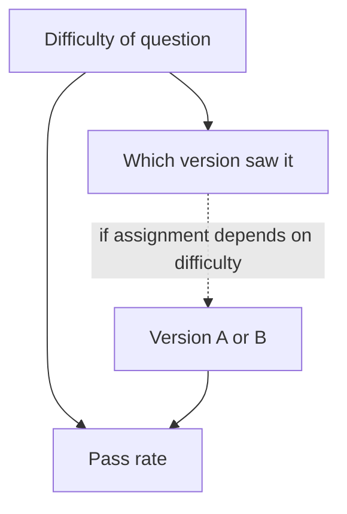

Here is a result that looks impossible. Version B of a prompt beats version A on easy questions. It also beats A on hard questions. Yet when you pool all the questions, A has the higher pass rate. Nothing is wrong with the arithmetic. This reversal is **Simpson's paradox**, and it appears in real A/B tests whenever the mix of easy and hard cases differs between the groups being compared.

## A worked example

Two prompt versions are compared on a mixture of easy and hard questions, but the traffic split is uneven: A saw mostly easy questions, B saw mostly hard ones.

| | Easy: passed / total | Easy rate | Hard: passed / total | Hard rate | **Overall** |
|---|---|---|---|---|---|
| **A** | 180 / 200 | 90% | 40 / 100 | 40% | 220 / 300 = **73.3%** |
| **B** | 95 / 100 | 95% | 90 / 200 | 45% | 185 / 300 = **61.7%** |

B wins on easy (95% vs 90%) and on hard (45% vs 40%), but loses overall (61.7% vs 73.3%).

## The maths: why the reversal happens

An overall rate is a weighted average of the slice rates, with weights equal to each slice's share of that group's items:

$$
\hat p = \sum_s w_s\, \hat p_s, \qquad w_s = \frac{n_s}{N}
$$

The two groups use *different weights*:

```steps
Same slice rates, different weights
A's weights: easy $200/300 = 0.667$, hard $100/300 = 0.333$. B's weights: easy $0.333$, hard $0.667$.
---
A overall: $0.667 \times 0.90 + 0.333 \times 0.40 = 0.600 + 0.133 = 0.733$.
---
B overall: $0.333 \times 0.95 + 0.667 \times 0.45 = 0.317 + 0.300 = 0.617$.
---
B's better slice rates are outweighed by its heavier weight on the hard slice, which has low pass rates for both versions.
---
Compare fairly by **standardising**: give both versions the same weights, say 50/50. A: $0.5 \times 0.90 + 0.5 \times 0.40 = 0.65$. B: $0.5 \times 0.95 + 0.5 \times 0.45 = 0.70$. B is better by 5 points, which is the conclusion the slices support.
```

The paradox is not that numbers are fooling you; it is that two different questions got different answers. "Which version did better on the traffic it happened to receive?" is answered by the pooled rates. "Which version is better, for a given kind of question?" is answered by the slices (or the standardised rate). Only the second tells you what would happen if B received the same traffic as A.

## Which is correct: pooled or sliced?

It depends on why the groups differ in mix:

- If the difference in mix is an **accident of assignment** (non-random allocation, a router that sent hard questions to B, a time-of-day effect), the slice-level or standardised comparison is the right one. The slice variable is a **confounder**.
- If the mix differs **because of the treatment itself** (B changes what users ask, because B's answers prompt follow-up questions), the pooled result is the real effect on the overall outcome.

Random assignment at the start of an A/B test protects against the first case: with large samples, both arms get nearly the same mix of easy and hard requests, so pooled and sliced comparisons agree. Simpson reversals are a warning sign that assignment was not random: a routing rule, a bug, an SRM, or an analysis that filters by something the treatment affects.



Where the arrow from difficulty to "which version saw it" exists (non-random), the pooled comparison is confounded.

## See it in a randomised comparison

```sim
ab-significance
{"pA": 0.65, "pB": 0.7, "n": 600, "alpha": "0.05"}
```

This uses the standardised rates (65% vs 70%). Even with an honest 5-point gap, 600 per arm gives a p-value of about 0.07 (not significant at 0.05). The lesson: fixing the paradox corrected the sign of the conclusion, not its uncertainty; you still need the sample size for the question you actually care about.

## Other common analysis traps

| Trap | What goes wrong | Defence |
|---|---|---|
| **Survivorship** | analysing only conversations that finished, dropping early abandoners | include everyone assigned; analyse by assignment (intention to treat) |
| **Peeking** | stopping the test at the first p < 0.05 | fixed horizon or sequential methods |
| **Selecting the best slice after the fact** | some slice always looks good by chance | pre-specify slices; correct for multiple comparisons |
| **Ratio metrics with unequal denominators** | "resolution rate per conversation" shifts if conversations per user shifts | analyse per user, the unit of randomisation |
| **Novelty effect** | initial spike fades | run longer; check week 1 vs week 2 |
| **Changing the metric after seeing results** | any metric can be made to look good | write the primary metric down first |

## In practice

When a pooled result and a sliced result disagree, stop and look at the slice weights in each arm before writing the report. Always inspect the mix of key attributes between arms (language, difficulty, tier): if it differs, find out why. In randomised experiments the mix should match; if not, suspect an assignment bug. For observational comparisons (before/after a deploy, not randomised) standardise by slice and be explicit that unmeasured confounders may remain.

```quiz
{"q": "Using the table: what is A's pass rate if it had received B's traffic mix (100 easy, 200 hard)?", "options": ["73.3%", "56.7%", "65%", "40%"], "answer": 1, "explain": "A's slice rates are 90% and 40%. On 100 easy and 200 hard: $(0.9 \\times 100 + 0.4 \\times 200)/300 = (90 + 80)/300 = 0.567$. Compared with B's 61.7% on the same mix, B is ahead by 5 points, matching the slice results."}
```

```quiz
{"q": "In a properly randomised A/B test with 10,000 users per arm, you find a Simpson-style reversal between the pooled and a by-language analysis. What is the most likely explanation?", "options": ["It is a normal outcome of randomisation", "The assignment was not actually random with respect to language (a routing bug or sample-ratio mismatch)", "The pooled result is always correct", "The slices are too large"], "answer": 1, "explain": "With large randomised arms the language mix is nearly identical in both, so pooled and sliced comparisons agree. A reversal signals imbalance, from a bug in assignment or logging."}
```
