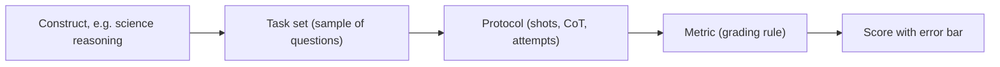

A model card says "GPQA 71%, MMLU-Pro 82%". It is tempting to read these as properties of the model, like its parameter count. They are not. A benchmark score is the outcome of an **experiment**: a particular set of questions, asked in a particular way, graded by a particular rule. Change any of the three and the number moves.

Think of a school exam. A grade of 71% tells you something about the student, but also about which questions were set, whether it was open-book, how long they had, and how strictly it was marked. Two students' grades are only comparable if they sat the same exam under the same conditions.

So every **benchmark** has three parts:

| Part | What it fixes | Example of how it varies |
|---|---|---|
| **Task set** | The questions or problems | MMLU covers 57 subjects; GPQA has 448 expert-written science questions |
| **Metric** | How one answer is scored | Exact match on a letter, unit tests passing, a model judge |
| **Protocol** | How the model is asked | Zero-shot or 5-shot, chain of thought allowed, number of attempts, tools, temperature |

The protocol is where most confusion comes from. A score reported with chain of thought and 8 attempts averaged is a different measurement from a single greedy answer, even on the same questions.

## The maths: a score is an estimate

Treat the benchmark's questions as a sample drawn from a much larger universe of questions of that kind. What you care about is the model's accuracy $p$ on that universe; what you observe is $\hat p$ on $n$ questions. The **standard error** is

$$
\text{SE} = \sqrt{\frac{\hat p (1-\hat p)}{n}}
$$

and an approximate 95% interval is $\hat p \pm 1.96\,\text{SE}$.

```steps
Error bars on two published scores
GPQA has $n = 448$ questions. A model scores $\hat p = 0.60$. $\text{SE} = \sqrt{0.60 \times 0.40 / 448} = \sqrt{0.000536} = 0.0231$.
---
95% interval: $0.60 \pm 1.96 \times 0.0231 = 0.60 \pm 0.045$, so roughly 55.5% to 64.5%. Two models 3 points apart on this set are not clearly different.
---
Humanity's Last Exam has $n = 2{,}500$ questions. A model scores $\hat p = 0.20$. $\text{SE} = \sqrt{0.20 \times 0.80 / 2500} = \sqrt{0.000064} = 0.008$.
---
95% interval: $0.20 \pm 0.016$. A larger set gives a much tighter interval, but only if the questions are independent. Questions that share a passage or a theme behave like fewer questions (clustering), and the true interval is wider.
```

## Chance level and choice count

Multiple-choice scores have a floor: guessing at random among $c$ options scores $1/c$. To compare across formats, rescale to the share of the gap above chance that the model closes:

$$
\text{chance-adjusted} = \frac{\hat p - 1/c}{1 - 1/c}
$$

With 4 options a 70% score is $(0.70 - 0.25)/0.75 = 0.60$. MMLU-Pro uses 10 options, so the same 70% is $(0.70 - 0.10)/0.90 = 0.67$. This is one reason MMLU-Pro moved to ten choices: it lowers the reward for guessing, and its authors report that sensitivity to the prompt style also dropped, from about 4 to 5 points on MMLU to about 2.

## What a benchmark cannot tell you

A benchmark measures **a construct** (graduate-level science recall, competition maths, bug fixing in Python repositories) through a narrow window. Common gaps:

- **Label noise.** A re-annotation of MMLU estimated that about 6.5% of its questions are flawed, and over half of one subject's sampled questions. Near the top, a model cannot score higher than the share of correct labels, and "errors" may be correct answers.
- **Format mismatch.** Picking a letter is not writing an answer for a user. High multiple-choice accuracy says little about tone, refusal behaviour or formatting.
- **Distribution mismatch.** Your users ask questions in your domain, in your language, with your context. A general benchmark is a proxy at best.



## In practice

When you read a reported score, ask four questions before comparing it with anything: how many items, which protocol (shots, chain of thought, attempts, tools), which grader, and which version of the dataset. If two numbers differ in any of these, they are not comparable. Re-run the comparison yourself under one protocol if the decision matters, and attach error bars. The [comparing systems](/learn/evaluation/comparing-systems) lesson shows how to make that comparison paired, which shrinks the error bar a lot.

```quiz
{"q": "A benchmark has 400 questions and a model scores 75%. Roughly what is the 95% confidence interval?", "options": ["75% ± 0.4 points", "75% ± 4.2 points", "75% ± 2.2 points", "75% ± 10 points"], "answer": 1, "explain": "SE = √(0.75 × 0.25 / 400) = √0.000469 = 0.0217. 1.96 × 0.0217 = 0.042, about ±4.2 points. ±2.2 points is one standard error, not a 95% interval."}
```

```quiz
{"q": "Model A scores 70% on a 4-option test; model B scores 60% on a 10-option test of similar material. Which closes more of the gap above chance?", "options": ["A: 0.60 vs B: 0.56", "B: 0.56 vs A: 0.47", "They are equal", "A, because 70 > 60"], "answer": 0, "explain": "A: (0.70 − 0.25)/0.75 = 0.60. B: (0.60 − 0.10)/0.90 = 0.556. A is ahead, but by much less than the raw 10 points suggest. Answering 'A because 70 > 60' happens to be right but for the wrong reason: raw scores on different formats are not comparable."}
```
