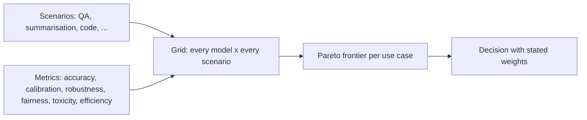

A single accuracy number answers one question: how often is the model right on this task? Deploying a model raises many more. Does it know when it might be wrong? Does it still work when users make typos? Is it slower or more expensive than the alternative? Does it treat groups of users differently? **Holistic evaluation** measures a model across a grid of **scenarios** (tasks and domains) and **metrics** (properties), so that a weakness on one axis cannot hide behind strength on another.

A car review is the everyday version. Top speed is one number; a useful review also reports braking, fuel use, safety rating, boot space and price, because buyers weigh them differently.

The best-known example is Stanford's **HELM** (Holistic Evaluation of Language Models, 2022). It evaluated 30 models on 42 scenarios with seven metrics: accuracy, **calibration**, **robustness**, fairness, bias, toxicity and efficiency. One of its points was about coverage: before HELM, a typical model had been evaluated on under a fifth of the core scenarios; HELM ran every model on nearly all of them under the same conditions, so comparisons became possible at all.

## The maths: three metrics beyond accuracy

**Calibration** asks whether stated confidence matches observed accuracy. Group answers into bins by the model's confidence and compare. The **expected calibration error** is the bin-size-weighted average gap:

$$
\text{ECE} = \sum_b \frac{n_b}{N}\,\big|\text{acc}_b - \text{conf}_b\big|
$$

**Robustness** is the accuracy kept under realistic perturbations (typos, paraphrases, reordered options): report the drop $\text{acc}_{\text{clean}} - \text{acc}_{\text{perturbed}}$.

**Efficiency** is what each correct answer costs. With price per query $c$ and accuracy $a$:

$$
\text{cost per correct answer} = \frac{c}{a}
$$

```steps
One model, three extra numbers
Calibration: 100 answers given at confidence 0.9, of which 72 were right; 50 answers at confidence 0.6, of which 30 were right. Gaps: $|0.72 - 0.90| = 0.18$ and $|0.60 - 0.60| = 0$.
---
$\text{ECE} = \frac{100}{150} \times 0.18 + \frac{50}{150} \times 0 = 0.12$. The model is overconfident when it is most sure, the worst place for it.
---
Robustness: 80% on clean questions, 72% when 5% of characters are typos. A drop of 8 points.
---
Efficiency: 0.4 cents per query at 80% accuracy costs $0.4/0.80 = 0.5$ cents per correct answer.
```

## Pareto, not a single winner

When metrics disagree, no single ranking is right. A model is **dominated** if another model is at least as good on every metric you care about and strictly better on one. The undominated models form the **Pareto frontier**, and the choice among them is a business decision.

| Model | Accuracy | Cost per 1k queries | ECE | Dominated? |
|---|---|---|---|---|
| P | 0.86 | 9.00 | 0.05 | No (most accurate) |
| Q | 0.82 | 2.50 | 0.04 | No (good balance) |
| R | 0.80 | 3.00 | 0.07 | Yes, by Q: Q is more accurate, cheaper and better calibrated |
| S | 0.71 | 0.40 | 0.09 | No (cheapest) |

Cost reporting is spreading. The ARC Prize made an efficiency (cost) figure part of all ARC-AGI results from ARC-AGI-2 on, on the view that solving a task by brute force spending is not the same as solving it intelligently. Agent leaderboards increasingly do the same ([reading agent results](/learn/agents/agent-benchmarks/reading-agent-results)).



## In practice

You rarely need all seven metrics, but you almost always need more than one. A sensible default for an application team is accuracy (or task success), a robustness check on paraphrased and noisy inputs, cost and latency per successful answer, and a safety metric suited to the product. Write down the weights before you look at the results, so the choice is not reverse-engineered from a favourite model.

```quiz
{"q": "Answers at confidence 0.8: 200 answers, 150 correct. Answers at confidence 0.5: 100 answers, 50 correct. What is the ECE?", "options": ["0.033", "0.05", "0.10", "0.25"], "answer": 0, "explain": "Bin 1 accuracy 0.75 vs confidence 0.8: gap 0.05. Bin 2: 0.50 vs 0.50: gap 0. ECE = (200/300)(0.05) + (100/300)(0) = 0.033. 0.05 forgets to weight by bin size."}
```

```quiz
{"q": "Model A: 0.84 accuracy at 6 cents per 1k queries. Model B: 0.80 at 2 cents. Model C: 0.78 at 3 cents. Which is dominated, considering only accuracy and cost?", "options": ["A", "B", "C", "None"], "answer": 2, "explain": "B beats C on both accuracy (0.80 > 0.78) and cost (2 < 3 cents), so C is dominated. A and B trade accuracy against cost, so both stay on the frontier."}
```
