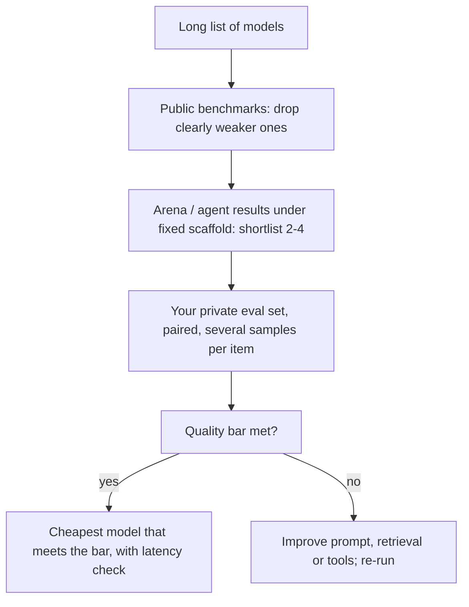

Public numbers answer "which models are generally strong?". Your question is narrower: "which model, prompt and settings work best for **my** users, at **my** budget?". The two overlap but are not the same, and the most common mistake in model selection is to let the first answer the second.

A hiring analogy fits. A degree and a CV (public benchmarks) get a candidate onto the shortlist. A reference from a previous employer (arena ratings, other teams' reports) adds evidence. But you still run a work-sample test on the actual job (your own eval set) before hiring, because that is the only evidence about the role you are filling.

## A ladder of evidence

| Evidence | What it is good for | What it cannot tell you |
|---|---|---|
| Static capability benchmarks (MMLU-Pro, GPQA, maths sets) | Ruling out models that lack basic capability | How the model behaves on your inputs and format |
| Fresh or time-windowed sets (LiveCodeBench, new competitions) | Capability with less contamination risk | Your domain, your prompts |
| Arena ratings (overall, by category, style-controlled) | Broad conversational preference | Your users' preferences and your quality bar |
| Agent benchmarks with a fixed scaffold | Tool use and multi-step competence | Your tools, your policies, your scaffold |
| **Your own eval set**, paired, with error bars | The actual decision | Nothing more to climb to: this is the top rung |

Use the lower rungs to narrow a long list to two to four candidates. Use the top rung to decide.

## The maths: how big must your own comparison be?

To detect a difference $\delta$ between two pass rates near $p$ with significance $\alpha = 0.05$ (two-sided, $z = 1.96$) and 80% power ($z = 0.84$), an unpaired comparison needs about

$$
n \approx \frac{(1.96 + 0.84)^2 \cdot 2p(1-p)}{\delta^2}
$$

items per model. Pairing (both models answer the same items) usually cuts this substantially, because only items where the two models disagree carry information.

```steps
Sizing a shortlist bake-off
Two shortlisted models, expected pass rate around $p = 0.80$, and you care about a gap of $\delta = 0.05$.
---
Unpaired: $n \approx 7.84 \times 2 \times 0.80 \times 0.20 / 0.0025 = 7.84 \times 0.32 / 0.0025 = 1{,}004$ items per model.
---
Paired, if the models disagree on about 15% of items: the test runs on discordant items only. With a 5-point gap the discordant split is 10% vs 5% of items. The paired (McNemar) sample size is $n \approx \big(1.96\sqrt{0.15} + 0.84\sqrt{0.15 - 0.05^2}\big)^2 / 0.05^2 = (0.759 + 0.323)^2 / 0.0025 \approx 470$ items, under half the unpaired figure (power is covered in [sample size and power](/learn/evaluation/comparing-systems/sample-size-and-power)).
---
If you only care about gaps of 10 points, the unpaired requirement drops by a factor of 4, to about 250. Decide the gap that would change your decision before you size the set.
```

## Cost changes the winner

The model to pick is the one with the best value at the quality bar you need, not the highest score. Suppose model A passes 88% of your eval at 1.2 cents per request and model B passes 85% at 0.3 cents. Per successful request, A costs $1.2/0.88 = 1.36$ cents and B costs $0.3/0.85 = 0.35$ cents. If 85% clears your bar and failures are cheap to recover (a retry, a human glance), B is the better product choice. If each failure costs a support ticket worth far more than a cent, A may win. Put the cost of a failure into the comparison explicitly.



## In practice

Keep a private eval set that mirrors production (built from real traffic, refreshed regularly, never published), and rerun it whenever a new model ships. Record protocol details with every result so comparisons stay valid over time. Distrust any single public number that moved a lot in one release without a matching move on a fresh benchmark. The next lesson, [eval-driven development](/learn/evaluation/eval-driven-development), shows how to build and maintain that private set.

```lab
build-an-eval-suite
```

```quiz
{"q": "Model A: 90% on your eval at 2.0 cents per request. Model B: 84% at 0.5 cents. What is B's cost per successful request?", "options": ["About 0.60 cents", "About 0.42 cents", "About 2.22 cents", "About 0.84 cents"], "answer": 0, "explain": "0.5 / 0.84 = 0.595 cents. A costs 2.0 / 0.90 = 2.22 cents per success. Whether B's 6-point lower pass rate is acceptable depends on what a failure costs you."}
```

```quiz
{"q": "A new model tops a popular leaderboard. What is the best next step before switching your product to it?", "options": ["Switch immediately; leaderboards are reliable", "Run it on your private eval set, paired against your current model, and compare pass rate and cost per success with error bars", "Wait until it tops a second leaderboard", "Ask it which model is better"], "answer": 1, "explain": "A public ranking is evidence about general strength under someone else's protocol. Only a paired comparison on your own inputs measures the decision you are making; topping a second leaderboard adds little new information."}
```
