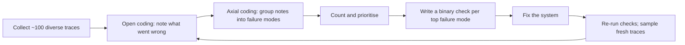

**Eval-driven development** means letting measured results, not impressions, decide what you change next: every prompt edit, model swap or new tool is judged by an evaluation that runs the same way each time. The phrase is sometimes read as "write the evals first, like test-driven development". For LLM products that is usually backwards. You do not yet know how the system fails, so evaluators written up front tend to measure generic properties ("helpfulness 4.2/5") that nobody can act on.

Practitioners who have built many of these systems (Hamel Husain and Shreya Shankar's evals FAQ is a good summary) recommend the opposite order: **observe first**, then write evaluators for the failures you actually see. Anthropic's guide on agent evals gives the same advice in different words: start with 20 to 50 tasks drawn from real failures.

A doctor works the same way. They do not order every test on day one; they examine the patient, form hypotheses about what is wrong, and then order the tests that would confirm or rule those out.

## The loop



**Open coding**: read each trace and write a short free-text note on the first thing that went wrong. **Axial coding**: group the notes into named **failure modes** ("quotes the wrong refund window", "ignores the user's stated date", "calls search when the answer is in context") and count them. The existing [error analysis](/learn/evaluation/error-analysis) lesson covers taxonomies and Pareto prioritisation in detail; here the point is what comes next. Each top failure mode becomes a **criterion** with a **binary** verdict: pass or fail, not a 1 to 5 score. Binary labels force a decision, are faster to give, and make judge agreement measurable.

There is a second reason to look before you define. Shankar and colleagues found **criteria drift**: people need criteria to grade outputs, but grading outputs changes their criteria. Your first rubric will be wrong in ways you only discover by reading outputs, so expect to revise it.

## The maths: how many traces before you have seen the problems?

If a failure mode occurs in a fraction $r$ of traces, the chance that a random sample of $n$ traces contains at least one example is

$$
P(\text{seen}) = 1 - (1 - r)^n
$$

Solving for the $n$ that gives confidence $C$ of seeing it at least once:

$$
n = \frac{\ln(1 - C)}{\ln(1 - r)}
$$

```steps
How many traces to read?
A failure mode affects 3% of traces, $r = 0.03$. You want 95% confidence of seeing it at least once.
---
$n = \ln(0.05) / \ln(0.97) = -2.996 / -0.0305 = 98.4$. About 100 traces, which is why "read a hundred" is a common starting rule.
---
A rarer mode at $r = 0.01$ needs $\ln(0.05)/\ln(0.99) = 298$ traces. Rare failures need targeted sampling (filter for long conversations, low feedback scores, tool errors) rather than more random reading.
---
Seeing a failure once is enough to name it. Estimating its rate precisely needs many more examples, which is the job of the golden set (next topic).
```

## Turning a failure mode into a criterion

| Failure mode (from notes) | Criterion (binary) | Cheapest reliable check |
|---|---|---|
| Quotes 14-day refund window; policy says 30 | Every stated refund window equals the policy value | Regex + lookup (code) |
| Answer ignores the date the user gave | Answer uses the user's date when one is given | Model judge with a narrow prompt |
| Replies in English to Spanish users | Reply language matches user language | Language-ID library (code) |
| Rambling, buries the answer | First sentence answers the question | Model judge, calibrated |

Notice that each criterion is specific enough that two people would usually agree on the verdict. "Is the answer helpful?" fails that test; "does the first sentence answer the question?" passes it.

## In practice

Have one person with domain knowledge own the quality bar (the FAQ calls this a "benevolent dictator") so labels stay consistent. Keep reading traces after launch: a fresh batch every couple of weeks, always including some random ones, catches failure modes your existing checks cannot see. Resist dashboards of generic scores; a short note saying "refund-window errors fell from 6% to 1%, new failure: wrong currency for EU users" is more useful.

```quiz
{"q": "A failure mode occurs in 2% of traces. Roughly how many random traces must you read to have a 90% chance of seeing at least one?", "options": ["About 45", "About 114", "About 230", "About 500"], "answer": 1, "explain": "n = ln(0.10)/ln(0.98) = −2.303/−0.0202 = 114. Using 1/r = 50 underestimates it: at n = 50 the chance of seeing it is only 1 − 0.98⁵⁰ = 64%."}
```

```quiz
{"q": "Why are binary pass/fail criteria usually preferred over 1-5 quality scores in application evals?", "options": ["They contain more information", "They force a clear decision, are faster to label, and make agreement between graders measurable and actionable", "Model judges cannot output numbers", "Statistics only work on binary data"], "answer": 1, "explain": "A 1-5 scale invites graders to hide in the middle and makes '3.6 vs 3.8' hard to act on. Binary criteria tied to specific failure modes map directly to fixes. Model judges can output numbers, and statistics work on scales too; those options are false."}
```
