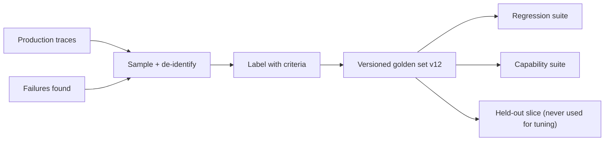

A **golden set** is the fixed, versioned collection of inputs (with references or criteria) that every change is scored against. Error analysis tells you *what* to check; the golden set decides *where* you check it. A good one looks like your production traffic, over-represents the cases you are worried about, and is large enough that a real change shows up above the noise.

Think of it as a pilot's checklist plus a flight simulator. The checklist items (criteria) came from past incidents; the simulator scenarios (golden items) are chosen to cover normal flights and the rare emergencies that matter most.

## What goes in

| Source | Share (typical start) | Why |
|---|---|---|
| Sampled production traces | Majority | Matches real inputs, phrasing and length |
| Past failures, reduced to test cases | Grows over time | Each one is a regression you never want back |
| Hand-written edge cases | Small | Rare but costly situations (refunds over a limit, legal questions) |
| Synthetic variations | Fill gaps | Cover combinations real traffic has not produced yet |
| **Negative cases** | Deliberate | Cases where the system should *not* act (no tool call, a refusal, "I don't know") |

Negative cases are easy to forget. Anthropic's agent-evals guide describes a web-search eval that had to cover both "should search" and "should not search": a set with only the first kind rewards a system that searches for everything.

For synthetic data, a reliable recipe is to define **dimensions** (issue type, customer mood, product line, language), write about 20 combinations by hand, and only then ask a model to generate more combinations and turn each into a realistic message. Synthetic items help coverage; they are poor at estimating real failure *rates*, so keep production samples as the backbone.

## Two suites, two jobs

Split the set by purpose:

- **Regression suite**: cases the system already passes and must keep passing. Expected pass rate near 100%. Any failure is a signal.
- **Capability suite**: harder cases you are working towards. Pass rate starts low and should climb. Cases that become reliably solved "graduate" into the regression suite.

## The maths: margin of error

For a pass rate near $p$ and a desired 95% margin of error $E$, you need about

$$
n = \frac{1.96^2 \, p (1-p)}{E^2}
$$

items, if they are independent and each is run once.

```steps
Sizing for a margin of error
Expected pass rate $p = 0.80$, target margin $E = 0.05$ (±5 points). $n = 3.8416 \times 0.80 \times 0.20 / 0.0025 = 0.6147 / 0.0025 = 246$.
---
Tighter margin $E = 0.03$: $n = 0.6147 / 0.0009 = 683$. Halving the margin roughly quadruples the set.
---
Slices are smaller. If Spanish traffic is 10% of a 500-item set, that slice has 50 items: $\text{SE} = \sqrt{0.8 \times 0.2 / 50} = 0.057$, a margin of ±11 points. Too wide to see a 5-point Spanish regression.
---
Fix: oversample the slices you must monitor (e.g. 150 Spanish items), and when reporting the overall rate, reweight each slice back to its true traffic share.
```

The worst case is $p = 0.5$, where $p(1-p) = 0.25$ is largest; near 0.95 the same margin needs far fewer items. That is why regression suites near 100% can be smaller than capability suites hovering around 50%.

## Hygiene



Version the set and record the version with every result; a score on v11 is not comparable with a score on v12. Keep a **held-out** slice that you never look at while tuning prompts, so you can check at the end that you have not overfitted to the visible items. Remove personal data before items enter the set.

## In practice

Start with 50 to 100 well-chosen items and grow from there, rather than waiting for a perfect 1,000. A small set that you read and trust beats a large one nobody has inspected. Add every production failure you fix. Refresh a slice every quarter from new traffic, because what users ask drifts.

```quiz
{"q": "You expect a pass rate around 90% and want a 95% margin of error of ±3 points. Roughly how many independent items do you need?", "options": ["About 100", "About 384", "About 1,067", "About 3,000"], "answer": 1, "explain": "n = 3.8416 × 0.9 × 0.1 / 0.0009 = 0.3457 / 0.0009 = 384. 1,067 is the worst case at p = 0.5, which overestimates for a 90% pass rate."}
```

```quiz
{"q": "Your golden set contains only questions where the agent should call the search tool. What is the main risk?", "options": ["The set is too small", "You will reward a system that calls search on everything, because over-triggering is never penalised", "Search tools cannot be evaluated", "The pass rate will be too low"], "answer": 1, "explain": "A one-sided set measures recall of the behaviour but not precision. Add negative cases where search is unnecessary or harmful so over-triggering shows up as failures."}
```
