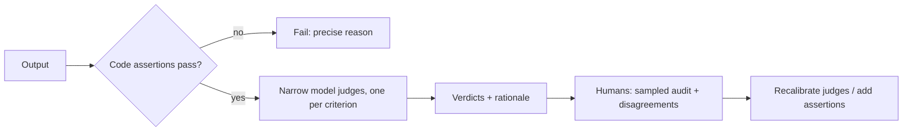

Every criterion needs a **grader**: the logic that turns an output into a verdict. There are three families, and a mature eval suite uses all three, each where it is strongest. The rule of thumb is simple: use the cheapest grader that is trustworthy for that criterion.

A factory quality line is the right picture. Automatic gauges check dimensions on every part (cheap, exact, narrow). A trained inspector looks at finish and fit on a sample (flexible, slower). An engineer investigates the odd ones and decides what the gauges should check next (expensive, authoritative).

## The three families

| Grader | Examples | Strengths | Weaknesses |
|---|---|---|---|
| **Code assertion** | Valid JSON, regex for a policy value, unit tests pass, the right tool was called, database row exists | Fast, free, deterministic, no calibration needed | Brittle to valid variation; cannot judge tone or nuance |
| **Model judge** | "Does the first sentence answer the question? PASS/FAIL", pairwise preference, rubric item | Handles open-ended text; scales to thousands of items | Costs tokens; non-deterministic; must be calibrated against humans; has biases |
| **Human review** | Domain expert labels, annotation queue, spot checks | The reference standard; catches what nobody thought to check | Slow, expensive, inconsistent without a clear rubric |

Anthropic's agent-evals guide groups graders the same way and adds one principle worth keeping: **grade outcomes, not paths**. Check that the refund exists in the database, not that the agent used exactly the tool sequence you imagined; there is often more than one valid way.

## Design rules that save pain

- **One judge per failure mode**, each with a narrow binary question, beats one judge asked for "overall quality". Narrow judges are easier to calibrate and their failures point at a specific fix.
- **Assertions first.** If a rule can decide it (format, presence of a required field, a number matching a source), write the rule. Reserve judges for what rules cannot capture.
- **Partial credit where it is real.** A support task might be scored as identity verified (0/1), correct refund amount (0/1), and tone acceptable (0/1); report each, plus the share passing all three.
- **Panels for noisy criteria.** One study found a panel of several smaller judges from different model families agreed with humans better than a single large judge and cost over seven times less.

## The maths: what grading costs per run

Suppose 500 golden items, each run 3 times (to average out sampling noise), with three criteria: two checked by code and one by a judge. A judge call reads about 1,500 input tokens and writes 100. At illustrative prices of \$3 per million input tokens and \$15 per million output tokens:

$$
\text{cost per judge call} = 1500 \times \frac{3}{10^6} + 100 \times \frac{15}{10^6} = 0.0045 + 0.0015 = \$0.006
$$

```steps
Grading budget for one CI run
Judge calls: $500 \times 3 = 1{,}500$. Cost: $1{,}500 \times \$0.006 = \$9$.
---
Code assertions: $500 \times 3 \times 2 = 3{,}000$ checks, effectively free and done in seconds.
---
If CI runs the suite 40 times a week, judging costs about $40 \times \$9 = \$360$ a week. Cheaper options: run the judge only on items whose output changed, or only on the nightly build.
---
Human review: a reviewer at \$60 per hour labelling one item every 2 minutes costs \$2 per item. Reviewing 100 sampled items a week costs \$200 and is the calibration anchor for everything else.
```



Running cheap checks first also saves money: there is no point paying a judge to assess tone in an answer that is not even valid JSON.

## In practice

Track, for each criterion, which grader owns it and when it was last validated against human labels. When a judge keeps flagging something a rule could catch, write the rule. When humans keep overruling a judge on one kind of item, narrow the judge's question or split the criterion. Tools such as promptfoo, DeepEval, Inspect, OpenAI Evals, LangSmith, Braintrust and Arize Phoenix all support mixing code checks and model-graded checks; the design choices above matter more than the tool.

```quiz
{"q": "Which criterion is best checked by a code assertion rather than a model judge?", "options": ["The reply is empathetic", "The reply's JSON matches the schema and the order ID equals the one in the database", "The explanation is easy to follow", "The summary captures the main point"], "answer": 1, "explain": "Schema validity and an exact ID match are deterministic, so a rule is cheaper and more reliable. The others need judgement and are where a calibrated judge or a human earns its cost."}
```

```quiz
{"q": "A suite has 800 items × 2 trials × 2 judge criteria, at 0.004 dollars per judge call. What does one full run cost in judging?", "options": ["About 6.40 dollars", "About 12.80 dollars", "About 3.20 dollars", "About 25.60 dollars"], "answer": 1, "explain": "Calls = 800 × 2 × 2 = 3,200. Cost = 3,200 × 0.004 = 12.80 dollars. Forgetting either the trials or the second criterion gives 6.40."}
```
