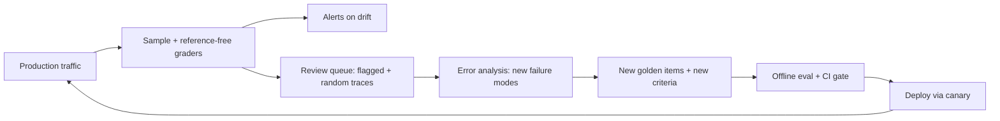

Offline evals run on a fixed golden set before you ship. **Online evals** run on live traffic after you ship. They answer a different question: not "is the new version better on the cases we chose?" but "is the system working on what users are actually sending, today?". The two are complementary, and the most valuable thing about online evals is what they feed back: new failures that become new golden items.

Restaurants again: the kitchen tastes every dish against the recipe before service (offline), and the manager samples plates from the pass and reads the comment cards during service (online). A complaint about a dish nobody tasted becomes a new line in the recipe book.

## What changes when you go online

| | Offline | Online |
|---|---|---|
| Inputs | Fixed golden set | Live, shifting traffic |
| References | Often available | Usually none: graders must be **reference-free** |
| Graders | Assertions, judges, humans | Assertions and calibrated judges on a sample; user signals |
| Purpose | Decide whether to ship | Detect drift, find new failure modes, validate offline results |

Reference-free graders are the workhorses online: format and policy assertions, judges for groundedness against the retrieved context, judges for the specific failure modes you found in error analysis. Explicit and implicit user signals (thumbs, rephrasing, escalations; see [implicit feedback](/learn/evaluation/online-evaluation/implicit-feedback)) complement them.

## The maths: how much traffic to grade

You cannot judge every conversation, so you sample. To detect a drop with a three-standard-error rule (as in [agent monitoring](/learn/agents/traces-and-evaluation/monitoring-and-regression-tests)), the daily sample must make the standard error small compared with the drop you care about:

$$
n_{\text{day}} = \frac{p(1-p)}{\text{SE}^2}, \qquad \text{sampling rate} = \frac{n_{\text{day}}}{\text{traffic per day}}
$$

```steps
Sizing an online judge
Baseline judged pass rate $p = 0.90$. You want to detect a 3-point drop within a day, so set $3\,\text{SE} = 0.03$, i.e. $\text{SE} = 0.01$.
---
$n_{\text{day}} = 0.90 \times 0.10 / 0.01^2 = 0.09 / 0.0001 = 900$ judged conversations per day.
---
With 50,000 conversations a day, the sampling rate is $900 / 50{,}000 = 1.8\%$.
---
At \$0.006 per judge call, that is about \$5.40 a day. For a 1-point drop you would need 9 times as many: $\text{SE} = 0.0033$, $n = 8{,}100$ a day.
---
Correct the judged rate for judge error (previous topics) before comparing it to an offline number; compare online numbers with each other freely if the judge is unchanged.
```

Stratify the sample: oversample new features, high-value customers and conversations that triggered tool errors, then reweight when you report the overall rate.

## The flywheel



Each turn of the loop makes the offline suite more like reality, which makes the CI gate more meaningful, which makes the next release safer. Teams that skip the review queue end up with a golden set frozen at launch, and a gate that guards against last year's problems.

## Canary releases close the loop

A new version that passed the offline gate still meets real users first through a **canary**: a small share of traffic, watched with the same online graders. The [canary sizing](/learn/production-systems/rollouts/canary-sizing) topic computes how long a canary must run to see a regression.

```sim
canary-rollout
{"canaryPct": 10, "durationMin": 60, "trafficPerMin": 2000, "bugRate": 0.0005, "alertThreshold": 1}
```

Treat the "bug" here as an output your online grader flags. Lower the canary share to 2% and see how much longer you must wait to detect the problem; then raise the bug rate and see detection become nearly immediate. Rare failure modes are what make canaries slow.

## In practice

Run the same graders online that you use offline where you can, so the numbers mean the same thing. Keep a small always-on random sample (unfiltered) next to the targeted ones; it is your only unbiased view. Review a batch of flagged and random traces every week or two, and track how many new golden items each review produced: if the answer is zero for months, either the system is mature or nobody is really looking.

```quiz
{"q": "Baseline judged pass rate is 80%. You want 3·SE to equal 4 points. How many judged conversations per day do you need?", "options": ["About 900", "About 400", "About 1,600", "About 100"], "answer": 0, "explain": "SE = 0.04/3 = 0.0133. n = 0.8 × 0.2 / 0.0133² = 0.16 / 0.000178 = 900. Using SE = 0.04 (forgetting the factor of 3) gives 100."}
```

```quiz
{"q": "What is the main reason online evals usually need reference-free graders?", "options": ["Reference-based graders are too expensive", "Live traffic has no gold answer attached to each request", "Judges cannot read references", "References leak private data"], "answer": 1, "explain": "Offline golden items come with references or criteria; a live user question does not. Online graders must judge from the input, the output and available context (e.g. retrieved documents)."}
```
