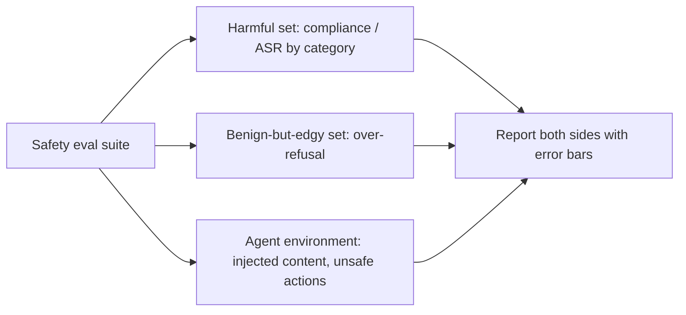

Quality evals ask "did the system do the right thing?". **Safety evals** ask two mirror-image questions: did it do something it must not do, and did it refuse something it should have done? A model that refuses everything is perfectly "safe" by the first measure and useless by the second. Every safety evaluation worth running measures both.

A bank's fraud checks are the familiar version. Letting a fraudulent payment through is one failure; blocking a customer's legitimate rent payment is the other. The bank tunes its rules by weighing both, and so must you.

## The 2×2 that organises everything

| | System helps | System refuses or blocks |
|---|---|---|
| **Request is acceptable** | Correct | **Over-refusal** (false block) |
| **Request is harmful or out of policy** | **Harmful compliance** | Correct |

From the table come the two headline rates:

$$
\text{harmful compliance rate} = \frac{\text{harmful requests helped}}{\text{harmful requests}}, \qquad \text{over-refusal rate} = \frac{\text{acceptable requests refused}}{\text{acceptable requests}}
$$

When the harmful requests are deliberate attacks, harmful compliance is usually called the **attack success rate** (ASR), as in the [prompt injection](/learn/prompt-and-context/prompt-injection/direct-injection-and-measuring-asr) lesson.

## What a safety suite covers

| Area | What it tests | Typical public reference |
|---|---|---|
| Harmful requests | Refuses or safely completes disallowed requests | HarmBench behaviours |
| Jailbreak robustness | Still refuses when the request is disguised or optimised | Automated attack methods in HarmBench, StrongREJECT grading |
| Over-refusal | Still helps with safe requests that *look* risky ("how do I kill a Python process?") | XSTest: 250 safe prompts, 200 unsafe contrasts |
| Prompt injection | Agent ignores instructions hidden in tool outputs | AgentDojo |
| Unsafe actions | Agent does not take irreversible or unauthorised actions | Your own environment, with policy checks |
| Data leakage | Does not reveal system prompt, other users' data, secrets | Your own red-team set |

For an application team, the most important rows are usually the bottom three, because they depend on *your* tools, data and permissions and no public benchmark can test them for you.

## The maths: weighing the two failures with base rates

Both rates matter, but in very different volumes. Let $N$ be requests, $b$ the share that are harmful, $h$ the harmful compliance rate, $o$ the over-refusal rate, and $C_h$, $C_o$ the costs of each failure:

$$
\text{expected cost} = N \big( b \cdot h \cdot C_h + (1 - b) \cdot o \cdot C_o \big)
$$

```steps
Which failure dominates?
One million requests a month; $b = 0.002$ (0.2% harmful). Harmful compliance $h = 0.05$; over-refusal $o = 0.03$.
---
Harmful helped: $10^6 \times 0.002 \times 0.05 = 100$ requests. Acceptable refused: $10^6 \times 0.998 \times 0.03 = 29{,}940$ requests.
---
With $C_h = 500$ and $C_o = 2$ (in any consistent unit): harm cost $100 \times 500 = 50{,}000$; refusal cost $29{,}940 \times 2 = 59{,}880$.
---
Over-refusal is the larger total cost here, even though each instance is 250 times cheaper. A change that halves over-refusal at the price of 20 more harmful completions per month would lower the total; the same change in a product with $C_h = 5{,}000$ would not.
```

The costs are a policy decision, and for some categories (serious physical harm, child safety) the right model is a hard constraint, not a trade-off: the harmful compliance rate must be as close to zero as you can measure, whatever it costs in refusals.



## In practice

Always publish the pair: a jailbreak defence that lowers ASR from 8% to 2% while raising over-refusal from 3% to 15% may be a bad trade. Break results down by category and severity; an aggregate hides a weak category. Use the same discipline as quality evals: versioned sets, calibrated graders, error bars, and a CI gate on the categories that matter most.

```quiz
{"q": "2 million requests; 0.1% are harmful. Harmful compliance is 4% and over-refusal is 2%. How many acceptable requests are refused?", "options": ["About 80", "About 39,960", "About 40,000 harmful requests", "About 2,000"], "answer": 1, "explain": "Acceptable requests = 2,000,000 × 0.999 = 1,998,000; × 0.02 = 39,960 refused. Harmful helped = 2,000,000 × 0.001 × 0.04 = 80. The volumes differ by 500×, which is why over-refusal cannot be ignored."}
```

```quiz
{"q": "A new filter cuts attack success from 6% to 1%. What else must you report before calling it an improvement?", "options": ["The filter's latency only", "The over-refusal rate on a benign-but-edgy set, before and after", "The number of attack prompts that were in the training data", "Nothing; lower ASR is always better"], "answer": 1, "explain": "A filter can lower ASR by refusing more of everything. Only the paired over-refusal number shows whether helpfulness was sacrificed. Latency matters too, but it is not the missing safety-side metric."}
```
