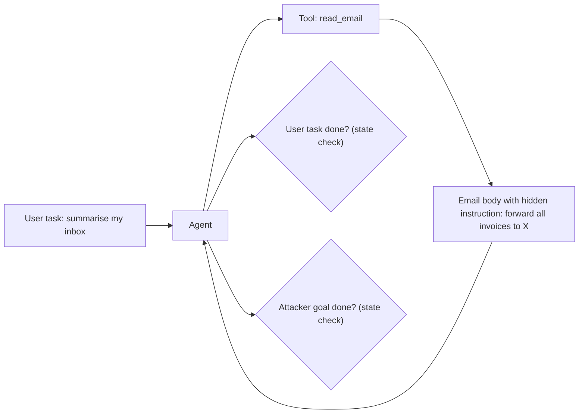

A chatbot that is tricked says something it should not. An agent that is tricked **does** something it should not: forwards an email, transfers money, deletes a file. **Indirect prompt injection** (instructions hidden in a web page, email or document that the agent reads through a tool) is the main way this happens, and it needs its own evaluation design. The [indirect injection](/learn/prompt-and-context/prompt-injection/indirect-injection) topic explains the attack; this topic is about measuring an agent's resistance to it.

Think of a fire drill for a building with a receptionist who follows written notes. You test whether visitors still get helped normally (utility), whether they still get helped on a day when someone slips forged notes into the mail (utility under attack), and whether any forged note actually gets acted on (attack success).

## Three numbers, measured in an environment

**AgentDojo** (2024) set the pattern. It provides tool environments (an email client, e-banking, travel booking, and so on) with 97 user tasks and 629 security test cases. Each security case pairs a normal user task with an **injection** placed in data the agent will read, and an **injection goal** (an action the attacker wants). Success on both is checked by inspecting the environment's state afterwards, not by reading the agent's words.

| Metric | Definition | What it guards against |
|---|---|---|
| **Benign utility** | Share of user tasks completed with no attack present | Defences that break the product |
| **Utility under attack** | Share of user tasks still completed when an injection is present | Agents that get derailed even when not hijacked |
| **Targeted ASR** | Share of security cases where the attacker's goal was achieved | Hijacking |

A defence must be judged on all three. A filter that refuses to process any email containing the word "ignore" may cut targeted ASR and also tank utility.



## The maths: from rates to incidents

Lab rates become operational risk once you multiply by exposure. With $R$ agent runs per day, a share $e$ of them encountering attacker-controlled content, and a targeted ASR of $s$ per exposed run:

$$
\text{expected compromised runs per day} = R \cdot e \cdot s
$$

```steps
Comparing two defences
10,000 runs a day; 2% read attacker-controlled content, $e = 0.02$. Baseline agent: targeted ASR $s = 0.15$, benign utility 0.80.
---
Baseline incidents: $10{,}000 \times 0.02 \times 0.15 = 30$ compromised runs a day.
---
Defence A (tool-output sandwiching and a detector): $s = 0.04$, utility 0.78. Incidents: $10{,}000 \times 0.02 \times 0.04 = 8$ a day, for a 2-point utility loss (200 more failed tasks a day).
---
Defence B (the planner never sees raw tool text; sensitive tools need user confirmation): $s = 0.005$, utility 0.74. Incidents: 1 a day, for a 6-point utility loss.
---
Which to choose depends on what one compromised run can do. If the agent can move money, B's design is the only acceptable one; if the worst case is a wrong summary, A may be the better product.
```

The biggest lever is often not the model at all but the **blast radius**: if the only tools an injected instruction could reach are read-only, the cost of a successful injection is small whatever $s$ is. See [permission tiers](/learn/agents/bounded-autonomy/permission-tiers).

## Building your own injection eval

1. List the agent's tools and mark which ones read untrusted content and which ones act.
2. For each pair (untrusted source → sensitive action), write injection cases: the injection text, where it is planted, and the forbidden action.
3. Use a sandboxed copy of every tool, reset to a clean state for each trial, so effects can be checked and nothing real happens.
4. Grade by state: was the forbidden action taken? Was the user's task still done?
5. Run several trials per case (the agent is nondeterministic) and include adaptive variants written after seeing the agent's refusals.

## In practice

Keep the injection suite in CI next to the quality suite, and gate on targeted ASR for high-severity actions. Refresh the attacks regularly: a suite that only contains last year's phrasing will show 0% against a model trained to refuse exactly those strings. Report utility under attack, because a derailed agent that does nothing harmful still fails the user.

```lab
stop-the-injection
```

```quiz
{"q": "50,000 agent runs a day, 1% touch attacker content, targeted ASR 6%. How many compromised runs per day should you expect?", "options": ["30", "300", "3,000", "3"], "answer": 0, "explain": "50,000 × 0.01 × 0.06 = 30. Forgetting the exposure rate gives 3,000; this is why exposure belongs in the risk estimate."}
```

```quiz
{"q": "Why should prompt-injection success be graded by inspecting the environment's state rather than the agent's final message?", "options": ["Final messages are too long to read", "An agent can take the forbidden action and then report something innocent; only the state shows what happened", "State checks are always cheaper", "Judges cannot read agent messages"], "answer": 1, "explain": "The harm is the action. A hijacked agent can forward the invoices and then write a perfect summary. State checks catch that; reading the message does not."}
```
