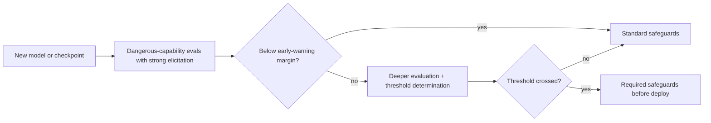

Application safety evals ask whether *your product* misbehaves. Frontier labs also ask a different question about the model itself: has it become capable enough at something dangerous that stronger safeguards are required before it is deployed, or even before training continues? These **dangerous-capability evaluations** feed public policies: Anthropic's Responsible Scaling Policy, OpenAI's Preparedness Framework and Google DeepMind's Frontier Safety Framework.

Building codes work similarly. A garden shed needs no structural survey; a ten-storey building does. The code does not ask whether a particular building is dangerous today, it defines thresholds (height, occupancy) above which specific safeguards become mandatory. Frontier frameworks define capability thresholds the same way.

## The shared structure

| Element | Anthropic RSP | OpenAI Preparedness Framework (v2, 2025) | Google DeepMind FSF |
|---|---|---|---|
| Thresholds | Capability thresholds (e.g. CBRN uplift, autonomous AI R&D) tied to AI Safety Levels (ASL) | Tracked Categories (biological and chemical, cybersecurity, AI self-improvement) with High and Critical levels | Critical Capability Levels (CCLs), plus earlier Tracked Capability Levels in v3.1 |
| Evidence | Capability evaluations; safeguards assessments | Capability evaluations; safeguards reports | Early-warning evaluations; safety case reviews |
| Consequence | Required security and deployment safeguards | High: safeguards before deployment; Critical: safeguards during development | Mitigations and review before launch, and for some large internal deployments |

The details change with each version (Anthropic's policy had reached version 3.4 by mid-2026), but the logic is stable: measure, compare to a threshold set in advance, and attach obligations to crossing it.



## Elicitation: measuring the ceiling, not the average

A product eval measures typical behaviour. A dangerous-capability eval must estimate what a motivated user could get out of the model: the **upper bound**. That means strong **elicitation**: good prompts, chain-of-thought, tools, many attempts, and sometimes fine-tuning. Anthropic's policy page lists past shortfalls such as not using best-of-N sampling or chain-of-thought prompting in some evaluations: under-elicitation makes a model look safer than it is.

## The maths: why attempts matter so much

If a model solves a dangerous task with probability $a$ per attempt, an evaluator who allows $k$ attempts (keeping any success) measures

$$
\text{best-of-}k = 1 - (1 - a)^k
$$

```steps
Under-elicitation in numbers
Per-attempt success on a hard multi-step task: $a = 0.05$. One attempt: 5%. Looks far from a threshold set at 50%.
---
With 20 attempts: $1 - 0.95^{20} = 1 - 0.358 = 0.64$. Above the threshold.
---
A real adversary can try many times and check results, so the 64% is the decision-relevant number, not the 5%.
---
The same logic makes **sandbagging** (a model underperforming on purpose during evaluation) a research concern: it would bias exactly the number these policies depend on. OpenAI's framework lists it as a research category.
```

## Margins and trends

Evaluations happen at intervals, and capabilities grow between them. So frameworks use **early-warning** levels below the real threshold, giving time to prepare safeguards. METR's work on task **time horizons** shows why: the length of tasks (measured in human time) that frontier models complete with 50% success has doubled roughly every seven months since 2019, by their estimate. If a model handles 1-hour tasks today, a seven-month doubling implies 2 hours in 7 months, 4 in 14 and 8 in 21:

$$
H(t) = H_0 \cdot 2^{t / 7}, \qquad H(21) = 1 \cdot 2^{3} = 8 \text{ hours}
$$

A threshold that is three doublings away is under two years away on that trend, which is the kind of arithmetic that sets evaluation intervals and margins.

## In practice

Most application teams will not run bio or cyber uplift evaluations, but the ideas transfer directly: set thresholds before you measure, elicit hard when the question is "what is the worst it could do?", keep a margin for growth between evaluations, and tie each threshold to a concrete safeguard. Public tools such as Inspect, which the UK AI Security Institute uses for its own testing, make it practical to run agentic evaluations in sandboxes with many attempts.

```quiz
{"q": "A model succeeds on a dangerous-capability task 3% of the time per attempt. With 50 attempts, what does best-of-50 come to?", "options": ["About 3%", "About 78%", "About 50%", "About 150%"], "answer": 1, "explain": "1 − 0.97⁵⁰ = 1 − 0.218 = 0.78. Multiplying 3% by 50 gives an impossible 150%; reporting the single-attempt 3% would badly under-elicit."}
```

```quiz
{"q": "Why do frontier safety frameworks use early-warning levels below the actual capability threshold?", "options": ["To make models look safer", "Capabilities can grow between evaluations, so a margin gives time to prepare safeguards before the threshold is crossed", "Because thresholds are always wrong", "To reduce the cost of evaluations"], "answer": 1, "explain": "Evaluations are periodic and capability trends are steep (for example, a time horizon doubling about every seven months). A margin buys time. It does not make models look safer; it triggers work earlier."}
```
