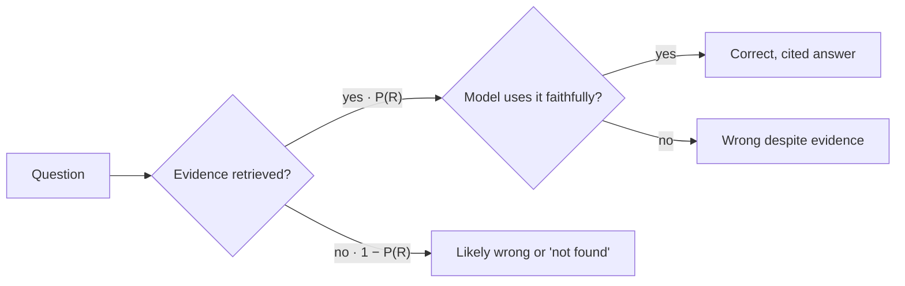

```callout-before
Before you start
You should know that a language model predicts the next token from what is in its context window, and that its knowledge comes from the data it was trained on. Nothing about search or vectors is assumed yet.
```

Think of two students sitting the same exam. One studied hard a year ago and must answer from memory. The other studied less but is allowed to bring the textbook and the lecture notes from last week. On questions about recent material, or anything too specific to memorise, the second student wins easily, provided they can find the right page quickly and actually read it.

A language model on its own is the first student. Everything it "knows" was squeezed into its **parameters** during training, and that knowledge has a **cutoff date**, is blurred for rare facts, and never included your company's private documents. **Retrieval-augmented generation (RAG)** turns it into the second student: before answering, the system searches a collection of documents, copies the most relevant passages into the prompt, and asks the model to answer from them.

The idea is simple, but it changes the model's job. Without retrieval the model must *recall* a fact. With retrieval it must *read* a fact that is sitting in its context, which is a much easier and more reliable task for a transformer.

## What retrieval fixes, and what it does not

| Problem | Does RAG help? | Why |
|---|---|---|
| Knowledge cutoff ("what changed last week?") | Yes | Update the documents, not the model |
| Private or proprietary data | Yes | The data never has to enter training |
| Rare, precise facts (part numbers, clauses) | Yes | Reading beats recalling for low-frequency facts |
| Citations and auditability | Yes | Each claim can point to a retrieved passage |
| Style, format, tone | Little | That is behaviour, better taught by prompting or fine-tuning |
| Reasoning the model cannot do | No | Evidence in context does not add skill |
| Questions whose answer is not in your data | No | Retrieval returns the closest text, relevant or not |

The last row is the one that surprises people. A search engine always returns *something*. If the answer is not in the collection, the model receives plausible-looking but irrelevant passages and may build a confident wrong answer from them. A good RAG system must be allowed to say "I could not find this".

## A first equation

Write $A$ for the event that the system answers correctly, $R$ for "the passage containing the answer was retrieved and placed in the prompt", and $\bar R$ for its complement. By the law of total probability:

$$
P(A) = P(R)\,P(A \mid R) + P(\bar R)\,P(A \mid \bar R)
$$

Here $P(R)$ is the **retrieval hit rate**, $P(A \mid R)$ is how often the model answers correctly *and faithfully* when the evidence is present, and $P(A \mid \bar R)$ is how often it gets lucky from its own memory when the evidence is missing. For private data that last term is close to zero (the model never saw your documents), which gives the approximation used throughout this module:

$$
P(\text{correct}) \approx P(\text{retrieved}) \times P(\text{faithful} \mid \text{retrieved})
$$

```steps
Worked example: a support bot
Retrieval finds the right help-centre passage for 85% of questions: $P(R) = 0.85$.
---
When the passage is in the prompt, the model answers correctly 90% of the time: $P(A \mid R) = 0.90$.
---
When the passage is missing, the model still answers 30% of questions correctly from general knowledge: $P(A \mid \bar R) = 0.30$.
---
Total: $0.85 \times 0.90 + 0.15 \times 0.30 = 0.765 + 0.045 = 0.81$. The approximation, which ignores the lucky term, gives $0.765$. For a bot over private data the lucky term would shrink towards 0 and the two numbers would converge.
```

The equation has a practical message: a RAG system is two systems in series, and the worse one caps the whole. A model that is perfectly faithful cannot exceed the retrieval hit rate, and perfect retrieval cannot rescue a model that ignores what it is given.



## In practice

Teams usually reach for RAG for one of three reasons: the data changes faster than anyone would retrain a model (prices, policies, tickets), the data is confidential, or the answers must be traceable to a source. A common early mistake is to judge the whole system by end-to-end answers only. When accuracy is 70%, you cannot tell whether search or the model is at fault. The rest of this module builds the tools to measure each half on its own: retrieval metrics in [Hybrid Search and Reranking](/learn/retrieval-and-rag/hybrid-and-reranking) and grounding metrics in [Evaluating RAG](/learn/retrieval-and-rag/evaluating-rag).

```quiz
{"q": "Retrieval finds the right passage 60% of the time, and the model is faithful 95% of the time when it has the passage. The data is private, so the model cannot answer without it. Roughly what accuracy do you expect?", "options": ["95%", "60%", "57%", "78%"], "answer": 2, "explain": "With no lucky term, $P \\approx 0.60 \\times 0.95 = 0.57$. Picking 95% judges the system by its generator alone; picking 60% forgets that even retrieved evidence is sometimes misused."}
```

```quiz
{"q": "A user asks your HR bot about a policy that does not exist in the document collection. What is the main risk?", "options": ["The vector search throws an error", "Retrieval returns the closest-looking passages, and the model may build a confident answer from irrelevant text", "The model refuses because the context is empty", "Nothing: retrieval only returns relevant passages"], "answer": 1, "explain": "Similarity search always returns its top-k, relevant or not, so the context is never empty. Unless the prompt and evaluation reward saying 'not found', the model tends to answer from whatever it was given."}
```

```sandbox
rag-basic
```
