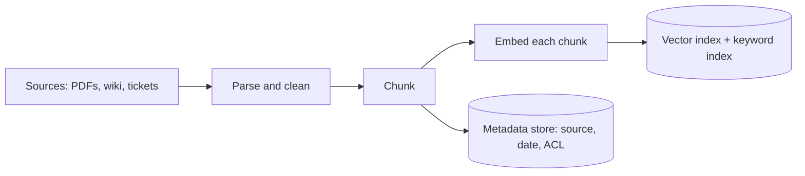

A library does most of its work before you walk in. Books are catalogued, shelved and labelled long before anyone asks for one, so that finding a book at the desk takes a minute rather than a week. RAG is organised the same way: an **offline indexing pipeline** prepares your documents ahead of time, and an **online query pipeline** answers each question in a fraction of a second using what was prepared.

Keeping the two apart in your head matters because they have completely different budgets. Indexing can take hours and runs once per document change. The query path runs on every request, and every millisecond of it is felt by a user.

## The indexing pipeline



1. **Parse**: turn PDFs, HTML and slides into clean text, keeping structure (headings, tables) where you can.
2. **Chunk**: split each document into passages of a few hundred tokens, because a whole manual is too big to put in a prompt and too blurry to embed as one vector. ([Chunking](/learn/retrieval-and-rag/chunking) is a lesson of its own.)
3. **Embed**: run each chunk through an **embedding model**, which maps text to a vector $\mathbf{v} \in \mathbb{R}^{d}$ (typically $d$ between 384 and 3072) so that passages with similar meaning land close together.
4. **Store**: write vectors into a **vector index** and, usually, the raw text into a **keyword index** too, with **metadata** such as source URL, last-updated date and who is allowed to see it.

## The query pipeline

```steps
One question, end to end
**Embed the query** with the same embedding model used for the chunks. Different models produce incompatible vector spaces.
---
**Search** the index for the $k$ chunks whose vectors are most similar to the query vector (and, in hybrid systems, the best keyword matches too). Apply metadata filters such as "only documents this user may read".
---
**Rerank** (optional): rescore the top candidates with a slower, more accurate model and keep the best few.
---
**Assemble the prompt**: instructions, the selected chunks with source labels, and the question.
---
**Generate**: the LLM answers from the provided passages and cites them.
```

## Doing the arithmetic on both sides

Indexing cost is driven by the number of tokens you embed. If a collection has $D$ documents averaging $\bar L$ tokens, you embed roughly $D \cdot \bar L$ tokens (a little more with chunk overlap). With an embedding throughput of $\theta$ tokens per second and a price of $c$ per million tokens:

$$
T_{\text{index}} = \frac{D \bar L}{\theta}, \qquad \text{Cost}_{\text{index}} = \frac{D \bar L}{10^{6}}\, c
$$

For $D = 20{,}000$ documents of $\bar L = 3{,}000$ tokens, that is $6 \times 10^{7}$ tokens. At $\theta = 10{,}000$ tokens/s indexing takes $6{,}000$ s, about 100 minutes; at an illustrative $c = \$0.02$ per million tokens it costs $60 \times 0.02 = \$1.20$. Embedding is cheap. Re-parsing and re-chunking messy PDFs is usually where the engineering time goes.

On the query side, the **time to first token** the user sees is the sum of every stage before generation starts:

$$
\text{TTFT}_{\text{system}} = t_{\text{embed}} + t_{\text{search}} + t_{\text{rerank}} + t_{\text{assemble}} + \text{TTFT}_{\text{LLM}}
$$

| Stage | Typical time | Running total |
|---|---|---|
| Embed query | 20 ms | 20 ms |
| Vector search (ANN) | 10 ms | 30 ms |
| Rerank 50 candidates | 60 ms | 90 ms |
| Assemble prompt | 2 ms | 92 ms |
| LLM prefill to first token | 450 ms | 542 ms |

Retrieval accounts for $92 / 542 \approx 17\%$ of the time to first token here. The LLM dominates, and a longer prompt (more chunks) makes its prefill slower, which is the hidden latency cost of retrieving too much. Generation then adds its own time per output token, which retrieval does not affect.

## In practice

The most common production bug in this architecture is a **mismatch between the two pipelines**: the index was built with one embedding model, chunk size or text normaliser, and the query path uses another after an upgrade. Results do not crash; they just quietly get worse. Version the embedding model and chunking settings alongside the index, and re-embed everything when either changes.

The second most common is forgetting **access control**. The index holds every document; the query path must filter by the user's permissions *before* chunks reach the prompt, because anything in the prompt can end up in the answer.

```quiz
{"q": "You upgrade the embedding model used for queries but keep the existing index. What happens?", "options": ["Search gets faster because the new model is better", "Nothing, as long as both models have the same dimension d", "Results silently degrade, because query and chunk vectors now live in different vector spaces", "The index automatically re-embeds on the next query"], "answer": 2, "explain": "Two embedding models, even with equal $d$, assign unrelated coordinates to meaning. Similarity between a new-model query and old-model chunks is close to noise. Matching dimensions is the tempting trap: it stops errors, not the degradation."}
```

```quiz
{"q": "Retrieval stages take 90 ms and LLM prefill takes 450 ms. You double k from 5 to 10 chunks of 400 tokens each. Which latency is most likely to grow noticeably?", "options": ["Query embedding", "Vector search", "LLM prefill, because the prompt gets about 2,000 tokens longer", "None of them"], "answer": 2, "explain": "Search cost barely depends on k for small k, and the query embedding is unchanged. The prompt grows by $5 \\times 400 = 2{,}000$ tokens, and prefill time grows with prompt length."}
```
