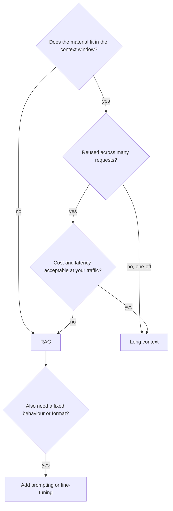

There are three ways to get knowledge into a model's answer. You can **train** it in (fine-tuning), you can **paste all of it** into a very long prompt (long-context stuffing), or you can **look up the relevant part** and paste only that (RAG). They are not rivals so much as tools for different jobs, and the deciding arguments are usually arithmetic.

## What each one changes

- **Fine-tuning** changes the weights. It is good at teaching *behaviour*: a format, a tone, a domain's vocabulary, a classification. It is a poor way to store facts that change, because every update needs a new training run and the model cannot tell you where a fact came from.
- **Long-context stuffing** changes nothing about the model and needs no search at all. It is excellent when the material is small, read once, and needed as a whole, such as "summarise this contract".
- **RAG** changes the prompt per question. It scales to collections far bigger than any context window, updates as soon as a document is re-indexed, and gives every claim a source.

## The size argument

A context window holds $W$ tokens. A collection of $D$ documents averaging $\bar L$ tokens needs $D \bar L$ tokens. Stuffing is only possible when $D \bar L < W$ (minus room for instructions and output).

A company wiki of $D = 50{,}000$ pages at $\bar L = 3{,}000$ tokens is $1.5 \times 10^{8}$ tokens. Even a 1-million-token window holds $10^6 / (1.5 \times 10^8) \approx 0.7\%$ of it. Past a few hundred documents, retrieval is not optional.

## The cost argument

Even when the material fits, you pay for every input token on every request. Compare a 150,000-token stuffed prompt with the 2,350-token RAG prompt from the previous topic, at the same illustrative prices ($\$3$ in, $\$15$ out per million, 250 output tokens):

$$
\text{Stuffed} = \frac{150{,}000 \times 3 + 250 \times 15}{10^6} = 0.45 + 0.00375 = \$0.454
$$

$$
\text{RAG} = \frac{2{,}350 \times 3 + 250 \times 15}{10^6} = \$0.0108, \qquad \frac{0.454}{0.0108} \approx 42\times
$$

Prompt caching narrows the gap when the same long prefix is reused: if cached input is billed at 10% of the normal rate, the stuffed prompt costs about $150{,}000 \times 0.3 / 10^6 + 0.00375 \approx \$0.049$, still about $4.5\times$ the RAG request. Latency follows a similar shape, since prefill time grows with prompt length (and cached prefixes only help when they hit).

## The quality argument

Long context is not free in quality either. When the one relevant paragraph sits in the middle of 150,000 tokens of mostly irrelevant text, models find it less reliably than when it is one of five short passages. RAG trades that risk for a different one, retrieval misses. Which risk is smaller depends on your data, and the only honest answer is to measure both on your own questions.

| Situation | Best fit | Reason |
|---|---|---|
| 40-page contract, one-off questions | Long context | Fits, read as a whole, no index to maintain |
| 50,000-page wiki, updated daily | RAG | Does not fit; freshness; citations |
| Answers must follow a strict house format | Fine-tune (or few-shot) | Behaviour, not knowledge |
| Support bot over a changing help centre, with a brand voice | RAG + light fine-tune or prompting | Knowledge from retrieval, behaviour from tuning |
| Questions that need the whole corpus at once ("main themes across all tickets") | Neither plain RAG nor stuffing; see graph and summary methods in [Advanced RAG](/learn/retrieval-and-rag/advanced-rag) | Top-k passages cannot represent a global question |



## In practice

The common mistake is fine-tuning to "teach the model our documents". It tends to produce a model that sounds like the documents while still inventing details, cannot cite, and is out of date at the next policy change. Teams that try it usually end up adding retrieval anyway. Fine-tune for behaviour; retrieve for facts. The full decision framework appears again in [When to Fine-Tune](/learn/production-systems/when-to-fine-tune).

```quiz
{"q": "A 20,000-token product manual is used to answer 50,000 questions a day. RAG prompts are 2,000 tokens. Ignoring caching and output, how many times more input tokens does stuffing the whole manual use?", "options": ["2x", "10x", "20x", "50,000x"], "answer": 1, "explain": "$20{,}000 / 2{,}000 = 10$ per request, and the ratio is the same at any traffic level. 50,000 is the number of requests, which multiplies both options equally."}
```

```quiz
{"q": "Leadership wants the model to 'know' a policy handbook that is revised every month, with answers citing the section. What do you recommend?", "options": ["Fine-tune monthly on the handbook", "RAG over the handbook, re-indexed when it changes", "Rely on the base model", "Fine-tune once and add a disclaimer"], "answer": 1, "explain": "Monthly changes and the need for citations both favour retrieval: re-indexing takes minutes and every answer can point to a section. Fine-tuning stores facts without provenance and needs a new training run per revision."}
```
